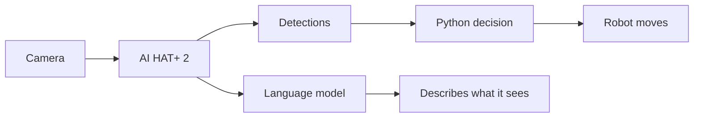

{:class="cover"}

---

Ahoy there makers! A robot that can see is good. A robot that can see and also talk about what it sees is better. The Raspberry Pi AI HAT+ 2 can do both on a Raspberry Pi 5, with no cloud connection, because it carries its own AI chip and its own memory.

Watch this first, then come back and let's build.



---

## Overview

The AI HAT+ 2 is an add-on board for the Raspberry Pi 5 with a Hailo-10H accelerator on it. It runs the vision jobs you may know from the AI HAT+, such as object detection and pose estimation. It also runs language models (LLMs) and vision-language models (VLMs), which the original AI HAT+ cannot.

We'll thread one idea through the whole course: giving a robot **eyes and a brain**. The eyes are camera detections. The brain is the code, and the language model, that decides what to do about them.

## Course Content

- **Meet the HAT**: what it is, how to fit it, and how to install the software
- **Eyes**: object detection and pose estimation with `rpicam-apps`, reading detections from Python, and turning them into robot behaviour
- **A brain**: running a language model with `hailo-ollama`, chatting in a browser, and asking the robot what it sees
- **Choosing and fixing**: performance, which Raspberry Pi AI product to pick, and a troubleshooting table

## Key Results

After completing this course, you will:

- Fit the AI HAT+ 2 and confirm it is detected
- Run camera object detection and pose estimation on the HAT
- Write the Python decision logic that turns a detection into a robot command
- Run a language model on the HAT and talk to it from the terminal, Python and a browser
- Pick the right Raspberry Pi AI product for a robot project

## What you'll need

- A Raspberry Pi 5
- A Raspberry Pi AI HAT+ 2
- A supported camera such as Camera Module 3, and the right cable for the Pi 5
- 64-bit Raspberry Pi OS (Trixie), up to date
- A Raspberry Pi Active Cooler, which the docs recommend
- A Phillips crosshead screwdriver
- Optional, for lesson 9: Docker

Please complete these two courses first, or make sure you are comfortable with their content:

- [Introduction to the Linux Command Line on Raspberry Pi OS](/learn/linux_intro/)
- [Computer Vision on Raspberry Pi with CVZone](/learn/cvzone/)

## How the course works

**One robot thread.** Each lesson adds to the same idea: a robot with eyes and a brain. The eyes arrive first, then the decisions, then the language model.

**Official commands only.** The HAT is new and its software moves quickly. Where the Raspberry Pi documentation gives a command, we use it word for word. Where it does not, we say so and point you to the right docs page rather than guessing.

**Shell and Python.** Commands for the terminal are in `bash` blocks. Python blocks are complete programs you can run on the Pi 5. Some use pretend detections so you can try the logic on any computer.

**Quizzes.** Three lessons end with a short quiz. Your score is kept in your browser.

**Mistakes are normal.** Look for the Common Issues list in each lesson, and the troubleshooting table in lesson 12.

Ready? Let's look at the board.
