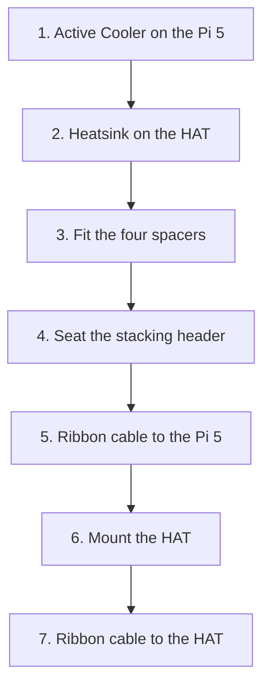

{:class="cover"}

---

Let's put it together. Take your time here: the ribbon cable is the only fiddly part, and a careful fit saves you headaches later. Follow the official instructions at [raspberrypi.com/documentation/accessories/ai-hat-plus.html](https://raspberrypi.com/documentation/accessories/ai-hat-plus.html) alongside this lesson, since they have photos.

## What is in the box

According to the documentation the HAT comes with four threaded spacers, four long screws (spacers to the Pi 5), four short screws (HAT to the spacers), a GPIO stacking header and a PCIe ribbon cable. The product page also lists an optional heatsink and a 16 mm stacking header.

You also need a Raspberry Pi 5 and a Phillips crosshead screwdriver. The documentation recommends the Raspberry Pi Active Cooler.

**Disconnect the Pi 5 from power before you start.**

## The steps

1. **Active Cooler (recommended).** Peel the paper off the thermal pads, line up the two white push pins with the heatsink holes and press until they click. Connect the fan's JST connector to the fan socket. The docs say not to remove the cooler once fitted.
2. **HAT heatsink (recommended).** Peel the paper off the pads, line up the two black push pins with the diagonally opposite holes on the HAT and press until they click. The docs recommend it especially for benchmarks or intensive work, and a language model is intensive work.
3. **Spacers.** Fit the four spacers to the yellow holes on the Pi 5 with the long screws.
4. **GPIO header.** Seat the stacking header on the Pi 5's GPIO pins.
5. **Ribbon cable, Pi end.** Slide the retaining clips on the HAT connector outward and take the cable out of it. Then lift the Pi 5's PCIe clip, push the cable in with the metal contacts facing inward, towards the USB ports, and press the clip down.
6. **Mount the HAT.** With the components facing up, line up the holes with the spacers and fix it with the four short screws.
7. **Ribbon cable, HAT end.** Slide the HAT connector's clip outward, insert the cable and push the clip back.

The stacking header, spacers and screws are designed so the HAT fits with the Active Cooler still installed.

## Add the camera first

The software docs say to attach the camera before the AI hardware, and that a supported camera such as Camera Module 3 is recommended. Connect it to one of the Pi 5's camera ports using the correct cable for the Pi 5.

## A robot-minded tip

If the Pi is going to live on a robot, check that nothing on the chassis presses on the ribbon cable, and think about airflow. The fan needs somewhere to breathe, and so does the heatsink.

## Try it Yourself

1. Before powering on, gently check that the ribbon cable is fully seated at both ends.
2. Check the fan's JST connector is firmly in its socket.
3. Challenge: sketch where on your robot chassis the Pi 5 and HAT would sit, leaving room for the camera cable.

## Common Issues

**Problem**: The cable will not go in.
**Solution**: Slide the retaining clip fully open first, and check the metal contacts face the right way.
**Why**: The connector only accepts the cable one way round.

**Problem**: The HAT is not detected later.
**Solution**: Power off and reseat both ends of the ribbon cable.
**Why**: A cable that is not fully seated is a common cause of a missing PCIe device.
