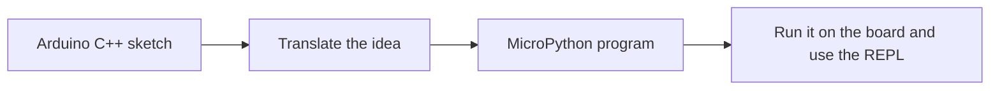

{:class="cover"}



By the end of this lesson you will be able to say what this course covers, what kit you need, and how the side-by-side lessons work.

## Overview

Ahoy there makers! You already know how to blink LEDs, read sensors and drive motors with Arduino C++. This course takes that knowledge and shows you how each piece looks in MicroPython, Python for microcontrollers. Every idea is shown twice, once as an Arduino sketch and once as MicroPython, so you are translating something you already understand rather than starting again.

You will finish with two working projects: a WiFi temperature monitor that serves its own web page, and a small obstacle-avoiding robot.



## Course Content

- Why and when to choose MicroPython over C++
- Python syntax for C++ programmers: no semicolons, indentation, dynamic types
- Control flow, functions and the end of `setup()` and `loop()`
- Digital pins, analogue input and PWM with `Pin`, `ADC` and `PWM`
- Timing: seconds, milliseconds and the non-blocking `millis()` pattern
- `print()`, the REPL and debugging
- A WiFi temperature monitor and an obstacle-avoiding robot
- A quick reference card to keep next to your keyboard

## Key Results

After completing this course, you will:

- Translate common Arduino sketches into working MicroPython programs
- Control pins, analogue inputs and PWM outputs with the `machine` module
- Avoid the classic seconds versus milliseconds mistake
- Use the REPL to test hardware without re-uploading code
- Build an IoT web server and a simple robot in MicroPython
- Decide when Arduino C++ is still the better tool

## What you'll need

- A Raspberry Pi Pico W or Pico 2 W (the examples are written for these; a Pico or Pico 2 works for everything except the WiFi lesson)
- A micro-USB or USB-C cable to suit the board
- Breadboard, jumper wires, a few LEDs with resistors (around 330 ohm) and a push button
- Thonny, a free editor, with MicroPython already on the board. If it is not, follow [How to install MicroPython](/learn/how_to_install_micropython/)
- For the robot lesson: two DC motors, a motor driver board, an HC-SR04 ultrasonic sensor, a chassis and a battery pack

An Arduino Nano ESP32 can also run MicroPython, but its pin names differ from the Pico's. Check the pinout in Arduino's MicroPython documentation before reusing the pin numbers in this course.

## How the course works

Most lessons follow the same pattern: the Arduino version first, the MicroPython version second, then a short list of what changed. Here is the idea in miniature:

**Arduino C++:**
```cpp
void setup() {
  pinMode(LED_BUILTIN, OUTPUT);
}

void loop() {
  digitalWrite(LED_BUILTIN, HIGH);
  delay(1000);
  digitalWrite(LED_BUILTIN, LOW);
  delay(1000);
}
```

**MicroPython:**
```python
from machine import Pin
import time

led = Pin("LED", Pin.OUT)  # the on-board LED on a Pico W or Pico 2 W

while True:
    led.on()
    time.sleep(1)
    led.off()
    time.sleep(1)
```

Each lesson opens with one objective, then teaches one idea, and ends with three parts:

- **Try it Yourself**: exercises of rising difficulty
- **Common Issues**: the mistakes people really make, with the fix
- **Check your understanding**: a short quiz, scored in the lesson sidebar

Code boxes with a Run button are small programs you can try in the browser. Longer programs are complete: save them to the board as `main.py` and they run on power-up.

> **Teachers**: This course suits learners aged about 14 and up who have already written Arduino sketches, and it works for a club or a lesson series. Allow 30 to 45 minutes per lesson (the two project lessons need 60 to 90). Each learner or pair needs one Pico W, a breadboard and basic parts; the robot lesson works best with one kit per group of three or four. Lessons 1 to 4 need no hardware at all, because the Run boxes execute the code in the browser. The WiFi lesson needs a network that lets devices reach each other, which some school networks block, so test it first or use a teacher's phone hotspot.

## Prerequisites

You should already be comfortable with Arduino sketches, basic electronics (LEDs, resistors, breadboards) and uploading code to a board. You do not need any Python experience. If you want a gentler Python start first, try [Learn MicroPython - The basics](/learn/micropython/), and for general Python see [Python](/learn/python/).

## Ready to start?

Next up is a straight answer to the question you are probably asking: why switch at all? Let's go!
