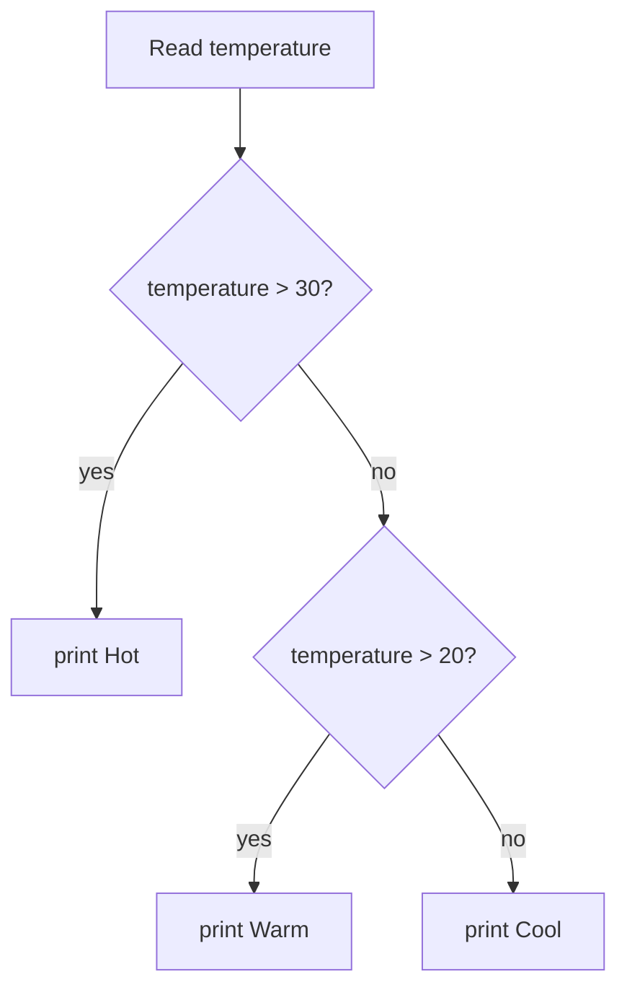

{:class="cover"}

---

By the end of this lesson you will be able to rewrite Arduino `if`, `while`, `for` and `switch` code as MicroPython using colons and indentation.

## Same ideas, new punctuation

Decisions and loops work the same way in both languages. The change is the punctuation: a colon opens the block, indentation defines it, and the parentheses are optional.



## If, elif and else

**Arduino C++:**
```cpp
if (temperature > 30) {
    Serial.println("Hot");
} else if (temperature > 20) {
    Serial.println("Warm");
} else {
    Serial.println("Cool");
}
```

**MicroPython:**


temperature = 25

if temperature > 30:
    print("Hot")
elif temperature > 20:
    print("Warm")
else:
    print("Cool")



`else if` becomes `elif`. The comparison operators (`==`, `!=`, `<`, `>`, `<=`, `>=`) are identical. The logical operators become words:

| C++ | Python | Meaning |
|-----|--------|---------|
| `&&` | `and` | Both true |
| `||` | `or` | Either true |
| `!` | `not` | Opposite |
{:class="table table-single"}


temperature = 22
humidity = 60
door_open = False

if temperature > 20 and humidity < 80:
    print("Comfortable")
if not door_open:
    print("Door is closed")



## While loops and the end of loop()

**Arduino C++:**
```cpp
int count = 0;
while (count < 5) {
    Serial.println(count);
    count++;
}
```

**MicroPython:**


count = 0
while count < 5:
    print(count)
    count += 1      # there is no ++ in Python



Python has `+=` and `-=` but no `++` or `--`. And since there is no `loop()` function, `while True:` is how you repeat forever. You will write it in almost every program:

**MicroPython:**
```python
from machine import Pin
import time

led = Pin("LED", Pin.OUT)

while True:          # the Python version of loop()
    led.toggle()
    time.sleep(0.5)
```

## For loops use range()

Python has no `for (int i = 0; i < 10; i++)`. You loop over a sequence, and `range()` makes the numbers.

**Arduino C++:**
```cpp
for (int i = 0; i < 5; i++) {
    Serial.println(i);
}
```

**MicroPython:**


for i in range(5):          # 0, 1, 2, 3, 4
    print(i)

for i in range(2, 10, 2):   # start, stop (not included), step: 2, 4, 6, 8
    print(i)



You can also loop directly over a list, with no index at all. This is lovely for several LEDs:

```python
from machine import Pin
import time

leds = [Pin(n, Pin.OUT) for n in (10, 11, 12, 13)]

for led in leds:        # a running light
    led.on()
    time.sleep(0.2)
    led.off()
```

`break` and `continue` work exactly as they do in C++.

## No switch statement

Python has no `switch`/`case` for this kind of job, so use `if`/`elif`.

**Arduino C++:**
```cpp
switch (mode) {
  case 1: Serial.println("Mode 1"); break;
  case 2: Serial.println("Mode 2"); break;
  default: Serial.println("Unknown");
}
```

**MicroPython:**


mode = 2

if mode == 1:
    print("Mode 1")
elif mode == 2:
    print("Mode 2")
else:
    print("Unknown")



Note there is no `break` needed: only the matching branch runs.

## CircuitPython note

If you meet CircuitPython code, you will see `import board` and `digitalio` instead of `machine`, and the main file is `code.py` rather than `main.py`. The control flow in this lesson is identical; only the hardware library differs.

## Complete example: a traffic light

**MicroPython:**
```python
from machine import Pin
import time

red = Pin(11, Pin.OUT)
yellow = Pin(12, Pin.OUT)
green = Pin(13, Pin.OUT)

lights = [(red, 5), (green, 5), (yellow, 2)]   # (pin, seconds)

while True:
    for light, seconds in lights:
        light.on()
        time.sleep(seconds)
        light.off()
```

Each pass through the `for` loop lights one lamp for its number of seconds. Adding a fourth stage is one more tuple in the list.

## Try it Yourself

1. Write a program with `temperature = 25` that prints `TOO HOT` above 30, `COMFORTABLE` from 20 to 30, and `TOO COLD` below 20.
2. Use a `for` loop and `range()` to blink the on-board LED five times.
3. Change the traffic light so each stage's time is read from the list, and add a "flashing yellow" stage that blinks three times.
4. Challenge: make a counter that prints the numbers 1 to 20, skipping multiples of 3 with `continue`.

## Common Issues

- **Problem**: `SyntaxError` on an `else if` line.
- **Solution**: Write `elif`.
- **Why**: Python spells "else if" as one word.

- **Problem**: `SyntaxError: invalid syntax` on `count++`.
- **Solution**: Use `count += 1`.
- **Why**: Python has no increment operator.

- **Problem**: A line meant to be inside a loop runs only once.
- **Solution**: Check it is indented to the same level as the other loop lines.
- **Why**: Indentation alone decides what belongs to a loop.

- **Problem**: A loop never stops when you expected it to.
- **Solution**: Make sure the variable in the condition changes inside the loop, or use `break`. In Thonny, press Stop to interrupt.
- **Why**: `while` repeats for as long as its condition stays true.

## Check your understanding


? How do you write `else if` in Python?
- [ ] `else if`
- [x] `elif`
- [ ] `elseif`
> Python uses the single keyword `elif`.

? Which loop is the Python equivalent of Arduino's `loop()`?
- [ ] `for i in range(1):`
- [x] `while True:`
- [ ] `loop():`
> `while True:` repeats forever, which is what `loop()` does.

? What numbers does `range(2, 10, 2)` produce?
- [ ] 2, 4, 6, 8, 10
- [x] 2, 4, 6, 8
- [ ] 0, 2, 4, 6, 8
> The stop value is not included, and the step is 2.

? What is the Python version of `count++`?
- [ ] `count++`
- [x] `count += 1`
- [ ] `inc(count)`
> Python has no `++` operator, so you add one explicitly.

