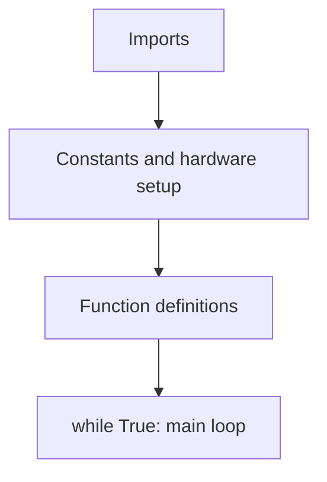

{:class="cover"}

---

By the end of this lesson you will be able to write MicroPython functions with default arguments and multiple return values, and organise a program without `setup()` and `loop()`.

## Functions with def

In C++ you declare a return type and a type for every parameter. In Python you write `def`, a name, the parameters and a colon.

**Arduino C++:**
```cpp
int addNumbers(int a, int b) {
    return a + b;
}

float celsiusToFahrenheit(float celsius) {
    return (celsius * 9.0 / 5.0) + 32.0;
}
```

**MicroPython:**


def add_numbers(a, b):
    return a + b

def celsius_to_fahrenheit(celsius):
    return (celsius * 9 / 5) + 32

print(add_numbers(2, 3))
print(celsius_to_fahrenheit(25))



No return type, no parameter types, and no `void`: a function that does not return anything just has no `return` line. Names use `snake_case`.

## setup() and loop() are optional

Arduino forces the two-function structure. MicroPython programs are ordinary Python files that run from the top to the bottom:



Code at the top level runs once, like `setup()`. A `while True:` loop is your `loop()`. Functions must be *defined* before the line that calls them, because Python reads the file in order.

**MicroPython:**
```python
from machine import Pin
import time

# Constants
LED_PIN = "LED"
BUTTON_PIN = 14

# Hardware
led = Pin(LED_PIN, Pin.OUT)
button = Pin(BUTTON_PIN, Pin.IN, Pin.PULL_UP)

# Helpers
def blink(times, delay=0.2):
    for _ in range(times):
        led.on()
        time.sleep(delay)
        led.off()
        time.sleep(delay)

def is_pressed():
    return button.value() == 0   # wired to GND, so pressed = 0

# Main loop
while True:
    if is_pressed():
        blink(3)
    time.sleep(0.05)
```

## Default and named arguments

C++ needs overloaded functions to make an argument optional. Python lets you give a default value in the definition, and you can name arguments when you call:


def describe_blink(times=1, delay=0.5):
    print(f"Blink {times} time(s), {delay}s each")

describe_blink()                 # times=1, delay=0.5
describe_blink(5)                # times=5
describe_blink(3, 0.2)           # times=3, delay=0.2
describe_blink(delay=1.0)        # name the one you want to change



## Returning more than one value

In C++ you need pointers or a struct. In Python you just return several values separated by commas (it makes a tuple) and unpack them on the other side.

**Arduino C++:**
```cpp
void getMinMax(int* minVal, int* maxVal) {
    *minVal = 0;
    *maxVal = 100;
}
int lo, hi;
getMinMax(&lo, &hi);
```

**MicroPython:**


def get_min_max():
    return 0, 100

low, high = get_min_max()
print(low, high)



## Passing hardware into functions

Pins are objects, so you can hand them to functions. This is how a small motor helper looks:

**MicroPython:**
```python
from machine import Pin
import time

def set_motor(forward_pin, reverse_pin, direction):
    """direction: 1 forward, -1 reverse, 0 stop"""
    forward_pin.value(1 if direction > 0 else 0)
    reverse_pin.value(1 if direction < 0 else 0)

motor_fwd = Pin(10, Pin.OUT)
motor_rev = Pin(11, Pin.OUT)

set_motor(motor_fwd, motor_rev, 1)
time.sleep(1)
set_motor(motor_fwd, motor_rev, -1)
time.sleep(1)
set_motor(motor_fwd, motor_rev, 0)
```

Variables you assign inside a function are local to it. To change a global variable from inside a function you must say `global name` first, though passing values in and returning results is usually cleaner.

## A complete sensor program

**MicroPython:**
```python
from machine import Pin, ADC
import time

SENSOR_PIN = 26
VOLTAGE_THRESHOLD = 2.5

sensor = ADC(Pin(SENSOR_PIN))
led = Pin("LED", Pin.OUT)

def read_voltage():
    return (sensor.read_u16() / 65535) * 3.3   # 16-bit ADC, 3.3 V reference

def check_threshold(voltage):
    if voltage > VOLTAGE_THRESHOLD:
        led.on()
        print("ALERT!")
    else:
        led.off()
    print(f"Voltage: {voltage:.2f}V")

def main():
    while True:
        check_threshold(read_voltage())
        time.sleep(1)

main()
```

You may see `if __name__ == "__main__": main()` in Python code. It only matters when a file can also be imported, so on a microcontroller you can leave it out.

## Try it Yourself

1. Write `fahrenheit_to_celsius(f)` and test it with 32 and 212.
2. Write `blink_pattern(pin, pattern, delay)` that takes a list such as `[1, 0, 1, 1, 0]` and sets the pin to each value in turn.
3. Write `analyze_sensor(raw)` that returns three values: the voltage, a status string (`"LOW"` under 1 V, `"HIGH"` over 2.5 V, otherwise `"MEDIUM"`), and `True` if the reading is in the middle band. Test it with 0, 20000 and 60000.
4. Challenge: add a `clamp(value, low, high)` function and use it to keep a motor speed between 0 and 100.

## Common Issues

- **Problem**: `NameError: name 'blink' isn't defined`.
- **Solution**: Move the `def` above the line that calls it.
- **Why**: Python runs the file top to bottom, so a function must exist before it is used.

- **Problem**: `TypeError: function takes 2 positional arguments but 1 were given`.
- **Solution**: Pass every argument that has no default, or add a default value.
- **Why**: Python does not allow missing arguments the way overloaded C++ functions do.

- **Problem**: A function returns `None` and printing it shows `None`.
- **Solution**: Add `return` followed by the value.
- **Why**: A Python function without a `return` line returns `None`.

- **Problem**: A global counter does not change inside a function, or raises `UnboundLocalError`.
- **Solution**: Declare `global counter` inside the function, or return the new value instead.
- **Why**: Assigning to a name inside a function creates a new local variable unless you say otherwise.

## Check your understanding


? What replaces Arduino's `loop()` in a MicroPython program?
- [ ] A function called `loop()` that Python calls for you
- [x] A `while True:` loop that you write yourself
- [ ] Nothing; MicroPython programs only run once
> There is no special loop function, so you write the repeat explicitly.

? How does Python return two values from one function?
- [ ] With pointers
- [x] `return a, b` and unpack with `x, y = function()`
- [ ] It cannot
> Returning comma-separated values makes a tuple you can unpack.

? Given `def blink(times=1, delay=0.5):`, what does `blink(delay=1.0)` do?
- [ ] It raises an error
- [x] Blinks once with a delay of 1.0
- [ ] Blinks 1.0 times
> The named argument changes only `delay`, and `times` keeps its default of 1.

? Why must `def blink():` appear before the code that calls `blink()`?
- [ ] Python sorts functions alphabetically
- [x] Python reads the file from top to bottom
- [ ] Functions have to be at the end of the file
> The name has to exist by the time the call runs.

