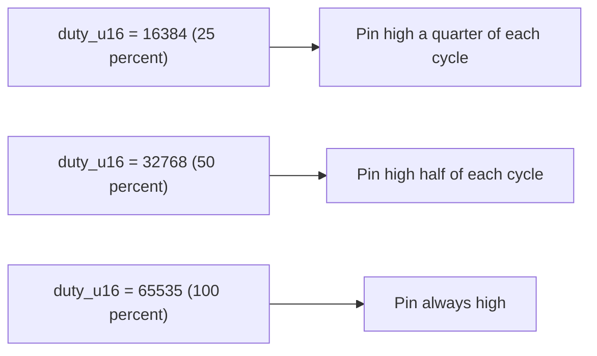

{:class="cover"}

---

By the end of this lesson you will be able to read an analogue sensor with `ADC.read_u16()` and drive an LED, motor or servo with `PWM.duty_u16()`.

## From analogRead to ADC

Arduino has `analogRead()` and `analogWrite()`. MicroPython has two classes: `ADC` for reading and `PWM` for writing. The biggest change is the numbers. On MicroPython you always get 16-bit values, 0 to 65535, whatever the chip's real resolution.

| Job | Arduino C++ | MicroPython |
|-----|-------------|-------------|
| Read analogue | `analogRead(A0)` gives 0 to 1023 | `ADC(Pin(26)).read_u16()` gives 0 to 65535 |
| PWM output | `analogWrite(9, 128)` takes 0 to 255 | `PWM(Pin(9)).duty_u16(32768)` takes 0 to 65535 |
{:class="table table-single"}

On a Pico the ADC is 12-bit in hardware, and MicroPython scales it up to 16 bits, so the last few bits are not real precision. It is still convenient, because the same code works whatever the hardware.

## Reading an analogue pin

On the Pico family only GP26, GP27 and GP28 can be read as ADC0, ADC1 and ADC2. The reference is 3.3 V, not Arduino's 5 V, so never feed a sensor more than 3.3 V.

**Arduino C++:**
```cpp
int raw = analogRead(A0);
float voltage = (raw / 1023.0) * 5.0;
```

**MicroPython:**
```python
from machine import Pin, ADC
import time

sensor = ADC(Pin(26))

while True:
    raw = sensor.read_u16()                # 0 to 65535
    voltage = (raw / 65535) * 3.3          # 3.3 V reference
    print(f"Raw: {raw}  Voltage: {voltage:.2f}V")
    time.sleep(1)
```

Wire a potentiometer with its outer legs to 3.3V (pin 36) and GND and its middle leg to GP26, and turn it to watch the numbers sweep from 0 to about 65535.

A TMP36 temperature sensor is a good example of turning a voltage into a unit. The sensor outputs 0.5 V at 0 degrees C and 10 mV per degree:

```python
from machine import Pin, ADC
import time

tmp36 = ADC(Pin(26))

while True:
    voltage = (tmp36.read_u16() / 65535) * 3.3
    temperature_c = (voltage - 0.5) * 100    # 10 mV per degree
    print(f"Temperature: {temperature_c:.1f}C")
    time.sleep(1)
```

## PWM: fake analogue output

PWM switches a pin on and off very quickly. The fraction of time it is on, the duty cycle, sets the average power: 0 is off, 32768 is half, 65535 is fully on.



**Arduino C++:**
```cpp
for (int b = 0; b <= 255; b++) {
    analogWrite(LED_PIN, b);
    delay(10);
}
```

**MicroPython:**
```python
from machine import Pin, PWM
import time

led = PWM(Pin(15))     # LED and resistor on GP15
led.freq(1000)         # 1000 times per second

while True:
    for brightness in range(0, 65536, 256):         # fade in
        led.duty_u16(brightness)
        time.sleep(0.005)
    for brightness in range(65535, -1, -256):       # fade out
        led.duty_u16(brightness)
        time.sleep(0.005)
```

To reuse an Arduino 0 to 255 value, scale it up:


def arduino_to_duty(value):
    """Convert 0-255 to 0-65535"""
    return value * 65535 // 255

def percent_to_duty(percent):
    """Convert 0-100 to 0-65535"""
    return percent * 65535 // 100

print(arduino_to_duty(128))    # about half
print(percent_to_duty(25))



## Choosing a frequency

| Use | Typical frequency |
|-----|-------------------|
| LED dimming | 500 to 2000 Hz |
| Small motor through a driver | 1000 to 20000 Hz |
| Hobby servo | 50 Hz |
{:class="table table-single"}

Set it with `pwm.freq()` before you set the duty.

## Motor speed

PWM sets the speed, and a direction pin (or two) sets which way the motor turns. Never connect a motor directly to a GPIO pin: use a motor driver, and see [Motors and motor drivers](/learn/motors_and_drivers/).

**MicroPython:**
```python
from machine import Pin, PWM
import time

speed = PWM(Pin(9))
speed.freq(1000)
direction = Pin(8, Pin.OUT)    # connected to the driver's direction input

direction.on()
speed.duty_u16(32768)          # half speed
time.sleep(2)
speed.duty_u16(65535)          # full speed
time.sleep(2)
speed.duty_u16(0)              # stop
```

## Servo angles

A hobby servo wants a pulse every 20 ms (50 Hz), and the pulse width sets the angle. At 50 Hz the period is 20,000 microseconds, so one microsecond of pulse is `65535 / 20000` of duty. Most servos use about 500 to 2500 microseconds across their range, but check yours, since cheap ones vary.

**MicroPython:**
```python
from machine import Pin, PWM
import time

MIN_US = 500      # pulse width for 0 degrees (adjust for your servo)
MAX_US = 2500     # pulse width for 180 degrees

servo = PWM(Pin(15))
servo.freq(50)

def set_angle(angle):
    pulse_us = MIN_US + (MAX_US - MIN_US) * angle / 180
    servo.duty_u16(int(pulse_us / 20000 * 65535))

while True:
    for angle in (0, 90, 180, 90):
        set_angle(angle)
        time.sleep(1)
```

Power the servo from its own 5 V supply (with grounds joined to the Pico), not the 3.3 V pin, and keep the signal wire on a GPIO pin.

> **Teachers**: Motors and servos draw more current than a USB port or a GPIO pin should supply, so use a separate battery pack and a driver board, and have learners check the wiring before power goes on. Share one motor kit per group, and set a timer so a motor is never left running unattended.

## Try it Yourself

1. Read a potentiometer and print the raw value and the voltage.
2. Make an LED on GP15 follow the potentiometer: `led.duty_u16(pot.read_u16())`.
3. Add a light-dependent resistor (LDR) in a divider on GP27, and make the LED dim as the room gets brighter (`65535 - ldr.read_u16()`).
4. Challenge: make a breathing LED that fades smoothly using `math.sin()`, and make it faster when you press a button.

## Common Issues

- **Problem**: `AttributeError: 'ADC' object has no attribute 'read'`.
- **Solution**: Use `read_u16()`.
- **Why**: MicroPython's ADC returns a 16-bit value through `read_u16()`.

- **Problem**: `AttributeError: 'PWM' object has no attribute 'duty'`.
- **Solution**: Use `duty_u16()`.
- **Why**: The Pico port provides `duty_u16()` and `duty_ns()`, not `duty()`.

- **Problem**: The LED stays fully on or off, or you get a `ValueError`, after copying an Arduino value like 128.
- **Solution**: Keep the number between 0 and 65535, and convert Arduino 0 to 255 values first.
- **Why**: The scale is 256 times larger than `analogWrite`.

- **Problem**: The servo twitches or the Pico resets.
- **Solution**: Power the servo from a separate 5 V supply, with a shared ground.
- **Why**: A servo's current spikes pull the Pico's supply down.

## Check your understanding


? What range does `ADC.read_u16()` return?
- [ ] 0 to 1023
- [ ] 0 to 255
- [x] 0 to 65535
> MicroPython always scales the reading to 16 bits.

? Which pins can read analogue values on a Pico?
- [ ] Any GPIO pin
- [x] GP26, GP27 and GP28
- [ ] Only GP0
> Only those pins are connected to the ADC.

? What duty value gives 50 percent brightness?
- [ ] 128
- [x] 32768
- [ ] 50
> Half of 65535 is about 32768.

? What PWM frequency do hobby servos expect?
- [ ] 1000 Hz
- [x] 50 Hz
- [ ] 20 kHz
> Servos want a pulse every 20 ms, which is 50 Hz.

