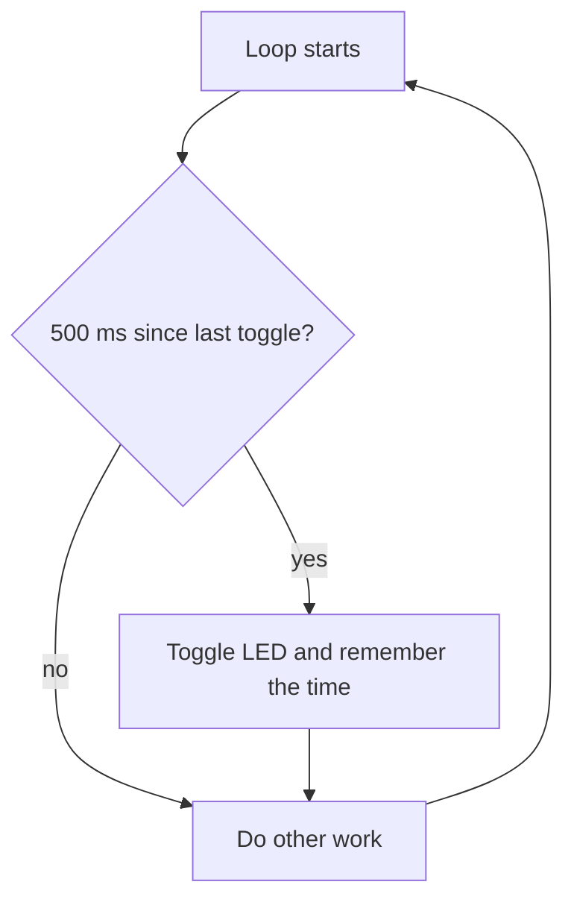

{:class="cover"}

---

By the end of this lesson you will be able to convert Arduino delays correctly, and write non-blocking timing code with `time.ticks_ms()` and `time.ticks_diff()`.

## The single biggest gotcha

**Arduino's `delay()` takes milliseconds. MicroPython's `time.sleep()` takes seconds.**

This causes more beginner bugs than anything else in the course. Write `time.sleep(1000)` and your board waits for over a quarter of an hour.

**Arduino C++:**
```cpp
digitalWrite(LED_PIN, HIGH);
delay(1000);        // 1000 milliseconds
digitalWrite(LED_PIN, LOW);
delay(500);
```

**MicroPython:**
```python
import time
from machine import Pin

led = Pin("LED", Pin.OUT)

while True:
    led.on()
    time.sleep(1)       # 1 second
    led.off()
    time.sleep(0.5)     # half a second
```

If you prefer to think in milliseconds, `time.sleep_ms(500)` and `time.sleep_us(50)` exist too.

| Arduino | MicroPython |
|---------|-------------|
| `delay(1000)` | `time.sleep(1)` or `time.sleep_ms(1000)` |
| `delay(100)` | `time.sleep(0.1)` or `time.sleep_ms(100)` |
| `delayMicroseconds(10)` | `time.sleep_us(10)` |
| `millis()` | `time.ticks_ms()` |
| `micros()` | `time.ticks_us()` |
{:class="table table-single"}

## millis() becomes ticks_ms()

**Arduino C++:**
```cpp
unsigned long start = millis();
// ... do something ...
unsigned long elapsed = millis() - start;
```

**MicroPython:**


import time

start = time.ticks_ms()
time.sleep(0.25)                                   # do something
elapsed = time.ticks_diff(time.ticks_ms(), start)  # never subtract directly
print(f"Took {elapsed} ms")



Always compare ticks with `time.ticks_diff(new, old)`. In Arduino C++, plain unsigned subtraction handles the counter rolling over. In MicroPython the counter wraps at a value that depends on the port (it is a power of two, but not 2^32), so ordinary subtraction can give wrong answers around the wrap. `ticks_diff()` handles it for you.

## Blink without delay

`delay()` freezes everything. The classic Arduino fix is to check `millis()` and act when enough time has passed. MicroPython uses the same idea.



**Arduino C++:**
```cpp
if (millis() - previousMillis >= interval) {
    previousMillis = millis();
    digitalWrite(LED_PIN, !digitalRead(LED_PIN));
}
```

**MicroPython:**
```python
from machine import Pin
import time

led = Pin("LED", Pin.OUT)
button = Pin(14, Pin.IN, Pin.PULL_UP)

led_previous = time.ticks_ms()
print_previous = time.ticks_ms()

while True:
    now = time.ticks_ms()

    if time.ticks_diff(now, led_previous) >= 500:     # blink every 500 ms
        led_previous = now
        led.toggle()

    if time.ticks_diff(now, print_previous) >= 2000:  # report every 2 s
        print_previous = now
        print("Button pressed" if button.value() == 0 else "Button released")

    time.sleep_ms(5)    # a tiny rest so the loop is not flat out
```

The LED keeps blinking whatever the button does, and the button message arrives on its own schedule.

## A timeout pattern

A common job is "wait for the button, but give up after a while":

**MicroPython:**
```python
from machine import Pin
import time

button = Pin(14, Pin.IN, Pin.PULL_UP)

def wait_for_button(timeout_ms):
    start = time.ticks_ms()
    while time.ticks_diff(time.ticks_ms(), start) < timeout_ms:
        if button.value() == 0:
            return True
        time.sleep_ms(10)
    return False

if wait_for_button(5000):
    print("Button pressed!")
else:
    print("Timed out")
```

## Measuring how long code takes

Microsecond counters are good for measuring a short piece of code:


import time

start = time.ticks_us()
total = 0
for i in range(1000):
    total += i
duration = time.ticks_diff(time.ticks_us(), start)
print(f"1000 additions took {duration} us")



Run this on a real board and try changing 1000 to 10000. Measuring is how you find out whether MicroPython is fast enough for your task.

## What is the time of day?

`time.localtime()` returns a tuple: `(year, month, day, hour, minute, second, weekday, yearday)`. So the hour is `t[3]`, not `t.tm_hour`. A Pico has no battery-backed clock, so the answer is only the real time if Thonny set it when you connected or your program set it from the network (for example with `ntptime.settime()` on a WiFi board). Otherwise the clock restarts from a default date on every power-up. For timing and intervals, use `ticks_ms()`, not the clock.


import time

t = time.localtime()
print(f"Time: {t[3]:02d}:{t[4]:02d}:{t[5]:02d}")   # hour, minute, second



## Try it Yourself

1. Convert `delay(250)` and `delay(2000)` into `time.sleep()` calls, using seconds.
2. Write a program with two LEDs, one blinking every 500 ms and one every 1300 ms, with no `sleep()` longer than 10 ms.
3. Make a reaction-time game: wait a random 1 to 5 seconds (`random.uniform(1, 5)`), turn an LED on, and print how many milliseconds the button press took.
4. Challenge: a traffic light that cycles red for 5 s, green for 5 s and yellow for 2 s using `ticks_ms()` and a state variable, so a button can interrupt it at any moment.

## Common Issues

- **Problem**: The program seems frozen after a `time.sleep(1000)`.
- **Solution**: Use `time.sleep(1)` for one second, or `time.sleep_ms(1000)`.
- **Why**: `sleep()` counts in seconds.

- **Problem**: Timing code works for a while, then misbehaves.
- **Solution**: Use `time.ticks_diff()` instead of subtracting ticks.
- **Why**: The tick counter wraps, and plain subtraction breaks at the wrap.

- **Problem**: `AttributeError: 'tuple' object has no attribute 'tm_hour'`.
- **Solution**: Index the tuple: `time.localtime()[3]` is the hour.
- **Why**: MicroPython's `localtime()` returns a plain tuple, not a struct.

- **Problem**: The clock shows the wrong date.
- **Solution**: Set it from Thonny or the network.
- **Why**: A Pico has no battery-backed real-time clock.

## Check your understanding


? What does `time.sleep(2)` do in MicroPython?
- [ ] Waits 2 milliseconds
- [x] Waits 2 seconds
- [ ] Waits 2 microseconds
> `time.sleep()` takes seconds, while Arduino's `delay()` takes milliseconds.

? Which function replaces Arduino's `millis()`?
- [ ] `time.time()`
- [x] `time.ticks_ms()`
- [ ] `time.sleep_ms()`
> `ticks_ms()` is the free-running millisecond counter.

? Why should you use `time.ticks_diff()`?
- [ ] It is faster
- [x] The tick counter wraps around, and it handles that correctly
- [ ] It converts to seconds
> Plain subtraction can go wrong when the counter rolls over.

? Why use the ticks pattern instead of `sleep()` for blinking?
- [ ] It makes the LED brighter
- [x] The program can do other things while it waits
- [ ] `sleep()` is not allowed on a Pico
> `sleep()` blocks everything, whereas checking elapsed time lets the loop keep working.

