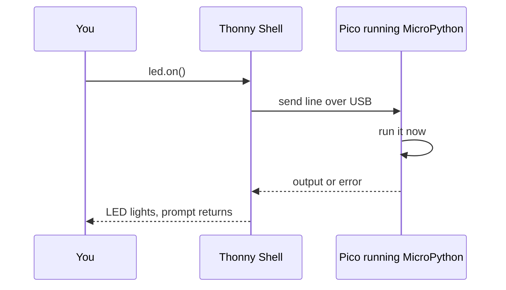

{:class="cover"}

---

By the end of this lesson you will be able to use `print()` and f-strings for debugging, log CSV data, and use the REPL to test hardware live.

## print() just works

Arduino needs `Serial.begin(9600)` and then `Serial.print()` and `Serial.println()`. MicroPython sends `print()` output down the USB connection with no setup, and no baud rate to match. `print()` adds a newline by default.

**Arduino C++:**
```cpp
void setup() { Serial.begin(9600); }
void loop() {
    Serial.print("Voltage: ");
    Serial.print(voltage, 2);
    Serial.println("V");
    delay(1000);
}
```

**MicroPython:**


import time

voltage = 3.287
for _ in range(3):
    print(f"Voltage: {voltage:.2f}V")   # two decimals, newline added
    time.sleep(1)



To stay on one line, use `end=""`:


import time

print("Loading", end="")
for i in range(5):
    print(".", end="")
    time.sleep(0.5)
print(" Done!")



There is no `flush=True` option on a Pico, and you do not need one.

## Formatting cheat sheet


value = 42
voltage = 3.287
print(f"{voltage:.3f}")     # 3.287  (3 decimals)
print(f"{value:05d}")       # 00042  (padded to 5 digits)
print(f"{value:08b}")       # 00101010  (binary)
print(f"0x{value:02X}")     # 0x2A  (hex)
print(f"{'left':<8}|{'right':>8}")   # left-aligned and right-aligned columns



## The REPL: type to your hardware

The REPL is a Python prompt running on the board. You reach it through the Shell in Thonny, or with a serial terminal such as `screen` or PuTTY at 115200 baud (the baud rate is only used when you open a raw terminal like these).



The prompt looks like `>>>`. Type these one line at a time:

```python
>>> 2 + 2
4
>>> from machine import Pin
>>> led = Pin("LED", Pin.OUT)
>>> led.on()
>>> led.off()
>>> for i in range(3):
...     print(i)
...
0
1
2
```

You cannot do this with Arduino C++, where changing anything means recompiling and uploading. The REPL is perfect for finding the right pin, checking what a sensor really returns, and trying a snippet before you put it in a file.

Useful keys:

- **Ctrl+C** stops the running program and returns to the prompt
- **Ctrl+D** does a soft reset, which runs `boot.py` and `main.py` again
- `help(Pin)` lists what an object can do, and `dir(Pin)` lists its names

## Debug messages that help

Labels turn a stream of numbers into something readable:

**MicroPython:**
```python
from machine import Pin, ADC
import time

DEBUG = True     # set to False to silence the debug lines

sensor = ADC(Pin(26))
led = Pin("LED", Pin.OUT)

def debug(message):
    if DEBUG:
        print(f"[DEBUG] {message}")

while True:
    raw = sensor.read_u16()
    debug(f"raw = {raw}")
    led.value(raw > 32768)
    print(f"LED: {'ON' if led.value() else 'OFF'}")
    time.sleep(1)
```

## Logging data as CSV

Printing `timestamp,value` lines gives you data you can paste into a spreadsheet:

**MicroPython:**
```python
from machine import Pin, ADC
import time

sensor = ADC(Pin(26))
start = time.ticks_ms()

print("ms,raw,volts")                       # header row
while True:
    ms = time.ticks_diff(time.ticks_ms(), start)
    raw = sensor.read_u16()
    print(f"{ms},{raw},{raw / 65535 * 3.3:.3f}")
    time.sleep(1)
```

## Reading from the keyboard

`Serial.read()` has no direct partner, because the serial port is also the REPL. The simplest way to get a line of text from the Shell is `input()`:

**MicroPython:**
```python
from machine import Pin

led = Pin("LED", Pin.OUT)

while True:
    command = input("Type on or off: ")     # waits for Enter
    if command == "on":
        led.on()
    elif command == "off":
        led.off()
    else:
        print("I only know on and off")
```

`input()` waits, so nothing else runs while it does. In real projects people more often use buttons, sensors or WiFi for input.

## Try it Yourself

1. In the REPL, create an LED on `"LED"` and turn it on and off by hand.
2. Print the voltage from an ADC pin with a label and two decimal places once a second.
3. Log CSV with a header row, then paste it into a spreadsheet and draw a chart.
4. Challenge: print a neat two-line table showing the raw values of two ADC pins (GP26 and GP27) with aligned columns.

## Common Issues

- **Problem**: No output appears in the Shell.
- **Solution**: Press Stop, check the interpreter shows MicroPython (Raspberry Pi Pico), and make sure your code calls `print()`.
- **Why**: Thonny must be connected to the board's serial port to display output.

- **Problem**: Thonny will not let you run a new program because the old one is still going.
- **Solution**: Press Stop in Thonny, or Ctrl+C in a terminal.
- **Why**: A `while True:` loop keeps the board busy until you interrupt it.

- **Problem**: `TypeError: can't convert 'int' object to str implicitly`.
- **Solution**: Use an f-string, or `str(value)`.
- **Why**: Python will not join text and numbers with `+`.

## Check your understanding


? What do you need to call before `print()` works in MicroPython?
- [ ] `Serial.begin(115200)`
- [x] Nothing: it works straight away
- [ ] `print.begin()`
> There is no setup step for `print()`.

? What does Ctrl+C do at the REPL?
- [ ] Copies text
- [x] Stops the running program
- [ ] Erases the board
> It interrupts the program and returns you to the `>>>` prompt.

? Which prints a float with 2 decimal places?
- [ ] `print(f"{x:2}")`
- [x] `print(f"{x:.2f}")`
- [ ] `print(x, 2)`
> `:.2f` means a float with two digits after the point.

? What is the REPL good for?
- [ ] Only for installing firmware
- [x] Trying code and testing hardware live
- [ ] Replacing `main.py`
> You can type commands and see results immediately.

