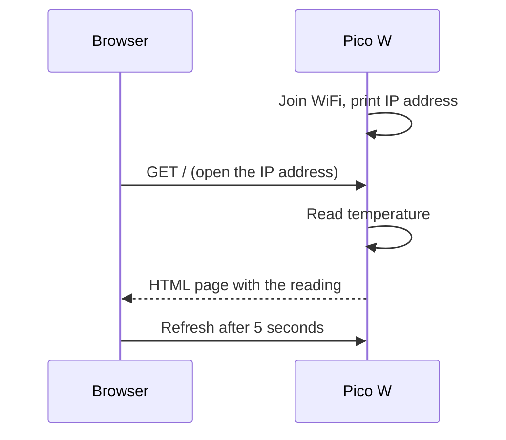

{:class="cover"}

---

By the end of this lesson you will be able to connect a Pico W to WiFi, read a temperature, and serve it as a web page you can open on your phone.

## What we are building

Let's put everything together: a WiFi temperature monitor. The board joins your network, reads its temperature, and answers web requests with a small page that refreshes itself every five seconds. The on-board LED shows what is going on: blinking while connecting, solid when ready.

You need a Raspberry Pi Pico W or Pico 2 W. No extra parts are needed, because we read the temperature sensor built into the chip. (It measures the chip's own temperature, which is a little warmer than the room, so treat it as a demo; a real sensor comes later in the lesson.)



## Step 1: connecting to WiFi

**Arduino C++ (ESP32):**
```cpp
WiFi.begin(ssid, password);
while (WiFi.status() != WL_CONNECTED) {
    delay(500);
    Serial.print(".");
}
Serial.println(WiFi.localIP());
```

**MicroPython:**
```python
import network
import time

SSID = "YourWiFiName"
PASSWORD = "YourWiFiPassword"

wlan = network.WLAN(network.STA_IF)   # station mode: join an existing network
wlan.active(True)
wlan.connect(SSID, PASSWORD)

for _ in range(20):                   # wait up to 10 seconds
    if wlan.isconnected():
        break
    print(".", end="")
    time.sleep(0.5)

if wlan.isconnected():
    print("\nIP address:", wlan.ifconfig()[0])
else:
    print("\nCould not connect")
```

There is no library to include: `network` is built into the firmware. `ifconfig()` returns `(ip, netmask, gateway, dns)`, so `[0]` is the board's address. Never share a file that contains your real WiFi password.

## Step 2: reading the temperature

The RP2040 and RP2350 both have a temperature sensor on ADC channel 4. Its voltage drops as the chip warms up, and the Raspberry Pi datasheet gives the formula:

```python
from machine import ADC

sensor = ADC(4)    # the internal temperature sensor

def read_temperature():
    voltage = sensor.read_u16() / 65535 * 3.3
    return 27 - (voltage - 0.706) / 0.001721
```

For a room reading, use a DHT22 on GP15. The `dht` module is part of the firmware:

```python
import dht
from machine import Pin

dht_sensor = dht.DHT22(Pin(15))   # data pin to GP15, 3.3 V and GND

def read_temperature():
    dht_sensor.measure()
    return dht_sensor.temperature()
```
{: .no-snakie }

A BME280 over I2C is another good choice, but its driver is not in the firmware: it needs a separate `bme280.py` file copied to the board. [Talking to the World - Working with I2C and SPI](/learn/i2c_spi/) shows how.

## Step 3: the web server

A web server is a socket that listens on port 80, accepts a connection, reads the request and sends back text. You keep the page as an f-string, so values drop straight in. We use inline styles so there is no CSS curly-brace clash with f-strings.

## The complete program

Save this to the board as `main.py`, after editing the WiFi details.

**MicroPython:**
```python
from machine import Pin, ADC
import network
import socket
import time

SSID = "YourWiFiName"
PASSWORD = "YourWiFiPassword"

led = Pin("LED", Pin.OUT)
sensor = ADC(4)
start = time.ticks_ms()

def connect_wifi():
    wlan = network.WLAN(network.STA_IF)
    wlan.active(True)
    wlan.connect(SSID, PASSWORD)
    for _ in range(20):                 # up to 10 seconds
        if wlan.isconnected():
            led.on()                    # solid LED: connected
            return wlan.ifconfig()[0]
        led.toggle()                    # blinking LED: trying
        time.sleep(0.5)
    return None

def read_temperature():
    voltage = sensor.read_u16() / 65535 * 3.3
    return 27 - (voltage - 0.706) / 0.001721

def make_page(temperature, uptime):
    return f"""<!DOCTYPE html>
<html>
<head>
<title>Temperature Monitor</title>
<meta http-equiv="refresh" content="5">
<meta name="viewport" content="width=device-width, initial-scale=1">
</head>
<body style="font-family: sans-serif; text-align: center; padding: 40px;">
<h1>Pico Temperature Monitor</h1>
<p style="font-size: 64px; margin: 10px;">{temperature:.1f} C</p>
<p>Uptime: {uptime:.0f} seconds</p>
<p>This page refreshes every 5 seconds.</p>
</body>
</html>"""

def serve(ip):
    server = socket.socket()
    server.setsockopt(socket.SOL_SOCKET, socket.SO_REUSEADDR, 1)
    server.bind(("0.0.0.0", 80))
    server.listen(1)
    print(f"Open http://{ip} in a browser")
    try:
        while True:
            client, address = server.accept()
            print("Request from", address)
            try:
                client.recv(1024)               # read (and ignore) the request
                uptime = time.ticks_diff(time.ticks_ms(), start) / 1000
                body = make_page(read_temperature(), uptime)
                header = "HTTP/1.1 200 OK\r\nContent-Type: text/html\r\nConnection: close\r\n\r\n"
                client.send((header + body).encode())
            except OSError as error:
                print("Request failed:", error)
            finally:
                client.close()
    finally:
        server.close()

ip_address = connect_wifi()
if ip_address:
    serve(ip_address)
else:
    print("No WiFi, so no server")
```

Run it, and the Shell prints an address such as `Open http://192.168.1.50 in a browser` (yours will differ). Open that address on any phone or computer on the same WiFi.

## How it differs from Arduino

On an Arduino ESP32 sketch you would include `WiFi.h` and a web server library, build `String` objects, and handle clients in `loop()`. In MicroPython the networking is built in, strings are easy, and you can stop the server with Ctrl+C and edit it live.

## Improving it

- **Add a JSON endpoint**: if the request contains `/api`, send `json.dumps({"temperature": t})` (with `Content-Type: application/json`) instead of HTML. `import json` first.
- **Log readings**: keep the last 10 readings in a list, and when it grows past 10 call `readings.pop(0)`.
- **Control an LED**: look for `/led/on` in the request text, and switch a GPIO pin to match.

> **Teachers**: This lesson needs a WiFi network that lets devices talk to each other. Many school networks block this, or require a login the Pico cannot give, so test it before the lesson or use a phone hotspot or a spare router. The WiFi name and password are typed into the code, so remind learners not to share their files, and use a guest network where possible. A group can share one Pico: one person edits, the rest open the page on their own devices.

## Try it Yourself

1. Run the program and open the page on a phone. Hold your thumb on the chip and watch the number rise.
2. Show the temperature in Fahrenheit as well as Celsius.
3. Add an LED on GP14 and make the page show a message ("Warm" or "OK") using an `if` based on the temperature.
4. Challenge: add `/led/on` and `/led/off` links that switch the LED, by checking whether the request text contains them.

## Common Issues

- **Problem**: The LED blinks forever and no IP address appears.
- **Solution**: Check the network name and password (they are case sensitive), and that the network is 2.4 GHz.
- **Why**: The Pico W's radio only supports 2.4 GHz WiFi.

- **Problem**: The browser says the page cannot be reached.
- **Solution**: Use the IP address the Shell printed, on a device on the same network.
- **Why**: The board has a private address that only works on your local network.

- **Problem**: `OSError: [Errno 98] EADDRINUSE` when you run it a second time.
- **Solution**: Press Stop, then run again, or reset the board.
- **Why**: The earlier run may still be holding port 80 until it is stopped.

## Check your understanding


? What does `network.WLAN(network.STA_IF)` create?
- [ ] A web server
- [x] A WiFi interface in station mode, which joins an existing network
- [ ] A new WiFi network
> Station mode connects the board to your router, as a phone does.

? What does `wlan.ifconfig()[0]` give you?
- [ ] The WiFi password
- [x] The board's IP address
- [ ] The signal strength
> `ifconfig()` returns a tuple, and the first item is the IP address.

? Why do the examples use `f"..."` strings for the web page?
- [ ] Because HTML requires it
- [x] So values like the temperature drop straight into the text
- [ ] To make the page load faster
> F-strings insert variables into text with `{name}`.

? Why does the program use `time.ticks_diff()` for uptime?
- [ ] To read the WiFi clock
- [x] To measure elapsed milliseconds safely
- [ ] To set the date
> `ticks_diff()` is the safe way to measure time between two tick readings.

