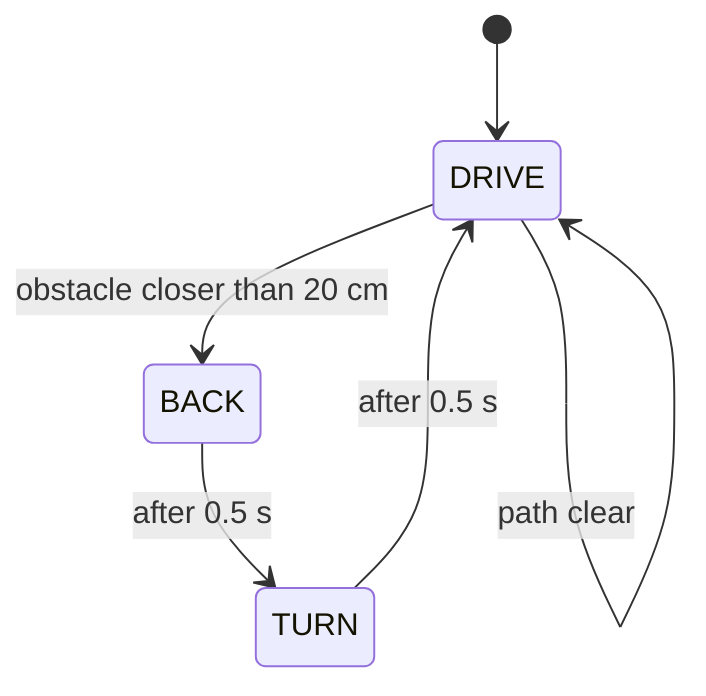

{:class="cover"}

---

By the end of this lesson you will be able to build a robot in MicroPython from small classes for motors and a distance sensor, and make it avoid obstacles with a simple state machine.

## What we are building

A two-wheeled robot that drives forward until the ultrasonic sensor sees something close, then backs up, turns and carries on. We will write it as three small classes, which is where MicroPython feels most different from a long Arduino sketch.

**You need:**

- A Raspberry Pi Pico (any variant)
- Two DC motors on a chassis, with a battery pack
- A dual motor driver board, such as an L298N or similar (see [Motors and motor drivers](/learn/motors_and_drivers/))
- An HC-SR04 ultrasonic sensor
- Two resistors for a voltage divider on the echo pin (for example 1 kilohm and 2 kilohm)
- Jumper wires

## Wiring

| Pico pin | Goes to | Job |
|----------|---------|-----|
| GP10 | Driver IN1 | Left motor forward |
| GP11 | Driver IN2 | Left motor reverse |
| GP12 | Driver ENA | Left motor speed (PWM) |
| GP13 | Driver IN3 | Right motor forward |
| GP14 | Driver IN4 | Right motor reverse |
| GP15 | Driver ENB | Right motor speed (PWM) |
| GP16 | HC-SR04 Trig | Start a measurement |
| GP17 | HC-SR04 Echo, through a divider | Echo pulse |
| GND | Driver GND, sensor GND, battery negative | Common ground |
{:class="table table-single"}

The Pico's pins are 3.3 V. The HC-SR04 echo pin outputs 5 V, so put a divider between echo and GP17 (the top resistor from echo to GP17, the bottom resistor from GP17 to GND), or use a 3.3 V version of the sensor. Power the sensor and driver as their datasheets say, and join all the grounds.

If a wheel spins the wrong way, swap that motor's two wires or swap its pins in the code.

## Step 1: a Motor class

On Arduino you might write one function per direction. In MicroPython a class bundles the pins and the behaviour together.

**Arduino C++:**
```cpp
class Motor {
  int fwd, rev, pwm;
public:
  Motor(int f, int r, int p) : fwd(f), rev(r), pwm(p) {
    pinMode(fwd, OUTPUT); pinMode(rev, OUTPUT); pinMode(pwm, OUTPUT);
  }
  void setSpeed(int speed) { /* set pins and analogWrite */ }
};
```

**MicroPython:**
```python
from machine import Pin, PWM

class Motor:
    def __init__(self, forward_pin, reverse_pin, pwm_pin):
        self.forward = Pin(forward_pin, Pin.OUT)
        self.reverse = Pin(reverse_pin, Pin.OUT)
        self.pwm = PWM(Pin(pwm_pin))
        self.pwm.freq(1000)

    def set_speed(self, speed):
        """speed from -100 (full reverse) to 100 (full forward)"""
        speed = max(-100, min(100, speed))
        self.forward.value(1 if speed > 0 else 0)
        self.reverse.value(1 if speed < 0 else 0)
        self.pwm.duty_u16(int(abs(speed) / 100 * 65535))

    def stop(self):
        self.set_speed(0)
```

`self` is the object the method belongs to, like `this` in C++. `__init__` is the constructor.

## Step 2: a Robot class

Two motors become one robot with human-sounding commands. Spinning on the spot means one wheel forwards and the other backwards.

```python
class Robot:
    def __init__(self, left, right):
        self.left = left
        self.right = right

    def forward(self, speed=50):
        self.left.set_speed(speed)
        self.right.set_speed(speed)

    def backward(self, speed=50):
        self.forward(-speed)

    def turn_left(self, speed=50):
        self.left.set_speed(-speed)
        self.right.set_speed(speed)

    def turn_right(self, speed=50):
        self.left.set_speed(speed)
        self.right.set_speed(-speed)

    def stop(self):
        self.left.stop()
        self.right.stop()
```
{: .no-snakie }

## Step 3: measuring distance

Arduino uses `pulseIn()`. MicroPython has `machine.time_pulse_us()`, which times a pulse in microseconds and returns a negative number if it times out.

**Arduino C++:**
```cpp
long duration = pulseIn(ECHO_PIN, HIGH);
float distance = duration * 0.034 / 2;
```

**MicroPython:**
```python
from machine import Pin, time_pulse_us
import time

class Ultrasonic:
    def __init__(self, trigger_pin, echo_pin):
        self.trigger = Pin(trigger_pin, Pin.OUT)
        self.echo = Pin(echo_pin, Pin.IN)

    def distance_cm(self):
        """Distance in cm, or None if there was no echo"""
        self.trigger.off()
        time.sleep_us(2)
        self.trigger.on()
        time.sleep_us(10)
        self.trigger.off()
        duration = time_pulse_us(self.echo, 1, 30000)   # wait up to 30 ms
        if duration < 0:
            return None
        return duration * 0.0343 / 2    # sound: 343 m/s, there and back
```
{: .no-snakie }

## The behaviour as a state machine

The robot is always in exactly one state, and sensor readings decide when to change.



## The complete program

Put the wheels in the air for the first test, so it cannot run off the desk. Save it as `main.py` once it works.

**MicroPython:**
```python
from machine import Pin, PWM, time_pulse_us
import time
import random

class Motor:
    def __init__(self, forward_pin, reverse_pin, pwm_pin):
        self.forward = Pin(forward_pin, Pin.OUT)
        self.reverse = Pin(reverse_pin, Pin.OUT)
        self.pwm = PWM(Pin(pwm_pin))
        self.pwm.freq(1000)

    def set_speed(self, speed):
        speed = max(-100, min(100, speed))
        self.forward.value(1 if speed > 0 else 0)
        self.reverse.value(1 if speed < 0 else 0)
        self.pwm.duty_u16(int(abs(speed) / 100 * 65535))

class Robot:
    def __init__(self, left, right):
        self.left = left
        self.right = right

    def drive(self, left_speed, right_speed):
        self.left.set_speed(left_speed)
        self.right.set_speed(right_speed)

    def stop(self):
        self.drive(0, 0)

class Ultrasonic:
    def __init__(self, trigger_pin, echo_pin):
        self.trigger = Pin(trigger_pin, Pin.OUT)
        self.echo = Pin(echo_pin, Pin.IN)

    def distance_cm(self):
        self.trigger.off()
        time.sleep_us(2)
        self.trigger.on()
        time.sleep_us(10)
        self.trigger.off()
        duration = time_pulse_us(self.echo, 1, 30000)
        if duration < 0:
            return None
        return duration * 0.0343 / 2

# Hardware (see the wiring table)
robot = Robot(Motor(10, 11, 12), Motor(13, 14, 15))
sensor = Ultrasonic(16, 17)
led = Pin("LED", Pin.OUT)

SAFE_DISTANCE = 20      # cm
DRIVE, BACK, TURN = 0, 1, 2

state = DRIVE
state_start = time.ticks_ms()
turn_direction = 1

def change_state(new_state):
    global state, state_start
    state = new_state
    state_start = time.ticks_ms()

print("Starting in 3 seconds...")
time.sleep(3)

try:
    while True:
        distance = sensor.distance_cm()
        elapsed = time.ticks_diff(time.ticks_ms(), state_start)

        if state == DRIVE:
            if distance is None or distance < SAFE_DISTANCE:
                print(f"Obstacle: {distance}")
                robot.drive(-40, -40)
                led.on()
                turn_direction = random.choice((-1, 1))
                change_state(BACK)
            else:
                robot.drive(60, 60)
        elif state == BACK:
            if elapsed > 500:
                robot.drive(50 * turn_direction, -50 * turn_direction)
                change_state(TURN)
        elif state == TURN:
            if elapsed > 500:
                led.off()
                change_state(DRIVE)

        time.sleep_ms(50)
except KeyboardInterrupt:
    robot.stop()
    print("Stopped")
```

Treating "no echo" as an obstacle is a safe choice: a sensor that cannot hear anything is better treated as blocked than as clear. The motors only stop when the program is stopped with Ctrl+C or Stop in Thonny, so keep a hand ready.

## Compared with Arduino

The structure is the same as an Arduino version, but classes are shorter, there are no header files, and you can test each piece in the REPL: `sensor.distance_cm()` prints a distance right away, and `robot.drive(50, 50)` runs the wheels for a moment.

> **Teachers**: Motors and a battery pack are the main risk: wires can short, batteries can get warm, and a robot can run off a desk. Test with the wheels lifted, use a battery holder with a switch, and keep the robot off tables. Allow two lessons for the build and the code, plan one kit per group of three or four, and have the wiring table printed. If you do not have hardware, learners can still write and read the classes, and test the logic in the Run boxes earlier in the course.

## Try it Yourself

1. Test the wheels one at a time in the REPL: `from machine import Pin, PWM`, then paste the `Motor` class and run `m = Motor(10, 11, 12)`, `m.set_speed(50)`, `m.set_speed(0)`.
2. Print the distance every half second and check it against a ruler.
3. Change `SAFE_DISTANCE` and the turn time, and watch how the behaviour changes.
4. Challenge: add a SEARCH state that spins slowly until the path ahead is clear, and print the state name each time it changes.

## Common Issues

- **Problem**: A wheel turns the wrong way.
- **Solution**: Swap the two wires for that motor, or swap its forward and reverse pin numbers.
- **Why**: Motor polarity depends on how you wired it.

- **Problem**: The motors do not move, but the code runs.
- **Solution**: Check the battery, the common ground between the battery, driver and Pico, and that the driver's enable pins are connected to the PWM pins.
- **Why**: The motors are powered by the battery through the driver, and a missing ground or enable means no signal gets through.

- **Problem**: `distance_cm()` always returns `None`.
- **Solution**: Check the trigger and echo pins, and the 5 V supply for the sensor.
- **Why**: With no echo pulse, `time_pulse_us()` times out and returns a negative number.

- **Problem**: The Pico restarts when the motors start.
- **Solution**: Power the motors from their own battery pack, not from the Pico's USB.
- **Why**: Motors pull a surge of current that drops the supply voltage.

## Check your understanding


? Why do the motors connect to a driver board rather than directly to the Pico?
- [ ] The Pico has no pins
- [x] A GPIO pin cannot supply the current a motor needs
- [ ] MicroPython does not support motors
> The driver switches the motor's own power under the Pico's control.

? What does `time_pulse_us(pin, 1, 30000)` return if no echo arrives?
- [ ] 0
- [x] A negative number
- [ ] 30000
> A negative value signals a timeout, and the code treats it as no reading.

? Why does the HC-SR04 echo pin need a voltage divider on a Pico?
- [ ] To make it faster
- [x] The echo pin outputs 5 V and Pico pins are 3.3 V
- [ ] To power the sensor
> A divider lowers the echo voltage to a safe level.

? In a state machine, how many states is the robot in at once?
- [ ] All of them
- [x] Exactly one
- [ ] None
> The program always knows which single state it is in, and each reading decides the move to the next.

