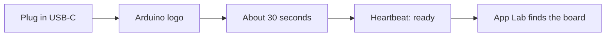

{:class="cover"}

---

Let's get your board running. This lesson has no code to write. By the end the board is named, online, and blinking an LED from a Python program, which proves everything is working.

---

## What to plug in

You need two things: the Uno Q and a USB-C **data** cable to your computer. Some USB-C cables only carry power, and the board will light up but App Lab will never find it. If in doubt, use the cable that came with a phone you've synced to a computer.

If you use a USB hub, make it a powered USB-C hub. Apple USB-C multiport adapters are not supported.

## Watch the boot animations

Plug the cable in and watch the LED matrix.

1. First it shows an **Arduino logo** animation. Linux is starting up.
2. After about 30 seconds it switches to a **heartbeat** animation. That means the board is ready.

Don't rush this. The first boot takes a moment, and App Lab can't talk to the board until the heartbeat appears.

## Install Arduino App Lab

App Lab is Arduino's desktop app for the Uno Q. It runs on Windows, macOS and Linux. Download it from [arduino.cc/en/software](https://www.arduino.cc/en/software) and install it like any other app.

You'll use it for the whole course. It is where you write code, press Run and read the output.

**Good to know:** App Lab can also run on the board itself, in "single-board computer mode", if you plug in a monitor, keyboard, mouse and a powered USB-C hub. In this course we use App Lab on your own computer.

## Connect and run the setup wizard

1. Open App Lab with the board plugged in and showing the heartbeat.
2. App Lab finds the board over USB. Select it.
3. The first-time setup asks you for three things:
   - A **board password**. Choose one you'll remember, because you'll need it again.
   - A **board name**. Something like `qboard` is easy to spot later.
   - Your **Wi-Fi network** and its password.
4. App Lab then installs updates. Let it finish before you unplug anything.

The wizard works with normal Wi-Fi. A network that makes you log in through a web page, such as a hotel or café network (a captive portal), is not supported by the wizard.

## Switch to wireless

When setup finishes, your board shows up in App Lab over Wi-Fi with a **Network** tag. You no longer need the USB data link to work with it.

Your computer and the board must be on the **same network**. You still need to power the board, so keep it on a USB-C 5 V 3 A supply or leave it plugged into your computer.

## The command-line route

If you'd rather skip the wizard, or you need to fix a Wi-Fi setup that went wrong, you can configure Wi-Fi from the command line with ADB and `nmcli`. Kev walks through it step by step in [How to Set Up WiFi on the Arduino Uno Q](/blog/arduino-uno-q-wifi-setup.html).

---

## Prove it works: Blink LED from Python

Time for the first win. App Lab comes with built-in examples, so we'll run one.

1. In the left sidebar you'll see **Apps, Inspirations, Examples, Resources, Bricks** and **Settings**. Open **Examples** (or **Inspirations**).
2. Find **Blink LED from Python** and open it.
3. Press **Run** at the top right.
4. Watch the board. An LED blinks.

Built-in examples are read-only, so you can run them but not change them. When you want to experiment, use **Copy and edit App** to get your own copy. We'll create our own App in the next lesson.

Press **Stop** (the Run button turns into it) when you've seen enough.

If an LED blinked, congratulations. Your board, cable, App Lab and Python side are all working.

---

## Try it Yourself

1. Open the **Python** console tab at the bottom of App Lab while the example runs. What do you see there?
2. Look at the sidebar and open a few items in **Examples** and **Inspirations**. Don't run them yet. Just see what is there.
3. Challenge: unplug the USB data cable once the board shows the **Network** tag, and check that App Lab still sees the board over Wi-Fi.

## Common Issues

**Problem**: The board lights up but App Lab doesn't find it.
**Solution**: Swap to a different USB-C cable, one that carries data.
**Why**: Charge-only cables power the board but have no data wires.

**Problem**: App Lab still can't see the board when it is plugged into a USB-C hub.
**Solution**: Plug straight into the computer, or use a powered USB-C hub. Apple USB-C multiport adapters are not supported.
**Why**: Apple USB-C multiport adapters are not supported, and other hubs can be unreliable unless powered.

**Problem**: The wizard can't join the Wi-Fi network.
**Solution**: Use a normal home or office network with a password, not one that makes you log in on a web page.
**Why**: Captive-portal Wi-Fi is not supported by the setup wizard.

**Problem**: The board has a Network tag but App Lab on your computer can't reach it.
**Solution**: Check that your computer and the board are on the same Wi-Fi network.
**Why**: App Lab finds the board over the local network, so both must be on it.

## Check your understanding


? What does the LED matrix show when the board is ready?
- [ ] A steady blue square
- [x] A heartbeat animation, after the Arduino logo animation
- [ ] Nothing, the matrix stays off
> The logo animation plays first, and after about 30 seconds a heartbeat means the board is ready.

? Your board is powered but App Lab can't find it over USB. What is the most likely cause?
- [x] A charge-only USB-C cable
- [ ] The matrix is switched off
- [ ] Python is not installed on your computer
> Charge-only cables carry power but no data, so App Lab can't see the board.

? Which of these can the setup wizard NOT handle?
- [ ] A 5 GHz Wi-Fi network
- [x] A hotel-style network with a login web page
- [ ] A network with a password
> Captive-portal Wi-Fi is not supported by the wizard.

