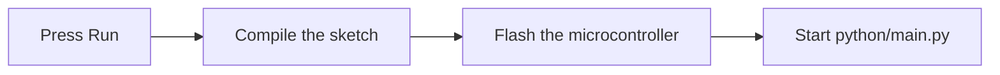

{:class="cover"}

---

Now let's build something of our own. We'll create an App called **Q Board** and make two LEDs blink, one from each brain. This is **Q Board stage 1**, and everything else in the course builds on it.

---

## Create the App

1. In App Lab's sidebar, find **Apps** and press the **+** next to it (**Create new App**).
2. Name it `Q Board`.

App Lab makes a folder of files for you. It lives on the board in `/home/arduino/ArduinoApps/`, and it is the folder you'll work in all course.

## What is in an App folder?

| File | Role |
|---|---|
| `app.yaml` | The manifest: the App's name, icon and Bricks. App Lab manages it |
| `python/main.py` | The Python side. **Mandatory**, it is the entry point |
| `python/requirements.txt` | Optional list of extra pip packages |
| `sketch/sketch.ino` | Optional C++ for the microcontroller |
| `sketch/sketch.yaml` | Sketch settings and libraries. App Lab manages it |
| `README.md` | Optional notes about the App |
{:class="table table-single"}

You can add other things too, such as an `assets/` folder for a web page later.

**Why this matters:** Python is the core of an App, and the sketch is optional. A sketch without a `main.py` isn't an App.



That is what **Run** does, every time.

---

## Stage 1a: the microcontroller blinks

Open `sketch/sketch.ino` and put this in it.

**sketch/sketch.ino**

```cpp
// Q Board, stage 1: the microcontroller blinks LED 3

void setup() {
  pinMode(LED3_R, OUTPUT);
  pinMode(LED3_G, OUTPUT);
  pinMode(LED3_B, OUTPUT);

  // These LEDs are "active low": HIGH turns a colour off, LOW turns it on
  digitalWrite(LED3_R, HIGH);
  digitalWrite(LED3_G, HIGH);
  digitalWrite(LED3_B, HIGH);
}

void loop() {
  digitalWrite(LED3_G, LOW);   // green on
  delay(500);
  digitalWrite(LED3_G, HIGH);  // green off
  delay(500);
}
```

LED 3 belongs to the microcontroller. It has three colour pins: `LED3_R`, `LED3_G` and `LED3_B`. In `setup()` we make them outputs and turn them all off.

### Active low

Here is the surprise. These LEDs are **active low**. `LOW` turns a colour **on** and `HIGH` turns it **off**, which is the opposite of what you might expect. That is why `setup()` writes `HIGH` to all three: it makes sure everything starts off. Then `loop()` switches green on with `LOW`, waits half a second, and switches it off with `HIGH`.

**Common mistake:** writing `HIGH` to turn an LED on. You'll get an LED that is on all the time, or never.

## Stage 1b: the smallest Python side

Every App needs a `python/main.py`, even if the sketch does the real work. This is the smallest valid one.

**python/main.py**

```python
from arduino.app_utils import App

print("Q Board is starting")

App.run()
```

`App.run()` starts the App and keeps your program running. It must be the **last line**. Code after `App.run()` never runs.

Press **Run**. App Lab compiles the sketch, flashes the microcontroller, and starts the Python side. LED 3 blinks green.

## Where does the output go?

At the bottom of App Lab are three console tabs.

- **App launch**: compile and deploy logs. Look here if Run fails.
- **Python**: everything from `print()` in `main.py`. You should see `Q Board is starting`.
- **Serial Monitor**: anything the sketch sends with `Serial.print`.

So `print()` in Python shows in the Python tab, and `Serial` in the sketch shows in the Serial Monitor tab. They are different tabs because they are different brains.

---

## Stage 1c: now Linux blinks too

Let's make the Linux side blink LED 1, at a different speed. Replace `python/main.py` with this.

**python/main.py**

```python
import time

from arduino.app_utils import App, Leds


def loop():
    Leds.set_led1_color(0, 0, 1)   # LED 1 blue (red, green, blue: 1 is on)
    time.sleep(0.2)
    Leds.set_led1_color(0, 0, 0)   # LED 1 off
    time.sleep(0.2)


App.run(user_loop=loop)
```

`Leds` controls the two LEDs that belong to Linux. `Leds.set_led1_color(r, g, b)` takes 0 or 1 for each colour, and here **1 means on**. That is the opposite of the sketch, because these are a different set of LEDs.

`App.run(user_loop=loop)` still ends the file, but now it also calls `loop()` over and over. Our loop turns LED 1 blue, waits 0.2 seconds, turns it off and waits again.

Press **Run** again. You should see LED 3 blinking green at half-second intervals, and LED 1 blinking blue faster. Two brains, two programs, two speeds.

**Q Board stage 1 is complete.** Notice something: neither side knows the other exists. How would Python tell the sketch to do something? That is the question lesson 6 answers, and in the meantime we'll use the microcontroller to draw on the LED matrix in lesson 4.

---

## Try it Yourself

1. Change the sketch so LED 3 blinks **red** instead of green. Which pin do you change?
2. Change the Python `time.sleep()` values to 0.5 and see how the two blinks line up over time.
3. Challenge: make LED 3 blink **blue** and **green** one after the other. Remember that LOW means on.

## Common Issues

**Problem**: The LED is on when you expect it off, or the other way round.
**Solution**: Remember LED 3 and LED 4 are active low. Use `LOW` for on and `HIGH` for off.
**Why**: The LEDs are wired so that pulling the pin low turns them on.

**Problem**: The App won't run, or Python reports an error about `main.py`.
**Solution**: Check `python/main.py` exists and ends with `App.run()` or `App.run(user_loop=loop)`.
**Why**: `main.py` is the mandatory entry point, and `App.run()` is what keeps it going.

**Problem**: Code you added after `App.run()` never does anything.
**Solution**: Move it above `App.run()`.
**Why**: `App.run()` doesn't return, so lines after it never run.

**Problem**: You can't find your `print()` or `Serial` output.
**Solution**: Look in the right tab. `print()` goes to **Python**, `Serial` goes to **Serial Monitor**, and compile errors go to **App launch**.
**Why**: Each tab shows output from a different part of the App.

## Check your understanding


? To turn LED 3 green on from a sketch, what do you write?
- [ ] `digitalWrite(LED3_G, HIGH);`
- [x] `digitalWrite(LED3_G, LOW);`
- [ ] `Leds.set_led3_color(0, 1, 0)`
> LED 3 is active low, so LOW turns the colour on.

? What must every `main.py` end with?
- [ ] `print("done")`
- [ ] `time.sleep(1)`
- [x] `App.run()` or `App.run(user_loop=loop)`
> `App.run()` keeps your Python running. Code after it never runs.

? Where does `print("hello")` in `main.py` appear?
- [ ] In the Serial Monitor tab
- [x] In the Python tab
- [ ] In the App launch tab
> Python's `print()` shows in the Python tab. Serial output from the sketch shows in Serial Monitor.

