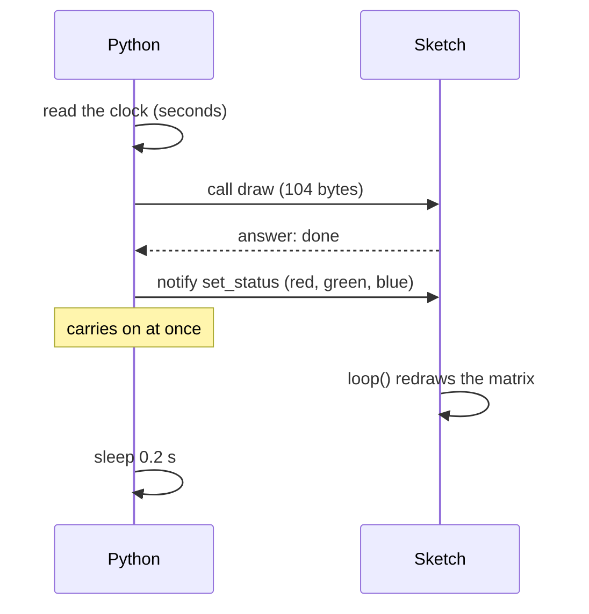

{:class="cover"}

---

This is where the two brains finally work as a team. Python decides what to show, and the sketch shows it.

In [lesson 6](/learn/arduino_uno_q/06_how_the_bridge_works.html) we watched a message travel across the Bridge, and the video there covers this ground, so watch it first if you haven't. Now we use that idea to build something real.

---

## What you'll see

This is **Q Board stage 4**. When it runs:

- The matrix shows the **seconds of the real clock** as two big digits, counting 00 to 59.
- **LED 4 is green** for most of the minute.
- LED 4 turns **red for the last 10 seconds** of each minute (50 to 59).

Why do we need both brains for that? Because each one knows something the other does not.

- **Linux knows the real time.** It gets it from the network. The microcontroller has no idea what time it is.
- **The microcontroller owns the matrix and the LEDs.** It drives them in real time, and Python cannot reach them directly.

So Python works out *what* to show, and sends it across the Bridge. The sketch does the *showing*. That one sentence is the whole skill of this course.

---

## The sketch

Open your Q Board App and replace the sketch with this.

**sketch/sketch.ino**

```cpp
#include <Arduino_RouterBridge.h>
#include <Arduino_LED_Matrix.h>
#include <vector>

// Q Board, stage 4: Python decides what to show, the sketch shows it

Arduino_LED_Matrix matrix;
uint8_t frame[104] = {0};   // the picture on the matrix right now

// Python calls this with 104 brightness values (0 to 7)
void draw(std::vector<uint8_t> newFrame) {
  size_t len = min(newFrame.size(), (size_t)104);
  memcpy(frame, newFrame.data(), len);
}

// Python calls this to set the colour of LED 4
void set_status(bool red, bool green, bool blue) {
  digitalWrite(LED4_R, red ? LOW : HIGH);    // active low: LOW is on
  digitalWrite(LED4_G, green ? LOW : HIGH);
  digitalWrite(LED4_B, blue ? LOW : HIGH);
}

void setup() {
  pinMode(LED4_R, OUTPUT);
  pinMode(LED4_G, OUTPUT);
  pinMode(LED4_B, OUTPUT);
  set_status(false, false, false);

  matrix.begin();
  matrix.setGrayscaleBits(3);
  matrix.clear();

  Bridge.begin();
  Bridge.provide("draw", draw);                    // only copies memory
  Bridge.provide_safe("set_status", set_status);   // touches pins: run it in loop()
}

void loop() {
  matrix.draw(frame);
  delay(10);
}
```

### Walking through the sketch

The sketch is a **menu of two things Python can ask for**: `draw` and `set_status`. Everything else is housekeeping.

**`draw` and `frame`.** The global array `frame` is the picture on the matrix right now. When Python calls `draw`, the function copies the 104 values it was sent into `frame`. That is all it does. The `min(...)` keeps us safe if Python ever sends too many values.

**`loop()` keeps redrawing.** Notice that `draw` never touches the matrix. `loop()` calls `matrix.draw(frame)` over and over, every 10 ms, so the matrix always shows whatever is in `frame`. Python only changes the memory. The sketch does the drawing in its own time.

**Why `provide` for `draw`?** Look at the two registrations at the bottom of `setup()`.

- `draw` uses `Bridge.provide`. It runs in the Bridge's high-priority background thread, so it must be quick and must not touch hardware. Copying memory is exactly that, so it is safe there.
- `set_status` uses `Bridge.provide_safe`. It calls `digitalWrite`, which touches pins. `provide_safe` makes the function wait and run inside `loop()`, which is the safe place for Arduino calls.

**Why the LED code is "backwards".** LED 4 is **active low**, so `LOW` turns a colour on. That is why `red ? LOW : HIGH` reads the opposite of what you expect.

**Common mistake:** putting `digitalWrite` in a plain `provide` function. It may seem to work for a while and then hang. We look at exactly why in [lesson 9](/learn/arduino_uno_q/09_when_the_bridge_goes_wrong.html).

---

## The Python

**python/main.py**

```python
import time

from arduino.app_utils import App, Bridge

# Each digit is 5 LEDs wide and 7 tall. "1" is a lit LED.
FONT = {
    "0": ["01110", "10001", "10011", "10101", "11001", "10001", "01110"],
    "1": ["00100", "01100", "00100", "00100", "00100", "00100", "01110"],
    "2": ["01110", "10001", "00001", "00010", "00100", "01000", "11111"],
    "3": ["11110", "00001", "00001", "01110", "00001", "00001", "11110"],
    "4": ["00010", "00110", "01010", "10010", "11111", "00010", "00010"],
    "5": ["11111", "10000", "11110", "00001", "00001", "10001", "01110"],
    "6": ["00110", "01000", "10000", "11110", "10001", "10001", "01110"],
    "7": ["11111", "00001", "00010", "00100", "01000", "01000", "01000"],
    "8": ["01110", "10001", "10001", "01110", "10001", "10001", "01110"],
    "9": ["01110", "10001", "10001", "01111", "00001", "00010", "01100"],
}


def number_frame(number, level=7):
    """Return 104 brightness values that show a number from 0 to 99."""
    frame = [0] * 104
    text = f"{number:2d}"                 # 7 becomes " 7", 42 stays "42"
    for position, digit in enumerate(text):
        if digit == " ":
            continue
        left = 1 + position * 6           # first digit at column 1, second at column 7
        for row, line in enumerate(FONT[digit]):
            for col, pixel in enumerate(line):
                if pixel == "1":
                    frame[row * 13 + left + col] = level
    return frame


def loop():
    seconds = time.localtime().tm_sec     # Linux knows the real time

    # call: send the picture and wait until the sketch has it
    Bridge.call("draw", bytes(number_frame(seconds)))

    # notify: send and carry on. LED 4 is red for the last 10 seconds of each minute
    last_ten = seconds >= 50
    Bridge.notify("set_status", last_ten, not last_ten, False)

    time.sleep(0.2)


App.run(user_loop=loop)
```

Press **Run**. The sketch is compiled and flashed, Python starts, and the seconds appear on the matrix.

### Walking through the Python

**The FONT.** Each digit is a list of seven strings, one per row, each five characters wide. A `1` is a lit LED. Squint at the `"0"` entry and you can see the zero. You can edit any digit to redesign it.

**`number_frame()` builds 104 values.** The matrix is 8 rows by 13 columns, so 8 x 13 = 104 LEDs, stored row by row. To put a pixel at a row and column, the index is:

```
index = row * 13 + left + col
```

Here `left` is the column where the digit starts. The first digit starts at column 1 and the second at column 7 (`1 + position * 6`), which leaves a gap between them.

Two worked examples:

- The top row of the second digit's middle pixel: row 0, left 7, col 2, so index 0 x 13 + 7 + 2 = **9**.
- The left edge of the first digit, in row 3: row 3, left 1, col 0, so index 3 x 13 + 1 + 0 = **40**.

`f"{number:2d}"` pads the number to two characters, so 7 becomes `" 7"`. A space is skipped, which gives a blank tens digit.

**Why `bytes(...)`?** The sketch's `draw` takes a `std::vector<uint8_t>`. On the Bridge, Python `bytes` maps to exactly that type. A plain Python list is a different type, so the types would not match. So we convert the 104 numbers with `bytes()` before sending.

**`call` versus `notify`.** We use both, on purpose.

- `Bridge.call("draw", ...)` **waits for the answer**. When it returns, the sketch has the picture. If nothing answers, it raises an error after the timeout.
- `Bridge.notify("set_status", ...)` is **fire and forget**. Python sends it and carries on straight away. It is best effort: if one is lost, nobody tells you. For an LED we update again 0.2 seconds later, so a lost one hardly matters.

`App.run(user_loop=loop)` calls `loop()` again and again, and it must be the last line of `main.py`.

---

## One pass through the loop

Here is one trip round `loop()`. Python is on the left and the sketch on the right. The router sits between them and carries every message, so it is left out to keep the picture simple.





Press **Next** to follow a single call through the router, one step at a time.

---

## Call or notify?

The choice comes up in every project. Here is how to decide.

| Situation | Use | Why |
| --- | --- | --- |
| You need the answer, or must know it arrived | `call` | It waits and gives you the result or an error |
| The next step depends on this one finishing | `call` | You know it is done before you carry on |
| A stream of updates where the next one replaces the last | `notify` | A missed one is fixed by the next |
| You do not care about the reply | `notify` | No waiting, so your loop stays fast |
{:class="table table-single"}

In our clock, `draw` is a `call` because we like to know the picture arrived. `set_status` is a `notify` because the LED is refreshed every 0.2 seconds anyway.

---

## Try it Yourself

1. **Show the minutes instead.** Swap the two lines in `loop()` that use `seconds` for this fragment. It is not a whole program, just the changed lines (we use a dimmer level so you can tell it apart):

```python
minutes = time.localtime().tm_min
Bridge.call("draw", bytes(number_frame(minutes, level=3)))
```
{: .no-snakie }

2. **Blink at the top of each minute.** When `seconds` is 0, send a blank frame first (`[0] * 104`, remembering `bytes()`), wait half a second, then show the number.
3. **Challenge: count down from 59.** Show `59 - seconds` instead of `seconds`. Then make LED 4 turn red when the countdown reaches 10 or less. Which side of the Bridge does each change belong on?

---

## Common Issues

**Problem**: Nothing appears on the matrix.
**Solution**: Check that the names in `Bridge.provide("draw", ...)` and `Bridge.call("draw", ...)` match exactly, and **Stop** then **Run** the App again after any edit.
**Why**: The Bridge matches by name. A typo, or an App that was not restarted, means the sketch Python is calling is not the one you wrote.

**Problem**: The digits look garbled or scrambled.
**Solution**: Make sure the frame is exactly 104 values long, and that you send it through `bytes(...)`.
**Why**: The matrix is read row by row, 13 columns at a time. If the length is wrong, every row is shifted and the picture tears.

**Problem**: Python shows a `ValueError` that mentions the name.
**Solution**: Check the sketch compiled, using the **App launch** tab, and that the name is spelled the same on both sides.
**Why**: It means the sketch answered that nothing provides that name.

---

## Check your understanding


? Why is `draw` registered with `Bridge.provide`, while `set_status` uses `Bridge.provide_safe`?
- [ ] `draw` is more important, so it gets priority
- [x] `draw` only copies memory, but `set_status` touches pins so it should run in `loop()`
- [ ] `provide_safe` is faster than `provide`
> `provide` runs the function in the Bridge's background thread, which is fine for quick memory copies. Anything that uses Arduino APIs such as `digitalWrite` belongs in `provide_safe`.

? Why do we send `bytes(number_frame(seconds))` rather than the plain list?
- [ ] Bytes are faster to print
- [ ] Python lists cannot be sent over the Bridge at all
- [x] The sketch expects a `std::vector<uint8_t>`, and Python `bytes` maps to that type
> The types on both sides must match. `bytes` becomes `std::vector<uint8_t>`, which is what `draw` takes.

? Which is the better fit for `notify`?
- [ ] Asking the sketch for a value you need next
- [x] Updating an LED colour that is refreshed again a moment later
- [ ] Sending something that must be confirmed as received
> `notify` does not wait and is best effort. It suits a stream of updates where the next one replaces the last. When you need the answer, use `call`.

