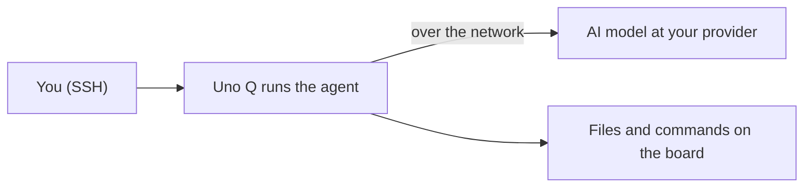

{:class="cover"}

---

So far in this course the two brains have worked as a team. This lesson is a showcase of what the Linux brain can do when it works alone: it can host an AI agent that is always on, always reachable, and remembers what it has learnt.

This lesson is optional. It follows Kev's own build, and it needs a paid or existing AI model subscription. Nothing later in the course depends on it. Watch Kev's video first, then read on for the ideas and the steps.



Kev also wrote the build up as a post, [Why I'm running Hermes Agent on an Arduino Uno Q](/blog/hermes-agent-on-arduino-uno-q.html).

---

## What is an agent?

An AI agent is a program that can run terminal commands, read and write files, browse the web and write code, and it keeps going in a loop until a task is done. You give it a goal. It works out the steps.

**Hermes Agent** is an open-source agent from Nous Research ([github.com/NousResearch/hermes-agent](https://github.com/NousResearch/hermes-agent)). Kev picks out three things that make it useful day to day.

| Feature | What it means |
| --- | --- |
| Skills | When Hermes solves a hard problem, it can save how it did it as a reusable skill document. It marks which skills it wrote itself. |
| Persistent memory | It remembers you, your projects and your setup across sessions, so it does not start from nothing each time. |
| Provider flexibility | It works with Anthropic, OpenAI, Google Gemini, GitHub Copilot and more, so you can use a subscription you already have. |
{:class="table table-single"}

---

## The board is not running the AI

This is the key idea of the lesson, so read it twice. The Uno Q does not run the AI model. The model runs at your provider, in their data centre. The board runs the agent: the loop that reads files, runs commands and calls the model over the network.

That is why the board needs very little. In Kev's build, the CPU sat at around 2 to 5 percent when the agent was idle. An agent spends most of its time waiting for replies over the network, so it asks very little of the processor.

Kev also notes that the Uno Q is slower than a Raspberry Pi in raw CPU tests. For an agent that mostly waits on network calls, that is not the bottleneck.



### Why give it a board of its own?

Kev runs sessions on many machines: a laptop, a desktop, a few Raspberry Pis. Each time he started on a different machine, what the agent had learnt stayed behind. One agent that lives on one board, always on, keeps its memory in one place.

---

## Board or rented server?

The usual alternative is a small rented server (a VPS). Here are Kev's figures from May 2026.

| Option | Cost in Kev's post |
| --- | --- |
| Uno Q, 4 GB (the one Kev used) | About 53 euros, paid once |
| Uno Q, 2 GB | About 39 euros, paid once |
| Small rented server | About 5 to 8 pounds a month, every month |
{:class="table table-single"}

Prices change, so treat these as a snapshot. Type your own numbers into the calculator below. The board cost is a one-off, the rental is monthly, and the answer is how many months until the board has paid for itself. Kev's figures mix euros and pounds, so it gives a rough answer.



Try the 8 pounds a month end of Kev's range, then try a cheaper board. A board has one more advantage over a rented server: when you stop using it as an agent host, it is still an Uno Q, and it goes into your next project.

---

## Setting it up

Everything here is typed on the board, over SSH. Lesson 10 shows how to get a terminal: [Linux survival kit](/learn/arduino_uno_q/10_linux_survival_kit.html). Follow the steps in Kev's order.

### Step 1: Tailscale, to reach the board from anywhere

Tailscale is a free-for-personal-use VPN. You put it on the board and on your own devices, and they can talk to each other privately, with no port forwarding.

Type this on the board:

```bash
curl -fsSL https://tailscale.com/install.sh | sh
sudo tailscale up
```

`tailscale up` prints a link. Open it on your phone or computer and sign in. The board then appears on your Tailscale network.

### Step 2: Install Hermes

Type this on the board:

```bash
curl -fsSL https://hermes-agent.nousresearch.com/install.sh | bash
```

This is the command in the project's README at the time of writing. Kev's post shows an older address, so if it fails, check the README on the Hermes GitHub page for the current one.

Then run the setup wizard on the board, where you choose your model provider, and start a session:

```bash
hermes setup
hermes
```

Two more commands from the README are worth knowing. Both are typed on the board.

```bash
hermes model
hermes doctor
```

`hermes model` lets you change provider and model. `hermes doctor` helps diagnose problems. `hermes update` brings Hermes up to date. After a few sessions, `hermes skills list` shows the skills it has built, which is how Kev checks what it has learnt.

### Step 3: tmux, so it keeps running

If your SSH connection drops, the session dies with it. tmux fixes that: it keeps a terminal alive on the board. Type these on the board:

```bash
sudo apt install tmux
tmux new -s hermes
```

Run `hermes` inside that tmux session. To leave it running, press Ctrl+B, then D. You can close SSH and come back later:

```bash
tmux attach -t hermes
```

---

## Stay safe

Read this part before you run anything.

- An agent can run any command that the `arduino` user can run. That is the point of it, and also the risk.
- Piping a script from the internet into a shell runs whatever that script says. If you are not sure, download it and read it first.
- Give the agent a board with nothing precious on it, and keep backups. Lesson 10 shows how to copy your Apps folder to your computer.
- Do not point an agent at hardware that can move or get hot until you trust it.

Kev has one more point about safety. Hermes builds its skills from your own sessions, rather than pulling them from a shared registry. Code you did not write is not arriving on the board that way.

---

## Back to the two brains

This lesson used only the Linux brain. The natural next step is to give the agent hands. Imagine a sketch that provides a few small, safe functions over the Bridge, such as `set_status` from the Q Board. A Python program, or the agent, calls them by name. The agent can ask for a status change, and the sketch still owns the pins and decides what is safe. That is an idea to explore, not a recipe, but it is the same split you have used all course.

---

## Try it Yourself

1. **Do the sums.** Use the calculator with the 2 GB board (39 euros) and with the top of Kev's rental range (8 pounds a month). How many months to break even?
2. **Read before you run.** Open the Hermes README on GitHub and find the install command. Compare it with the one in this lesson. Has it changed?
3. **Challenge: design the hands.** On paper, list three small functions a sketch could provide so an agent could change the Q Board's status safely. For each, say what the sketch would refuse to do.

---

## Common Issues

**Problem**: The Hermes install command fails or the address cannot be found.
**Solution**: Open the Hermes README on GitHub and copy the current install command.
**Why**: Kev's post shows an older address, and projects move their install scripts over time.

**Problem**: `hermes` is not found straight after installing.
**Solution**: Open a new terminal session on the board and try again.
**Why**: The install may add `hermes` to your path in a way that only new sessions pick up.

**Problem**: The agent stops when your SSH connection drops.
**Solution**: Run it inside tmux, and reattach with `tmux attach -t hermes`.
**Why**: A normal SSH session ends when the connection does, and takes its programs with it. tmux keeps them alive on the board.

**Problem**: You cannot reach the board when you are away from home.
**Solution**: Check that Tailscale is running on both the board and the device you are connecting from.
**Why**: Tailscale only links devices that are both signed in to it.

---

## Check your understanding


? Where does the AI model in this lesson actually run?
- [ ] On the Uno Q's microcontroller
- [x] At your model provider, over the network
- [ ] Inside tmux
> The board runs the agent, which reads files, runs commands and calls the model. The model itself runs at the provider, which is why the board needs so little.

? Why run Hermes inside tmux?
- [ ] It makes the model answer faster
- [ ] It stops the agent running commands
- [x] The session keeps running if your SSH connection drops
> tmux keeps the terminal alive on the board. You detach with Ctrl+B then D and reattach later with `tmux attach -t hermes`.

? Which is the best safety habit for an agent that can run commands?
- [ ] Give it your most important board so it learns faster
- [x] Use a board with nothing precious on it, and keep backups
- [ ] Point it at motors straight away to test it
> An agent can run any command the `arduino` user can. A spare board and a backup limit the damage, and hardware that can move or get hot should wait until you trust it.

