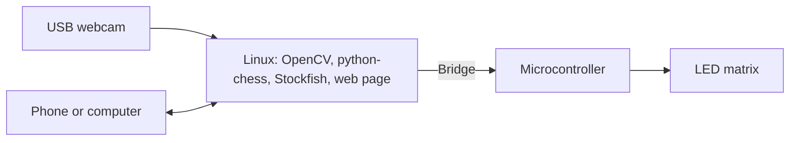

{:class="cover"}

---

By the end of this lesson you will be able to explain how the chess camera App splits its work between the two brains, and reuse its key idea in your own project.

Kev wanted to play chess against a computer without staring at a screen. So he pointed a webcam at a real board, plugged it into an Uno Q, and built an App that watches the game, works out each move you make, and plays back.

This lesson is a guided tour of that finished App. It uses nearly everything in the course, and it has one clever idea you can steal for your own projects. Watch the video first.



The App's code is in [Kev's repository](https://www.github.com/kevinmcaleer/uno_q_chess), and he wrote the build up in [Playing chess on a real board with the Arduino UNO Q](/blog/uno-q-chess-camera.html). This lesson does not reprint the code.

---

## What it does

You move a piece and take your hand away. The App reads the move. It tracks the whole game: check, checkmate, castling, en passant and promotion. Stockfish, a chess engine, picks a reply, and you choose how strong it plays from skill 0 to skill 20.

The reply appears on the web page, as an arrow on the camera view, and on the Uno Q's LED matrix, with the from-square dim and the to-square bright. You move the computer's piece for it, and the App checks that you moved the right one. It can speak through a Bluetooth speaker or your browser, and a *Coach me* option comments on your moves.

---

## How the two brains split the job

It is an App Lab App, so it has the folders you know: `app.yaml`, `python/`, `assets/` and `sketch/`.



Linux does the heavy work. It runs OpenCV on the camera frames, python-chess for the rules, Stockfish for the thinking, and the web page on port 7000, as in lesson 11. The microcontroller has one job: driving the LED matrix.

| Course lesson | Part of the chess App |
| --- | --- |
| Lesson 4, the LED matrix | Shows the computer's move on the board itself |
| Lessons 7 and 8, the Bridge | Python tells the sketch what to draw |
| Lesson 10, containers and requirements | Stockfish is downloaded by the App, as an App cannot use `apt install` |
| Lesson 11, the web page on port 7000 | The control page |
| Lesson 12, the camera | The webcam frames |
| Lesson 13, run at startup | A chess board that is ready when you switch it on |
{:class="table table-single"}

---

## The clever part: reading a move without recognising pieces

You might expect the App to look at the board and work out which piece is on which square. It does not. It never needs to know what kind of piece is on a square. It reads a move in four steps.

1. **Straighten the board.** You calibrate once by marking the four corners, or let the App find the board itself. From then on every frame is warped into a flat, top-down 8 x 8 grid, so the App knows which pixels belong to which square.
2. **Wait for stillness.** Nothing is read while a hand is over the board. The App compares each square's average colour between frames and waits until they stop changing. It ignores brightness changes that the whole board shares, so the webcam's auto-exposure does not count as movement.
3. **Score every square.** It compares the settled board with the last settled board, and scores how much each of the 64 squares changed.
4. **Ask the rules.** The App always knows the position, so it asks python-chess for every legal move. It picks the one whose squares changed while the rest stayed quiet, and it also checks that the starting square now looks empty.

This works because a typical position has only about 30 legal moves, and only one of them changes the right squares. Castling changes four squares and en passant changes three, and the App handles them the same way.

Try it. This board is in the opening position, where there are exactly 20 legal moves.



Make a move and read the scores. Watch the squares that "changed" in the camera's eyes, then watch the 20 legal moves get scored until one is left. Then switch on camera noise and see that the right move still wins.

### The design lesson

The trick is to use what you already know. The App knows the rules, so the vision problem shrinks from "what is on every square?" to "which of about 30 moves matches these changes?". Before you reach for a bigger model, ask yourself: what do I already know that narrows this down?

---

## Real-world extras

A real table is messier than a demo. Kev added three checks for that.

- If you brush a neighbouring piece as you move, the App still reads the move, then asks you to centre the piece you nudged.
- If the whole board slides, almost every square changes at once. The App spots this, finds the board again and saves the new calibration.
- Once a second, while nothing is moving, it checks which squares look occupied. A missing piece is outlined in red and an unexpected one in yellow.

### Pieces the camera can see

Kev found that tall pieces are a problem. Unless the camera is directly overhead, a tall king leans into the squares next to it in the image. So he designed low, wide printable pieces and flat coins. He also found that colours matter: pick ones that stand out from both the light and the dark squares. In Kev's build, cream pieces with red symbols and black pieces with yellow symbols worked well. Plain white pieces on light squares were the hardest for the camera to see.

---

## What you would need to build it

- An Uno Q
- A USB-C hub with power delivery, because the board has one USB-C port and the hub carries power and the camera
- A 5 V USB-C power supply
- A USB webcam. Any UVC webcam will do. Kev's runs at 1280x720 and 15 fps.
- A camera stand that holds the camera as directly above the board as you can manage
- A chess board and pieces. The repository has printable boards, with 50 mm squares.
- Optional: a Bluetooth speaker

---

## The set-up steps

These are the steps from Kev's post, in order.

1. Get the App onto the board. Type this on the board, over SSH:

```bash
git clone https://github.com/kevinmcaleer/uno_q_chess ~/ArduinoApps/chess-camera
```

2. Plug the webcam into the hub and the hub into the board. Mount the camera above the board with even light.
3. Open the App in App Lab and press **Run**. The first game needs the internet, because the App downloads Stockfish (about 30 MB) into its `data/` folder.
4. Browse to `http://<board>:7000` on your phone or computer.
5. In the Camera panel choose **Calibrate**. Either press **Find board automatically**, or click the corners a8, h8, h1 and a1 and press **Snap to squares**. Check the grid, then press **Save calibration**.

You only need to calibrate again if the camera moves.

The repository also has offline tests, including 604 simulated moves from angled, noisy, fake camera images. That means you can try the detector on a laptop before buying any hardware.

---

## Try it Yourself

1. **Play with the detector.** In the demo above, make three different moves. For each, note which squares changed and how many legal moves scored close to the right one.
2. **Break it with noise.** Switch on camera noise and make the same moves again. Does the right move still win? Why does knowing the rules help?
3. **Read the README.** Open the [repository](https://www.github.com/kevinmcaleer/uno_q_chess) and find where it describes calibration. Write down which step is done once, and what would force you to do it again.
4. **Challenge: build it.** If you have a webcam, a hub and a board, follow the set-up steps and play a game.

---

## Common Issues

**Problem**: A tall piece seems to be read on the wrong square.
**Solution**: Move the camera directly overhead, or use low, wide pieces or flat coins.
**Why**: Seen from an angle, a tall piece leans into the squares next to it in the image.

**Problem**: White pieces on light squares are hard for the camera to see.
**Solution**: Choose piece colours that stand out from both the light and the dark squares.
**Why**: The App reads moves from how much each square changes. A piece that looks like the square under it changes very little.

**Problem**: The grid no longer sits on the squares.
**Solution**: Calibrate again and save the new calibration.
**Why**: The calibration is tied to where the camera is. If the camera moves, the grid does not move with it.

**Problem**: The first game does not start.
**Solution**: Make sure the board is online.
**Why**: The first game downloads Stockfish, about 30 MB, into the App's `data/` folder.

---

## Check your understanding


? How does the chess camera read a move?
- [ ] It recognises each piece with an AI model
- [x] It scores how much each square changed, then picks the legal move that matches
- [ ] It asks you to type every move
> The App never works out what kind of piece is on a square. It uses the rules to list the legal moves, and picks the one whose squares changed.

? Why does the App wait until the board is still before reading?
- [x] A hand over the board would change the squares and give a false move
- [ ] The LED matrix needs time to light up
- [ ] Stockfish can only think when nothing moves
> Nothing is read while a hand is over the board. The App waits until each square's colour stops changing.

? Why does the App download Stockfish itself instead of using `apt install`?
- [ ] Stockfish is not available for chess
- [ ] The microcontroller stores it
- [x] An App runs in a container without root, so it cannot use `apt install`
> This is the same point as lesson 10. Programs you install with `apt` are not available inside an App, so the App fetches what it needs itself.

