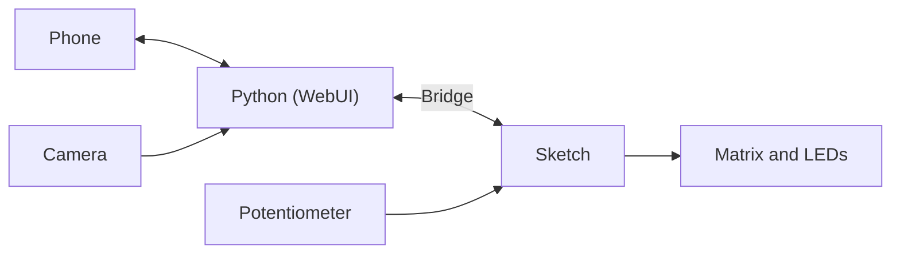

{:class="cover"}

---

You started with one blinking LED and finished with a board that runs by itself, serves a web page and counts people with a camera. More importantly, you learnt how to split a project between a Linux computer and a real-time microcontroller, and how to make the two talk. That skill carries to every project you build next.

---

## What you built

| Stage | Lesson | What was added | Which brain |
| --- | --- | --- | --- |
| 1 | 3 | Blink | Microcontroller |
| 2 | 4 | A beating heart on the LED matrix | Microcontroller |
| 3 | 5 | A bar graph from a potentiometer | Microcontroller |
| 4 | 7 | Python draws the clock on the matrix over the Bridge | Python decides, sketch draws |
| 5 | 8 | The sketch sends sensor readings up to Python | Sketch reads, Python receives |
| 6 | 11 | A web page on your phone | Python serves the page, sketch keeps the limit |
| 7 | 12 | A camera that counts people | Linux sees, sketch shows |
| 8 | 13 | Runs by itself at power-on | Both |
{:class="table table-single"}

Here is the finished Q Board.

---

## The ideas to keep

- **Each brain does what it is good at.** The sketch owns pins and timing. Python owns the network, files, the camera and AI.
- **Call when you need the answer, notify for streams.** `Bridge.call()` waits for a reply. `Bridge.notify()` does not.
- **Handlers store, loops act.** A function that is called for you, such as a web handler, only stores the new value. The loop is the one place that acts on it.
- **Use `provide_safe()` unless the function only stores a value.** It is the rule that always works.
- **Decide what the sketch does when Python is away.** Keep a default so the board still behaves. A robot's safety stop belongs in the sketch.
- **Use what you already know to shrink a hard problem.** The chess camera knew the rules, so it never had to recognise a piece.

---

## Where next

Kev has more to learn from, and the Uno Q is a good place to keep building.

- [Arduino to Python](/learn/arduino_to_python/) is a good next course if the Python side is the part you want to grow.
- [Python for beginners](/learn/python/) goes back over the language from the start.
- The four posts: [Uno Q tips](/blog/uno-q-tips.html), [Wi-Fi set-up](/blog/arduino-uno-q-wifi-setup.html), [Hermes Agent on the Uno Q](/blog/hermes-agent-on-arduino-uno-q.html) and [the chess camera](/blog/uno-q-chess-camera.html).
- [Kev's YouTube channel](https://www.youtube.com/@kevinmcaleer28) has new builds as they happen.

Pick one small project that needs both brains, and start with the question the course taught you to ask first: which brain should do this?

---

## Check your understanding


? Which job belongs to the microcontroller rather than to Linux?
- [ ] Serving a web page
- [x] Reading a pin and driving LEDs with exact timing
- [ ] Running a camera model
> The microcontroller owns pins and real-time timing. Linux owns the network, files, the camera and AI.

? What does the Bridge let the two sides do?
- [ ] Share one block of memory
- [x] One side provides a named function and the other calls it by name
- [ ] Copy files between the board and your computer
> The Bridge is a remote procedure call (RPC) link. You provide a function on one side and call it by name from the other.

? In lesson 8 the sketch needs to send a reading to Python and carry on. Which fits best?
- [ ] `Bridge.call()`, and wait for the answer
- [x] `Bridge.notify()`, which does not wait
- [ ] `Bridge.provide()`
> `notify` is for streams of readings where you do not need an answer. `call` is for when you need one.

? A function registered with `provide()` prints with `Serial.println()`. What is the risk?
- [ ] The text is shown twice
- [x] It can deadlock, so use `provide_safe()`
- [ ] The Serial Monitor tab closes
> `provide()` runs in the Bridge's background thread. `provide_safe()` runs the function in `loop()`, where Arduino calls are fine.

? Which address opens the Q Board web page from lesson 11?
- [ ] `http://<boardname>.local`
- [x] `http://<boardname>.local:7000`
- [ ] `http://<boardname>.local:80`
> The WebUI Brick serves the App's `assets/` folder on port 7000.

