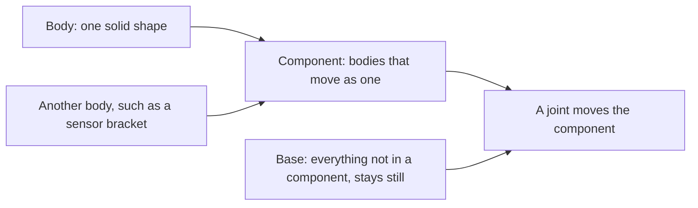

{:class="cover"}

---

By the end of this lesson you will be able to tell a body from a component, and lay out the three parts of the desk arm in the Assemble tab.

Before anything can move, BetterCad needs to know which bits move *together*. A forearm might be one printed part, or a printed part with a sensor screwed to it and a cable clip on the side. Either way it swings as one lump.

BetterCad calls that lump a **component**.

---

## Bodies and components

| Word | What it is |
|---|---|
| **Body** | One solid shape. Everything you've made so far is a body |
| **Component** | A named group of bodies that move as one. A joint always moves a component |
| **Base** | Everything that isn't in a component. It stays still, and the rest of the robot hangs from it |
{:class="table table-single"}

You rarely have to make a component by hand. Pick a plain body as the part that moves and the Joint tool makes it a component for you. You'll see that happen in the next lesson.

---

## Get the arm's parts

The desk arm has three parts. Download [desk-arm-parts.bcad](/learn/bettercad_joints_urdf/assets/desk-arm-parts.bcad), then:

1. Open [BetterCad](https://bettercad.kevsrobots.com).
2. Click the arrow beside **Save** and choose **Open...**.
3. Pick the file you downloaded.

{:class="img-fluid w-100"}

The Browser lists three bodies:

| Body | Size | Holes |
|---|---|---|
| **Base** | A 60 x 60 x 6 mm plate with a 6 x 24 x 50 mm upright grouped onto it | One M3 hole in the upright, near the top |
| **Upper arm** | 90 x 20 x 6 mm | An M3 hole near each end |
| **Forearm** | 70 x 20 x 6 mm | An M3 hole near one end |
{:class="table table-single"}

The arms are lying flat beside the base, the way you'd print them. That's fine. A joint will pick each one up and put it where it belongs.

> **Would you rather build the parts?** They are Library boxes with the sizes above, plus holes from the Hole tool (**H**). Put the holes about 10 mm from the ends. The exact spot doesn't matter, but some of your numbers later in the course will differ a little from mine.

---

## Why the holes matter

Every joint needs two things: a point to turn about, and a direction for the axle. A round hole gives both. Its centre is the point, and the direction it was drilled is the axle.

So the usual way to design a moving part is the way you'd build it. Put a hole where the bolt or the servo shaft goes, then make the joint on the hole.

---

## The Assemble tab

Click **Assemble** at the top.

{:class="img-fluid w-100"}

The model hasn't changed, but the toolbar has:

| Group | Buttons | What they are for |
|---|---|---|
| **Arrange** | Select, Move, Turn | The same tools as the Model tab |
| **Components** | Component, Insert, Joint, Rigid group | Making moving parts and joining them |
| **Motion** | Save pose, Drive link | Poses, and joints that drive other joints. The small arrow under the group has more |
| **Check** | Clashes, Sweep | Finding where parts collide |
{:class="table table-single"}

Some buttons are greyed out. Save pose, Drive link and Sweep have nothing to work on until there's a joint.

The Browser has gained a **Joints** folder that says "None yet". Let's fix that.

---

## Try it Yourself

1. Click each of the three bodies and read its size in Properties.
2. Hover over each button in the Components, Motion and Check groups and read its tip.
3. Open the small arrow under the **Motion** group. It lists Save pose, Set tool point, Drive link and Link joints. You'll use all four before the course is done.

---

## Common Issues

- **Problem**: Open... isn't in the menu
- **Solution**: Click the small arrow to the right of the Save button, not the button itself
- **Why**: The button saves. The arrow opens the menu with Open, Save as and Export

---

## Check your understanding


? What does a joint move?
- [ ] A single face
- [x] A component
- [ ] The whole model
> A component is a group of bodies that move as one. Picking a plain body for a joint makes it a component automatically.

? What is Base?
- [ ] The bottom face of the model
- [ ] The first body you made
- [x] Everything that isn't in a component, which stays still
> The rest of the robot hangs from Base, directly or through other parts.

? Why put a hole where a joint will go?
- [ ] BetterCad refuses to make a joint without one
- [x] Its centre and direction give the joint a point and an axle
- [ ] It makes the part lighter
> You can joint on other snaps too, but a hole is the easiest and it matches how you'll build the real thing.

