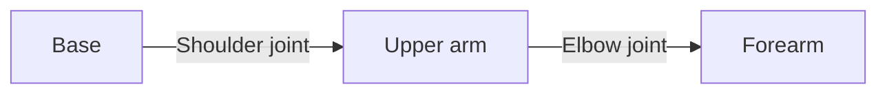

{:class="cover"}

---

By the end of this lesson you will be able to chain a second hinge onto the first to build a two-joint arm, then rename, edit and reorder joints.

One joint is a lever. Two joints is an arm. The second joint works exactly like the first, with one difference: the forearm hangs from the upper arm, not from the base. When the shoulder turns, the elbow and everything past it goes along for the ride.

---

## Make the elbow

1. Click **Home** if the shoulder isn't at zero. Joints are easiest to make at home.
2. Click **Joint**.
3. Click the hole in the **Forearm**, which is still lying on the bed.

The bar says "Made Forearm a component, so the joint can move it".

4. Move the pointer to the hole at the top of the **Upper arm** and click it.

{:class="img-fluid w-100"}

The forearm jumps up onto the upper arm and swings once.

{:class="img-fluid w-100"}

Look at the panel. **Hangs from** now reads Upper arm. BetterCad took that from the part you clicked.

5. Click **OK**.

---

## Name it

6. Click the new joint in the Browser, press **F2**, type `Elbow` and press Enter.

> The new joint is probably called Joint 1 as well. BetterCad numbers a new joint from the names in use, and you renamed the first one. Renaming each joint as soon as you make it avoids two with the same name.

{:class="img-fluid w-100"}

---

## A chain

The Pose section now has two sliders.

7. Drag the **Shoulder** slider.

The upper arm swings, and the forearm goes with it, holding its own angle.

8. Drag the **Elbow** slider.

Only the forearm moves.

This is a **chain**: Base, then Upper arm, then Forearm. Each part's position depends on every joint between it and the base. Robot people call the parts **links**, and you'll meet that word again in the URDF file.

A chain can branch. A robot with two arms has two chains hanging from one body. What it can't do is loop back on itself: each component hangs from exactly one joint. If you try to give a part a second one, BetterCad says "Forearm already hangs from a joint".

---

## The Browser's joint menu

Right-click a joint in the Browser:

| Item | What it does |
|---|---|
| **Hide** | Hides the joint's blue arrow in the view. The eye on its row does the same |
| **Edit joint** | Opens the Joint panel again with everything as you left it |
| **Move earlier**, **Move later** | Reorders the joint among the steps |
| **Roll to here** | Winds the timeline back to just after this joint was made |
| **Rename** | The same as F2 |
| **Suppress** | Switches the joint off without deleting it |
| **Delete** | Removes it |
{:class="table table-single"}

Edit joint is the one you'll use most. Changing a joint's kind, limits or line-up never means starting again.

---

## Components in the Browser

Each component has its own row, with its own Bodies folder inside. Click the eye on a component's row and everything in it hides at once.

Right-click a body and you'll find **Move into** for each component. That's how a second body joins a moving part: model the sensor bracket, then move it into Forearm, and it swings with the forearm from then on.

---

> **Teachers**: this is the lesson where a lost file hurts most, because every later lesson builds on the two-joint arm. Have learners save a `.bcad` file now, with their name in it, and keep it somewhere that survives a shared computer being wiped. Anyone who falls behind can open the downloadable stage files instead of rebuilding.

## Try it Yourself

1. Pose the shoulder at 40 and the elbow at 60. Then swap the numbers. Do the two poses put the tip in the same place?
2. Add a small Library box, then right-click it and move it into Forearm. Pose the elbow and watch it go. Delete the box when you're done.
3. Right-click **Elbow**, choose **Suppress**, and try the sliders. Then switch it back on the same way.

---

## Common Issues

- **Problem**: The forearm joined on but hangs from Base, not the upper arm
- **Solution**: Right-click the joint, choose **Edit joint**, and pick Upper arm under Hangs from
- **Why**: The second click decides what the part hangs from. If it landed on the upright, that's Base

- **Problem**: The forearm sits behind the upper arm, not in front
- **Solution**: You clicked the hole on the other face. Edit the joint and tick **Flip**, or pick the snap again
- **Why**: Parts join face to face, so the face you click decides the side

- **Problem**: Two joints have the same name
- **Solution**: Rename one with F2
- **Why**: A new joint's number comes from the names already in use

---

## Check your understanding


? The elbow joint hangs the forearm from the upper arm. What happens to the forearm when the shoulder turns?
- [ ] It stays where it is
- [x] It moves with the upper arm, keeping its own elbow angle
- [ ] It drops back to the bed
> Each part's position depends on every joint between it and the base.

? How many joints can one component hang from?
- [x] One
- [ ] Two
- [ ] As many as you like
> Chains can branch, but they can't loop.

? How do you change a joint's limits after it's made?
- [ ] Delete it and make it again
- [ ] Edit the numbers in the timeline
- [x] Right-click it and choose Edit joint
> The same panel opens, with everything as you left it.

