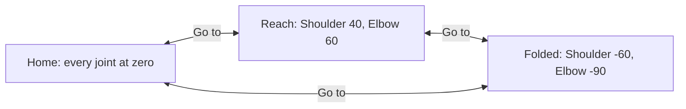

{:class="cover"}

---

By the end of this lesson you will be able to save the positions that matter as named poses, go back to them in a click, and update them later.

Some positions matter more than others. Folded up for the shelf. Reaching out as far as it goes. Gripper over the pen pot. You'll come back to these again and again, to check clearances, to take a screenshot, to show someone how it works.

A **named pose** saves every joint's angle under a name.

---

## Save a pose

1. In the Pose section, set **Shoulder** to `40` and **Elbow** to `60`.
2. Click **Save pose** in the Motion group.

A new row appears in the Browser's **Poses** folder, ready for a name. The bar says "Saved Pose 1. Type a name, or press Enter to keep it."

{:class="img-fluid w-100"}

3. Type `Reach` and press Enter.

Now a second one:

4. Set **Shoulder** to `-60` and **Elbow** to `-90`.
5. Click **Save pose**, type `Folded` and press Enter.

{:class="img-fluid w-100"}

---

## Go to a pose

6. Click **Reach** in the Browser.

The arm moves to it and the bar says "Went to Reach". A small **Now** beside a pose's name shows the model is in that pose. Move any joint and the Now disappears.

**Home** is always in the list. It's the pose with every joint at zero, and it can't be deleted.

---

## Change a pose

Right-click a pose:

| Item | What it does |
|---|---|
| **Go to** | The same as clicking it |
| **Update to the joints now** | Replaces the saved angles with where the joints are at this moment |
| **Rename** | The same as F2 |
| **Delete** | Removes the pose. The joints stay where they are |
{:class="table table-single"}

To adjust a pose: go to it, move the joints, then right-click it and choose **Update to the joints now**.

---

## What poses are for

**Checking.** The clash check can test any named pose without you going to it first. Save the awkward ones and you can test them all after every design change.

**Showing.** A pose is the quickest way to show how a thing moves. Click Folded, click Reach, and someone who has never seen the design understands it.

**Printing a mock-up.** An STL export can be made in the current pose, with **Export as posed** ticked, if you want a one-piece model of the arm mid-reach.

**Planning code.** The angles in a pose are the angles your servos need. Read them from the Pose section and you have the numbers for your first MicroPython test.

---

## Try it Yourself

1. Save a pose called `Up` with the shoulder at 0 and the elbow at 90.
2. Go to Reach, change the elbow to 45, and update the pose. Click Home, then Reach, to check it kept the change.
3. Click through all your poses in turn. Does any of them put the forearm through the base? You'll have a tool for that question shortly.

---

## Common Issues

- **Problem**: Save pose is greyed out
- **Solution**: Make a joint first
- **Why**: A pose is a set of joint angles, and a model without joints has none

- **Problem**: Clicking a pose moved the arm and you lost the position you were setting up
- **Solution**: Press Ctrl+Z, then save the position as a pose before clicking another
- **Why**: Going to a pose sets every joint

- **Problem**: A pose looks wrong after you edited a joint
- **Solution**: Go to the pose, fix it, and update it
- **Why**: A pose stores angles from home. Change a joint's line-up and home moves, so the same angles give a different shape

---

## Check your understanding


? What does a named pose store?
- [ ] A screenshot
- [ ] A copy of every body
- [x] The angle of every joint
> That's why poses are small, and why they follow the design when you change a part.

? What does the small "Now" beside a pose mean?
- [ ] It was saved most recently
- [x] The model is in that pose at the moment
- [ ] It's the home pose
> Move any joint and it disappears.

? How do you change the angles in a saved pose?
- [ ] Double-click it and type
- [x] Go to it, move the joints, then choose Update to the joints now
- [ ] Delete it and the joints follow
> Update replaces the saved angles with the current ones.

