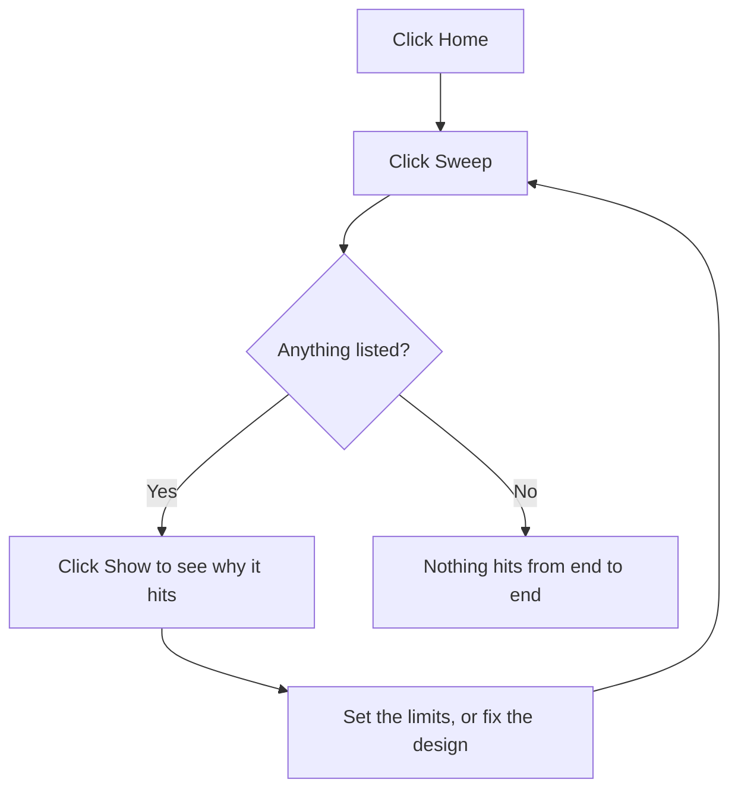

{:class="cover"}

---

By the end of this lesson you will be able to sweep every joint through its range to find collisions, and set safe joint limits in one click.

Checking one pose answers one question. A robot has endless poses, and the one that breaks it is never the one you thought to check.

A **sweep** moves a joint from one end of its range to the other in small steps, checks for clashes at every step, and tells you the exact angles where things collide.

---

## Sweep the arm

The shoulder still has the wide limits from the last lesson, -150 to 150.

1. Click **Home**.
2. Click **Sweep** in the Check group.

BetterCad runs each joint through its range. After a moment the results appear in Properties, under **Sweep the joints**:

{:class="img-fluid w-100"}

- "Upper arm hits Base from -150° to -131.6° on Shoulder"
- "Upper arm hits Base from 131.6° to 150° on Shoulder"

So the shoulder is safe between about -131 and 131 degrees, and in trouble beyond that on both sides. Nothing is listed for the elbow, which means the forearm clears everything across its whole range.

---

## See it

3. Click **Show** beside one of the results.

{:class="img-fluid w-100"}

The arm moves to the angle where the trouble starts and the two parts turn red. Now you can see *why* it hits: here, the bottom corner of the upper arm comes round and meets the base plate.

That tells you what a design fix would look like. Round off that corner, or raise the shoulder a few millimetres, and the safe range grows.

---

## Set the limits in one click

Under the results is a button: **Set the limits to -131° and 131°**.

4. Click it.

The bar says "Set the limits of Shoulder". Edit the joint and you'll find Lower is now -131 and Upper is 131. The slider stops there, a drag stops there, and the URDF file will say so too.

5. Click **Sweep** again.

"Nothing hits from end to end."

That sentence is the goal. When a sweep says it, no single joint can drive the arm into itself.

---

## Sweep settings

| Setting | What it does |
|---|---|
| **Move**: Each joint in turn | Sweeps one joint at a time from end to end, with the others held where they are |
| **Move**: All joints together | Tries a set of poses with every joint moved at once |
| **Move**: one named joint | Sweeps just that one |
| **Step** | How far a joint moves between checks. It starts at 5 degrees |
| **Poses** | For All joints together, how many poses to try. It starts at 200 |
{:class="table table-single"}

**Each joint in turn** is fast, and it's the right first check. But it holds the other joints still, so it only finds clashes along one path. Run it from home, then again from your other named poses.

**All joints together** finds the clashes that need two joints to cooperate, such as a forearm that only folds back into the upright when the shoulder is leaning too. Its results read differently, for example "Upper arm hits Base in 23 of 200 poses", and a clear run says "Nothing hits in 200 poses."

A smaller **Step** finds the edge of a clash more exactly and takes longer. More **Poses** makes a rare clash less likely to slip through, and takes longer too.

---

## Limits from the sweep, or from the servo?

The sweep tells you where the *design* runs out of room. Your servo has limits of its own. Use whichever is tighter:

- Sweep says 131, servo turns 90 each way: set 90. The servo can't get into trouble
- Sweep says 60, servo turns 90 each way: set 60, and make sure your code never asks for more. A servo will happily drive an arm into its own base

For our arm on a standard servo, the honest setting is -90 to 90.

6. Edit **Shoulder** and set the limits back to `-90` and `90`.

---

## Try it Yourself

1. Go to your Reach pose and sweep again with **Each joint in turn**. Do the results differ from the sweep at home?
2. Set **Move** to **All joints together** and sweep. Does it find anything the first sweep missed?
3. Widen the Elbow to -170 and 170 and sweep. Where does the forearm hit, and what does it hit?

---

## Common Issues

- **Problem**: Sweep is greyed out
- **Solution**: Make a joint first
- **Why**: There is nothing to sweep

- **Problem**: The sweep finds nothing, but you can see the arm going through the base
- **Solution**: Check the joint's limits. The sweep only covers the range between Lower and Upper
- **Why**: A sweep tests where the joint is allowed to go, not where it could go without limits

- **Problem**: The sweep takes a long time
- **Solution**: Use a bigger Step or fewer Poses, or press Esc to stop
- **Why**: Every step is a full clash check, and detailed parts such as gears take longer to check

---

## Check your understanding


? What does a sweep do that a clash check doesn't?
- [ ] It checks reference bodies
- [x] It checks every step of a joint's range, not one pose
- [ ] It fixes the clash by changing the parts
> One click covers the whole range and reports the angles where parts hit.

? A sweep with Each joint in turn says "Nothing hits from end to end". Is the arm certain to be clash-free?
- [ ] Yes
- [x] Not quite. Joints moving together can still clash
- [ ] No, sweeps are only a guess
> Each joint was tested with the others held still. All joints together tests them in combination.

? The sweep says the shoulder is clear to 131 degrees. Your servo turns 90 degrees each way. What limits do you set?
- [ ] -131 and 131
- [x] -90 and 90
- [ ] -180 and 180
> Use whichever is tighter, the design's room or the hardware's travel.

