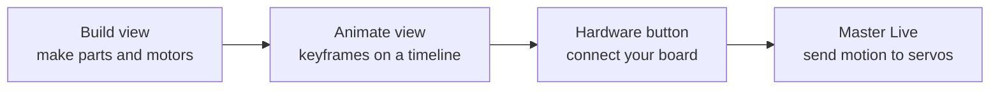

{:class="cover"}

---

By the end of this lesson you will be able to install Bottango, open it, and find your way around its main screen.

Let's get the software onto your computer first. Bottango is the "animation studio" for your robot: you design the movement here, and it sends commands to your board over USB.

## Step 1: Download Bottango

Head to the official site, <https://www.bottango.com>, and use the download link there. Bottango is free to download and runs on Windows, Mac and Linux. The site shows the current version and the system requirements, so check that your computer meets them.

Only download Bottango from the official site. Software from other places may be out of date, or not what it claims to be.

## Step 2: Install Bottango

The exact installer depends on your system and version, so follow the instructions on the download page. Here is what Kev saw:

### On Windows

1. Double-click the downloaded installer or the extracted program.
2. If Windows Defender SmartScreen warns you, click **More info**, then **Run anyway**. This warning appears for lots of small independent programs. Only do this for a file you downloaded from the official site.
3. Launch Bottango when it is ready.

### On macOS

1. Open the download and drag the **Bottango** app into your **Applications** folder.
2. On first launch, macOS may warn that it cannot check the app. Right-click Bottango, choose **Open**, then click **Open** again to confirm.

> **Note**: menus and installers change between versions. If your screen looks a little different, the official [Bottango docs](https://docs.bottango.com) are the final word.

## Step 3: Launch Bottango

When Bottango opens you will see the start screen, with **New Studio Project**, **Open A Project**, the Bottango kits and links to the community.

{:class="img-fluid w-100"}

Click **New Studio Project** (or open one of the examples) and you will reach the working screen. Here is a project open in the Animate view:

{:class="img-fluid w-100"}

Look at the top bar: there are buttons for **Animate**, **Import**, **Build** and **Learn**, plus a **Hardware** button and a **Master Live** switch. On the left, the **Parts** panel lists the structure of your character, including its servos. On the right, the **Animations** panel lists your animations. We will use all of these in the coming lessons.

## Common Issues

- **Problem**: Windows or macOS refuses to open Bottango.
- **Solution**: Use the right-click **Open** route on a Mac, or **More info** then **Run anyway** on Windows, and only for a file from the official site.
- **Why**: Both systems warn about apps from developers they do not recognise. The warning is not a sign the app is broken.

- **Problem**: Bottango crashes or will not start.
- **Solution**: Check the system requirements on the official site, update your graphics drivers, and re-download the latest version.
- **Why**: Bottango shows a 3D view, so an old graphics driver is a common cause of trouble.

> **Teachers**: installing software usually needs administrator rights on school computers. Ask your IT team to install Bottango before the lesson, and check the licence terms on the Bottango site for classroom use.

## Try it Yourself

1. Open Bottango and click around the top bar. Which buttons can you find?
2. Open one of the example or kit projects and press play on an animation. Watch the 3D character move.
3. Challenge: find the **Learn** button and see what help it offers.

## Check your understanding


? Where should you download Bottango from?
- [ ] Any file-sharing site that has it
- [x] The official Bottango website
- [ ] The Arduino IDE library manager
> The lesson says to download only from the official site, because other copies may be old or not what they claim to be.

? Which operating systems does Bottango run on, according to its site?
- [ ] Windows only
- [ ] Windows and Mac only
- [x] Windows, Mac and Linux
> The official site lists all three.

? What does the Parts panel show?
- [ ] The audio files in your project
- [x] The structure of your character, including its servos
- [ ] The list of installed Arduino libraries
> The Parts panel on the left lists your character's structure and servos. The Animations panel is on the right.

