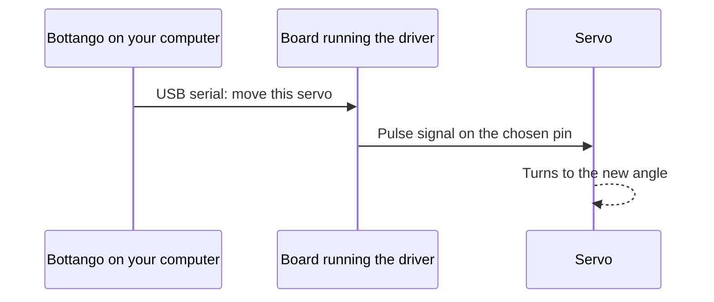

{:class="cover"}

---

By the end of this lesson you will be able to put the Bottango driver on a board and connect the app to it.

Bottango does not run on the board itself. Instead, the board runs a small open-source program called the **Bottango Arduino driver**. The app sends it commands over USB ("move servo 1 to this angle") and the driver turns them into servo signals.

## Which board?

The Bottango docs have a **Supported Microcontrollers** page, so check it for the current list. Two boards come up again and again in the docs and in this course:

- **Arduino Uno R3**: the Bottango docs say it handles up to 8 servos directly, or 5 when you add a PCA9685 servo board.
- **ESP32-based boards**: the docs say these handle 16 servos out of the box.

If you want more servos than one board can handle, you can split them across several boards. Other Arduino-compatible boards may work, but check the Supported Microcontrollers page before you buy.

## Step 1: Connect your board

Plug the board into your computer with a USB cable. Use a **data-capable** cable, because some cables only charge and carry no data.

## Step 2: Put the driver on the board

The Bottango docs describe uploading the driver with the Arduino IDE:

1. Download the Bottango Arduino driver from the links in the [Bottango docs](https://docs.bottango.com) (look under Hardware Drivers, Preparing a Driver).
2. **Fully extract the zip file** to a normal folder before you open anything.
3. Open the driver sketch (the `.ino` file) in the Arduino IDE.
4. Choose your board and port under **Tools**.
5. Click **Upload**.

> **Note**: earlier versions of this lesson described an installer button inside Bottango. We could not confirm that in the current docs, which use the Arduino IDE route above. If your version of Bottango has a built-in installer, the docs will say so.

## Step 3: Connect the app to the board

In Bottango, click the **Hardware** button at the top of the window, then choose the serial port your board is on. The Hardware window has status and driver tabs that show whether Bottango can talk to the board. The exact layout can change between versions, so follow the Hardware Drivers pages in the docs if yours differs.

Once connected, the **Master Live** switch in the top bar controls whether the movement you make in Bottango is sent to the real servos.

## Common Issues

- **Problem**: The Arduino IDE says `src/BottangoCore.h: No such file or directory`.
- **Solution**: Fully extract the downloaded zip first, then open the sketch from the extracted folder.
- **Why**: On Windows the sketch can be run from inside the zip, where it cannot find its other files. This is listed in the official Common Problems page.

- **Problem**: The board does not appear in the port list.
- **Solution**: Try a different USB cable (one that carries data) and a different USB port.
- **Why**: Charge-only cables have no data wires, so the computer never sees the board.

- **Problem**: Upload fails with a port busy error.
- **Solution**: Close the Arduino Serial Monitor and any other program using the port.
- **Why**: Only one program can use a serial port at a time.

> **Teachers**: school computers often block USB serial devices and driver installs. Test one machine with a board before the lesson. Keep a few known-good data cables in the kit, because charge-only cables are the most common reason a whole group is stuck.

## Try it Yourself

1. Find the **Supported Microcontrollers** page in the Bottango docs and check that your board is on it.
2. Upload the driver to your board, then write down the port name it used.
3. Open **Hardware** in Bottango and select that port. What status does it show?
4. Challenge: with the board connected, unplug the USB cable and watch what Bottango reports.

## Check your understanding


? What does the Bottango Arduino driver do?
- [ ] It replaces the Bottango app on your computer
- [x] It runs on the board and turns commands from the app into servo signals
- [ ] It makes the board charge faster
> The app sends commands over USB and the driver on the board makes the servo signals.

? You get `src/BottangoCore.h: No such file or directory`. What should you try first?
- [ ] Buy a different board
- [x] Fully extract the zip file and open the sketch from the extracted folder
- [ ] Reinstall Bottango
> This error usually means the sketch is being run from inside the zip file.

? How many servos can an Arduino Uno R3 handle directly, according to the Bottango docs?
- [ ] 2
- [x] 8
- [ ] 16
> The docs say 8, or 5 with a PCA9685. The 16 figure is for ESP32 boards.

