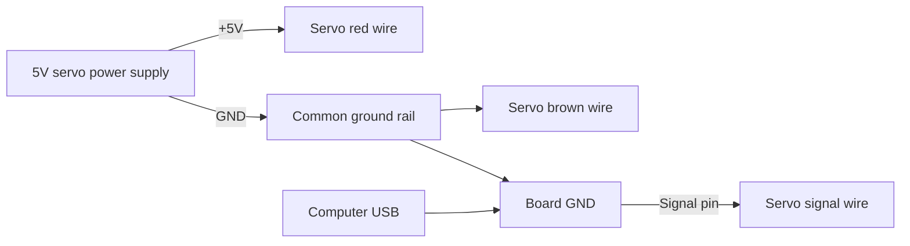

{:class="cover"}

---

By the end of this lesson you will be able to wire one or more servos to your board, powered from a separate supply with a common ground.

Servos are the muscles of your project. They move parts back and forth in response to the motion you create in Bottango. Wiring them takes five minutes, but powering them properly is the step that decides whether your project works or keeps resetting.

## Servo wires

Most hobby servos have three wires:

| Wire colour | Job |
|-------------|-----|
| Brown or black | Ground (GND) |
| Red | Power (usually 5V) |
| Orange or yellow | Signal |
{:class="table table-single"}

Colours vary between makers, so check your servo's datasheet before you plug in. Plugging a servo in backwards can damage it.

## The golden rule: do not power servos from your board

The Bottango docs have a page headed "Don't Power Servos from Your Microcontroller!" It is the single most important wiring rule in this course. Servos can draw far more current than a board's pins or regulator can supply, especially when they are pushing against a load or are stalled. Powering them from the board can make it reset, overheat or get damaged. Powering them from a computer's USB port is no better, because the port may shut down.

So use a **separate power supply** for the servos, sized for the voltage of your servos (most small hobby servos are 5V) and the maximum current your build could draw with everything moving at once.

## The common ground

The signal wire only makes sense if the board and the servo agree where "zero volts" is. So **connect the ground of the servo supply to the ground of the board**. The wiring is:

| Connection | Goes to |
|------------|---------|
| Servo red wire | Positive (+5V) of the servo supply, not the board's 5V pin |
| Servo brown or black wire | Ground of the servo supply |
| Servo signal wire | A signal pin on the board, for example D3, D5 or D6 on an Uno |
| Servo supply ground | Also joined to a GND pin on the board |
{:class="table table-single"}

Use one signal pin per servo. For example, servo 1 on D3, servo 2 on D5 and servo 3 on D6. Avoid D0 and D1 on an Uno, as the board uses them for USB communication.

## ESP32 boards

ESP32 signal pins work at **3.3V**, and they are not 5V tolerant, so never feed 5V back into a signal pin. Power the servos from the separate supply as above, join the grounds, and connect each servo's signal wire to a suitable GPIO pin. Check your board's pinout diagram, because some pins have special jobs.

## Testing

When you have set up your servos in the next lesson, use the slider to test each one. If a servo behaves badly, switch off the supply and check the wiring before you do anything else.

## Common Issues

- **Problem**: The servo twitches or the board keeps resetting.
- **Solution**: Power the servos from a separate supply, and check the board is not feeding them.
- **Why**: Servos draw sudden bursts of current when they start or strain, which pulls down the voltage the board needs to stay alive.

- **Problem**: The servo jitters or moves to random positions.
- **Solution**: Join the ground of the servo supply to the board's ground.
- **Why**: Without a shared ground the signal has no reference, so the servo reads noise as commands.

- **Problem**: The servo does not move at all.
- **Solution**: Check power, ground and signal in turn, then check the pin you chose in Bottango matches the pin you wired.
- **Why**: Any one of the three wires missing will stop the servo, and a pin mismatch sends the signal to the wrong place.

- **Problem**: The servo hums, grinds or gets hot at the end of its travel.
- **Solution**: Stop the movement, and reduce the servo's range in Bottango so the arm never hits a stop.
- **Why**: A servo pushing against a hard stop is stalled, and a stalled servo draws its maximum current and can strip its gears.

> **Teachers**: servo supplies are low voltage, but power rules matter. Use a regulated 5V supply or a battery pack made for servos, never mains wiring. Switch the supply off before changing wires, keep fingers away from moving horns, and watch for hot servos and short circuits between supply rails. Mixing up the red and brown wires can destroy a servo, so check each build before power goes on. Keep a spare servo in the kit.

## Try it Yourself

1. Draw your own wiring diagram for one servo, labelling the supply, board and ground connections.
2. Wire a single servo with a separate supply and a shared ground, then check each connection against your diagram.
3. Look up your servo's datasheet and write down its voltage range and wire colours.
4. Challenge: plan the supply for three servos. Which number from the datasheet do you need to size the supply?

## Check your understanding


? Why should servos not be powered from your board?
- [ ] Servos need 12V
- [x] They can draw more current than the board can safely supply
- [ ] Bottango will not detect them
> The Bottango docs warn that servos can easily draw much more current than a microcontroller can handle.

? What is a common ground for?
- [ ] It makes the servos stronger
- [x] It gives the board and the servo supply the same zero-volt reference
- [ ] It replaces the signal wire
> The signal wire only makes sense when both sides share the same ground.

? A servo grinds at the end of its travel. What is the likely cause?
- [ ] The USB cable is charge-only
- [x] It is pushing against a stop, so it is stalled
- [ ] The Hardware window is closed
> A stalled servo draws high current and can damage its gears, so reduce the range.

