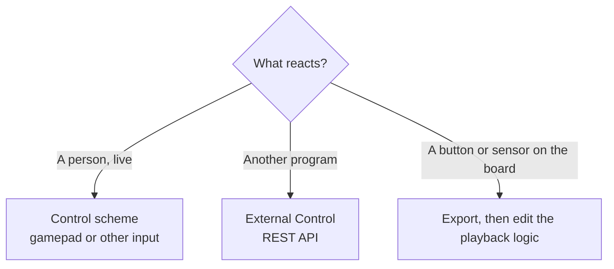

{:class="cover"}

---

By the end of this lesson you will be able to choose the right way to make a Bottango animation react to a person, a button or another program.

So far your animations play when you press play. But a good prop reacts: a visitor presses a button, and the parrot waves. Bottango gives you several routes to interactivity, and picking the right one saves a lot of head-scratching.

> **Note**: Kev's original version of this lesson described a **Triggers** panel with keyboard, gamepad and GPIO triggers. We could not find a panel of that name in the current official docs, which describe the routes below instead. If your version of Bottango has a Triggers panel, the same ideas apply. Check the [Bottango docs](https://docs.bottango.com) for your version.

## Route 1: Live control with a control scheme

The docs describe a **control scheme** as a set of mappings between parts and inputs. You map an input, such as a gamepad stick, to a servo, and move it in real time. You can record that movement as keyframes, or just perform it live. We will do this properly in lesson 9.

**Good for**: puppeteering, live shows, and recording natural movement by hand.

## Route 2: Control from another program

Bottango has an **External Control** section in the docs, including a **REST API** (a way for other programs on your network to send Bottango commands) and **SMPTE LTC** timecode for syncing to show equipment. The docs also list the REST API as a recording input.

**Good for**: connecting Bottango to a computer program, a show controller or a web page.

## Route 3: Playback logic on the board

When you export your animations (lesson 8), the export workflow has a step to **configure playback settings**. This is where you decide how the exported animations are played back. Because the exported code is Arduino-compatible and the driver is open source, you can also modify the playback logic to react to a button or sensor.

**Good for**: standalone props that need no computer.

## Thinking in events

Whatever route you pick, design your animations as **short pieces with a clear start and end**. A wave, a nod and a blink are three small animations you can mix and match, much like clips in a video editor. A long animation with everything in it is hard to react to.

A good rule is to start and end each short animation in the same neutral pose, so any one can follow any other without a jump.

## Common Issues

- **Problem**: I cannot find the Triggers panel from older tutorials.
- **Solution**: Look at control schemes, External Control and the export playback settings in the current docs.
- **Why**: Bottango changes between versions, and features move or get new names.

- **Problem**: My animations jump when one follows another.
- **Solution**: Start and finish every short animation in the same neutral pose.
- **Why**: If an animation ends somewhere else, the next one has to snap the servo to its own start.

- **Problem**: Everything works on the computer but not on the board alone.
- **Solution**: Remember that the board only has the animations you exported, and the computer's input devices are not connected to it.
- **Why**: A gamepad is plugged into the computer, so it cannot control a board running standalone.

> **Teachers**: the REST API lets other programs control hardware over the network. On a school network, check your policy first, keep the setup on an isolated or local network, and do not leave an open control port reachable by other classes.

## Try it Yourself

1. Make three short animations, such as a nod, a shake and a wave. Make them all start and end in the same pose.
2. Play them one after another. Is there any jump between them?
3. Look up the control scheme pages in the docs and write down what inputs are supported.
4. Challenge: draw a plan for a motion-activated Halloween prop. Which route would you use, and why?

## Check your understanding


? According to the docs, what is a control scheme?
- [ ] A wiring diagram
- [x] A set of mappings between parts and inputs
- [ ] An audio file format
> The lesson quotes this as the docs' definition.

? Which route suits a standalone prop with no computer?
- [ ] A control scheme with a gamepad
- [ ] The REST API
- [x] Exporting animations and configuring playback on the board
> A gamepad and the REST API need a computer, but the exported code runs on the board.

? Why should short animations start and end in the same pose?
- [x] So one can follow another without a jump
- [ ] To save memory on the computer
- [ ] Because Bottango requires it
> If an animation ends somewhere else, the next one snaps the servo to its start.

