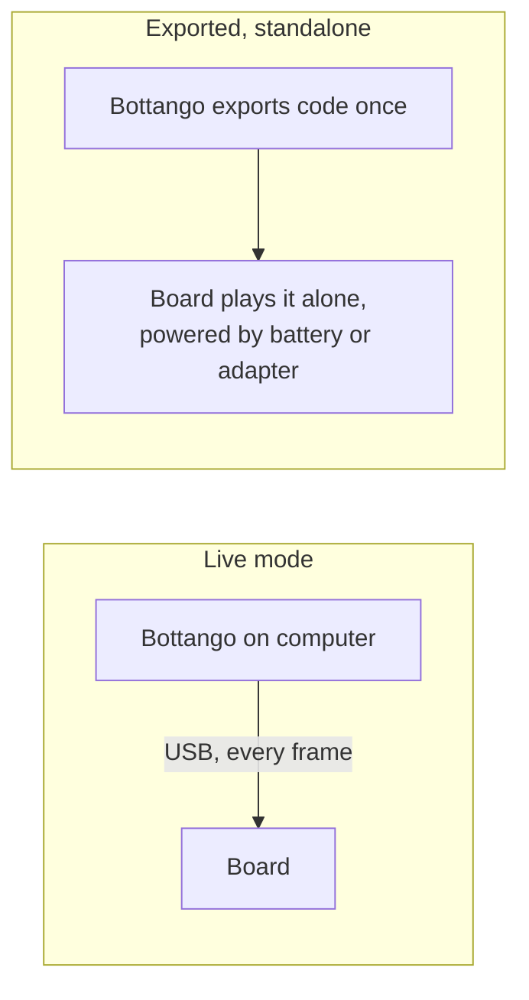

{:class="cover"}

---

By the end of this lesson you will be able to export an animation from Bottango and explain how a board plays it without a computer.

Until now Bottango has needed a live USB link to your board. That is great for building, but a Halloween prop or a costume cannot drag a laptop around. The answer is to **export** your animations as code that runs on the board by itself.

## How the export works

According to the Bottango docs, the **Exporting Animations** workflow starts from the animation view, where all your animations are listed. Click the **Export Animations** button to begin. There are four steps:

1. **Select included animations**: choose which animations go into the output.
2. **Select included effectors**: choose the servos and other parts that the animations use.
3. **Configure playback settings**: decide how the animations should play back.
4. **Select format and export**: choose the output format and export.

The docs explain that hardware controllers have limited memory, so include only the animations you really need.

> **Note**: earlier versions of this lesson described a **File > Export for Arduino Mode** menu that produced an `.ino` file and a `lib` folder. We could not confirm that in the current docs, which describe the Export Animations workflow above. If your version of Bottango is different, follow the Exporting Animations pages at [docs.bottango.com](https://docs.bottango.com).

## Put the exported code on the board

The exported output is Arduino-compatible code that works with the open-source Bottango driver. You upload it as you did the driver in lesson 2:

1. Follow the instructions Bottango gives you at the end of the export.
2. Open the result in the Arduino IDE.
3. Choose the right board and port under **Tools**, and click **Upload**.
4. Power the board from a battery or adapter, with the servos on their own supply.

If your board has no computer attached, the Bottango driver's playback logic runs the animation you exported.

## Add your own logic

Because the driver is open source and the exported playback logic is real Arduino code, you can change it. For example, you could start an animation when a button is pressed or a motion sensor fires. The Bottango docs have a **Custom Playback Logic** page under the firmware modification section for this. Only make changes like this once the unchanged export works.

## Tips for standalone mode

- Keep animations short and loopable.
- Export only the animations you need.
- Test the animation live first, so you know the motion is safe.
- Re-export after every change, because the board only plays what you last uploaded.

## Example: a Halloween jaw

1. Animate a jaw opening and closing.
2. Export it and put it on the board.
3. Power the board from a battery pack and the servo from its own supply.
4. Optional: add a sensor in the playback logic so it starts when someone walks past.

## Common Issues

- **Problem**: The animation plays from Bottango but nothing happens after exporting.
- **Solution**: Check the exported code uploaded successfully, the servo pins match your wiring and the servo supply is on.
- **Why**: A standalone board has no computer to tell it what to do, so any mismatch shows up straight away.

- **Problem**: The export is too big or fails.
- **Solution**: Export fewer animations and fewer parts.
- **Why**: Boards have limited memory.

- **Problem**: I changed my animation but the board plays the old one.
- **Solution**: Export again and upload the new code.
- **Why**: The board runs the code you last uploaded.

- **Problem**: The prop restarts or behaves oddly on battery power.
- **Solution**: Check the servo supply can deliver enough current, and the grounds are joined.
- **Why**: A weak supply sags when the servo moves, which can reset the board.

> **Teachers**: standalone props are great for projects, but they run unattended. Make sure batteries are secured and fitted by an adult or teacher-checked, keep moving parts away from fingers and hair, and put a clear switch on the supply. Allow a full lesson for this, as exporting, uploading and testing takes longer than expected.

## Try it Yourself

1. Export one short animation and put it on your board.
2. Unplug the USB from the computer, power the board another way, and check the animation plays.
3. Change the animation, then export and upload again. Confirm you see the new movement.
4. Challenge: read the Custom Playback Logic page in the docs. What would you change to start your animation with a button?

## Check your understanding


? Why do you export animations?
- [ ] To make Bottango run faster
- [x] So the board can play them without a computer
- [ ] To change the servo's wire colours
> Exported code runs on the board by itself.

? Why should you include only the animations you need when you export?
- [ ] Bottango can only export one
- [x] Hardware controllers have limited memory
- [ ] It makes the servos quieter
> The docs say hardware has limited memory.

? You edit an animation in Bottango but the board plays the old one. What should you do?
- [x] Export again and upload the new code
- [ ] Turn Master Live off
- [ ] Rename the servo
> The board only runs the last code you uploaded.

