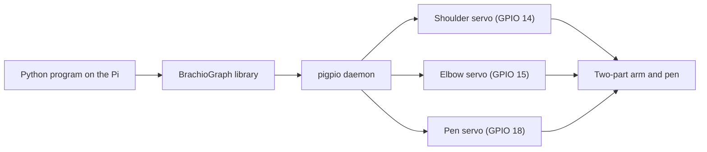

{:class="cover"}

---



By the end of this lesson you will be able to describe how a BrachioGraph draws, and check that you have everything you need to build one.

## Overview

A BrachioGraph (from the Greek *brachio*, arm, and *graph*, draw) is a pen plotter you can build at home for very little money. It was designed by Daniele Procida, and the project is open source. Two hobby servos swing a two-part arm, a third servo lifts and lowers the pen, and a Raspberry Pi tells all three what to do from a Python program.

The arm is made from lolly sticks, card and hot glue, so the drawings are a little wobbly. That is part of the charm, and it is also what makes it such a good teaching robot: every wobble has a cause you can find and fix, with better building or better code.

The software is the official BrachioGraph library, which lives in the evildmp/BrachioGraph repository on GitHub. The official documentation is at [brachiograph.art](https://www.brachiograph.art/), and this course follows it closely, so keep it open in another tab.

---

## Course Content

- Building the base, inner arm, outer arm and pen lift
- Wiring three servos to the Raspberry Pi GPIO pins
- Installing the BrachioGraph library and the pigpio service
- Moving the arm with angles and lowering the pen
- Drawing boxes and test patterns, then calibrating the plotter
- Turning ordinary images into plottable line drawings with `linedraw`

---

## Key Results

After completing this course, you will be able to:

- Build a working pen plotter from lolly sticks, card, servos and a Raspberry Pi
- Wire three hobby servos to the correct GPIO pins
- Install the BrachioGraph library and start the pigpio service
- Move the arm and pen from Python and read the plotter status
- Calibrate the plotter using parked pulse-widths, hysteresis correction and degrees-per-pulse-width values
- Vectorise a picture and plot it

---

## What you'll need

| Item | Notes | Quantity |
| --- | --- | --- |
| Hobby servos | The official docs recommend TowerPro SG90 | 3 |
| Raspberry Pi | With a GPIO header, power supply, microSD card. Pi OS Bullseye Lite is what the official install steps were tested on | 1 |
| Lolly (popsicle) sticks or stiff card | For the two arms | A few |
| Clothes peg | Holds the pen | 1 |
| Foam board, card or similar | A4-sized base | 1 |
| Jumper wires | To reach from servos to the GPIO header | 1 pack |
| Pen or pencil | Fine tip works best | 1 |
| Hot glue gun | With glue sticks | 1 |
{:class="table table-single"}

Tools: a ruler, a pencil, scissors, and a small drill or bradawl for pilot holes in the arms (optional). You will also need a computer to write the SD card, and a keyboard, mouse and monitor for the Pi, or a way to connect to it over SSH.

> **Which Pi?** The official install page does not name Pi models, and the original version of this course used a Raspberry Pi 3+. We could not confirm from the pigpio or BrachioGraph sources how pigpio behaves on the newest Pi models and OS releases, so if you have a recent Pi, check [brachiograph.art](https://www.brachiograph.art/) and the pigpio project first. The virtual plotter in lesson 5 needs no servos at all.

---

## How the course works

You build the hardware first, then bring it to life in code.

1. **Build** the base, arms and pen lift
2. **Wire** the servos to the Pi
3. **Set up** the Pi and install the library
4. **Code** your first movements
5. **Draw** boxes, test patterns and calibrate
6. **Vectorise** images and plot them

Every lesson opens with an objective, finishes with exercises, common problems, and a short quiz. Code blocks marked as complete programs can be saved and run on the Pi. Short snippets are meant to be typed into the Python prompt (the REPL) while the plotter is running. The Run button on the web page cannot work with this course, because the code needs the BrachioGraph library and the pigpio service, which only exist on your Pi.

> **Teachers**: This course suits ages 11 and up, in pairs or threes, and works well as a half-term project. Allow about 60 to 90 minutes for the build lesson (hot glue needs time to set), 30 minutes for wiring, 45 for the Pi setup and 45 to 60 minutes per coding lesson. Per group you need one full kit from the table above plus a Pi, power supply and screen. Hot glue guns and craft knives need supervision, and wiring should always be done with the Pi switched off. With no hardware, a class can still do lessons 4 to 6 using the virtual plotter described in lesson 5, though the Pi still needs the library installed.

---

## Prerequisites

This course assumes you can use a keyboard and a terminal a little. If the command line is new to you, try [Introduction to the Linux Command Line on Raspberry Pi OS](/learn/linux_intro/) first. Basic Python helps, and [Python for beginners](/learn/python/) covers it.

---

## What's Next

After this course, try:

- [Wall Drawing Robot Tutorial](/learn/scrawly_wally/) for a very different drawing robot
- [Building a Robot Arm with Raspberry Pi and PCA9685](/learn/pca9685/) for a bigger servo arm
- [Robotics 101](/learn/robotics_101/) for the wider picture
- [Python for beginners](/learn/python/) to get more from the code

Let's get building!

---
