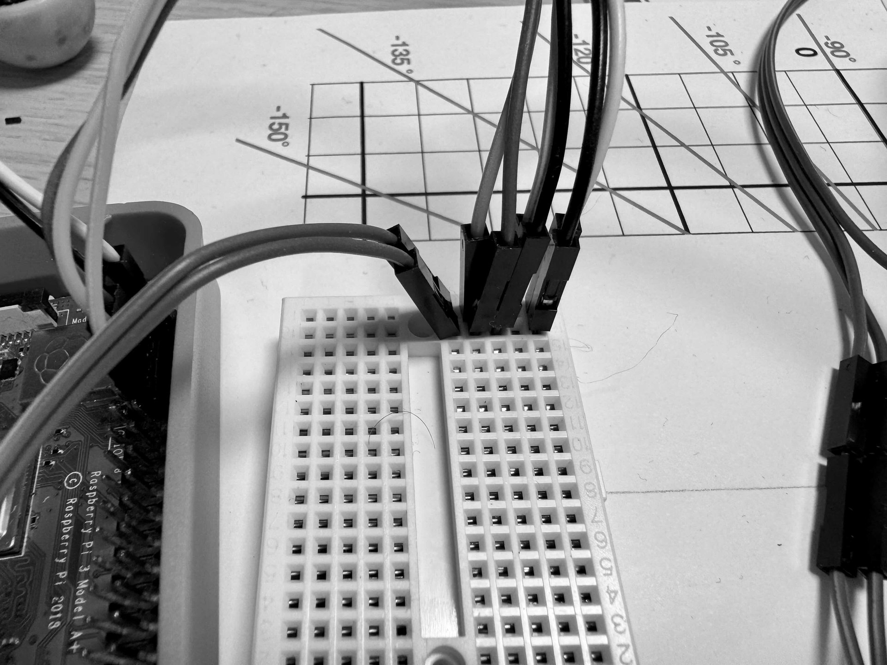
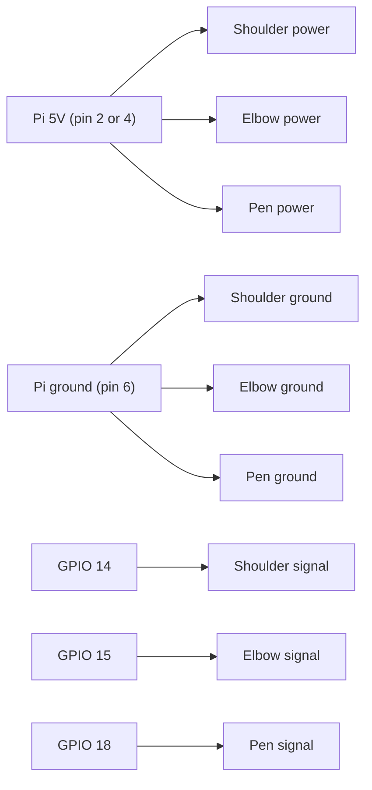
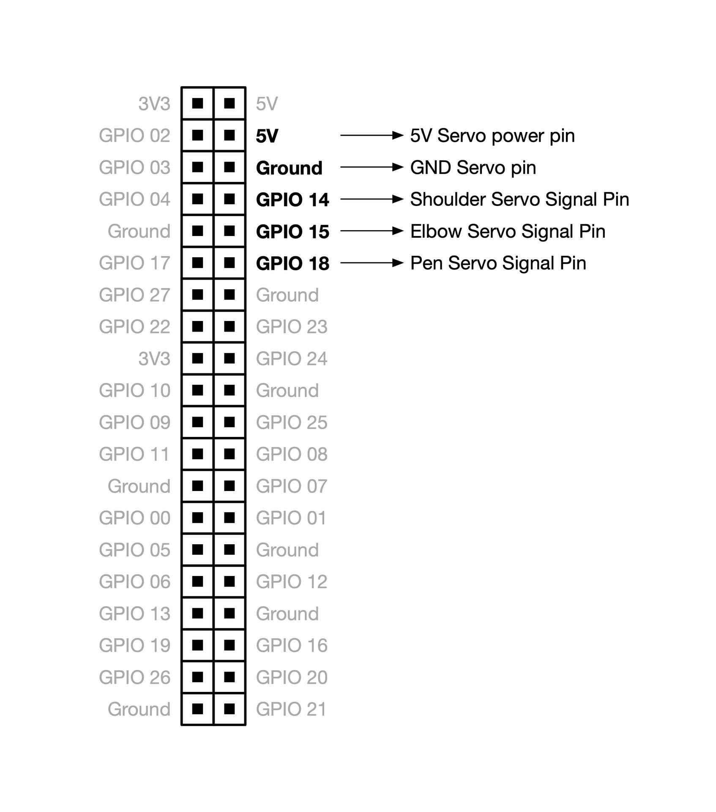
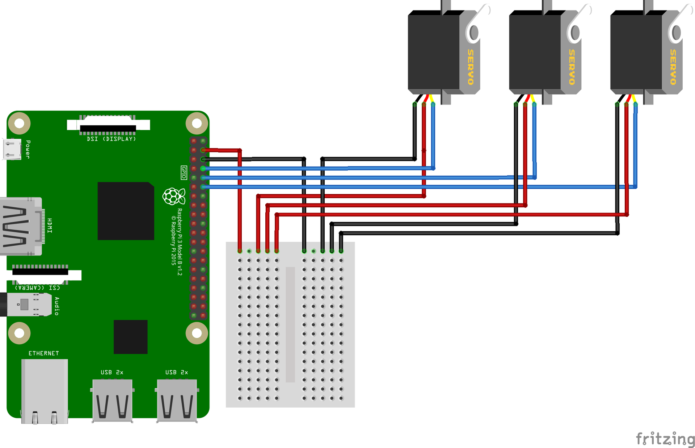
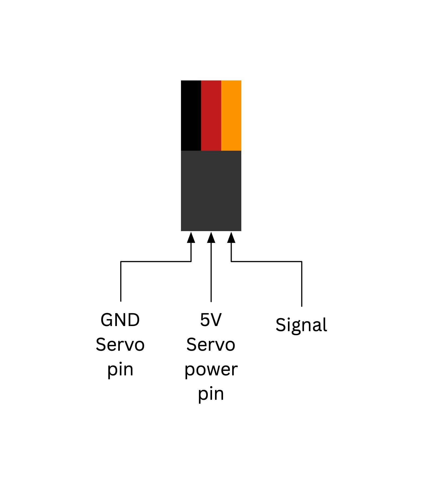

{:class="cover"}

---

By the end of this lesson you will be able to wire the shoulder, elbow and pen servos to the correct Raspberry Pi pins and explain what the power, ground and signal wires do.

{:class="w-100 card-hover card-shadow rounded-3"}

---

## What a servo's three wires do

A hobby servo has three wires. Two carry power and the third carries the signal that says where to turn.

| Wire | Usual colour | Goes to |
| --- | --- | --- |
| Power (5V) | Red or orange | A 5V pin on the Pi |
| Ground | Brown or black | A ground pin on the Pi |
| Signal | Yellow, orange or white | A GPIO pin, one per servo |
{:class="table table-single"}

Colours vary between makers, so check yours. The signal wire carries a stream of pulses, and the pulse width (how long each pulse lasts) tells the servo what angle to move to. You will see "pulse-width" a lot from now on.

---

## The wiring table

This matches the official [wiring page](https://www.brachiograph.art/tutorial/wiring/), and the pins the BrachioGraph library uses.

| Servo | Signal wire goes to | Physical pin |
| --- | --- | --- |
| Shoulder | GPIO 14 | 8 |
| Elbow | GPIO 15 | 10 |
| Pen lift | GPIO 18 | 12 |
| All three 5V wires | A 5V pin | 2 or 4 |
| All three ground wires | A ground pin | 6, 9, 14, 20, 25, 30, 34, 36 or 39 |
{:class="table table-single"}

The Pi only has two 5V pins, so at least two servos have to share one. The official guide suggests making a small "loom" from jumper cables so that all the 5V wires meet at one connector and all the ground wires at another. A small breadboard can do the same job. Use the photos and pinout images below to check which pins are which.

{:class="w-100 card-hover card-shadow rounded-3"}

{:class="w-100 card-hover card-shadow rounded-3"}

{:class="w-50 card-hover card-shadow rounded-3"}

> **Teachers**: Always wire with the Pi switched off and unplugged, and have a second person check each connection before power goes on. A 5V wire pushed onto a signal pin can damage the Pi, and a shared kit means several pairs of hands on the same header. The official guide powers all three servos from the Pi's own 5V pins. If a Pi in your classroom reboots when the servos move, that is a sign they are drawing too much current, so ask a teacher or technician about a separate 5V supply rather than experimenting. Whatever supply you use, its ground must be joined to the Pi's ground.

---

## Try it Yourself

1. Without wiring anything, point at each pin on the pinout image: physical pin 2, pin 8, pin 10, pin 12 and pin 6. Which GPIO number does each belong to?
2. Label three pieces of masking tape "shoulder", "elbow" and "pen" and stick one on each servo lead before you connect it.
3. Challenge: write down what you would check, in order, if only the pen servo failed to move when you reach lesson 4.

---

## Common Issues

- **Problem**: A servo doesn't move at all later on.
- **Solution**: With the Pi off, check that its red wire is on a 5V pin, its ground wire is on a ground pin, and its signal wire is on the right GPIO pin from the table.
- **Why**: All three connections must be good for a servo to respond.

- **Problem**: The Pi reboots, or the servos twitch, when they move.
- **Solution**: Power the Pi from a good supply. If it still happens, the servos need more current than the Pi's 5V pins can give, so use a separate 5V supply for them, with its ground joined to the Pi's ground.
- **Why**: Moving servos draw current spikes that can pull the Pi's supply voltage down.

- **Problem**: Only one servo behaves, or the wrong joint moves.
- **Solution**: Swap the signal wires into the order in the table: shoulder on GPIO 14, elbow on GPIO 15, pen on GPIO 18.
- **Why**: The library sends each servo's pulses to a specific pin.

- **Problem**: A servo moves the opposite way to what you expect.
- **Solution**: Don't rewire it. Direction is handled by calibration in lesson 5.
- **Why**: The sign of the degrees-per-pulse-width setting takes care of mirrored mounting.

---

## Check your understanding


? Which GPIO pin does the elbow servo's signal wire go to?
- [ ] GPIO 14
- [x] GPIO 15
- [ ] GPIO 18
> Shoulder is GPIO 14, elbow is GPIO 15 and the pen lift is GPIO 18.

? Why should the Pi be switched off while you wire the servos?
- [ ] The servos need to cool down
- [x] A wire in the wrong place on a live Pi can damage it
- [ ] The Pi can't see new wires until it reboots
> The GPIO pins are easily damaged by a power wire on a signal pin, so wire with the power off and check before switching on.

? What do the pulses on a servo's signal wire tell it?
- [ ] How fast to spin forever
- [x] Which angle to move to
- [ ] How much power to draw
> The pulse width sets the angle, which is why the library talks about pulse-widths.

