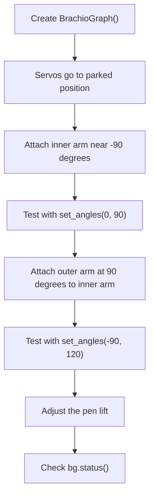
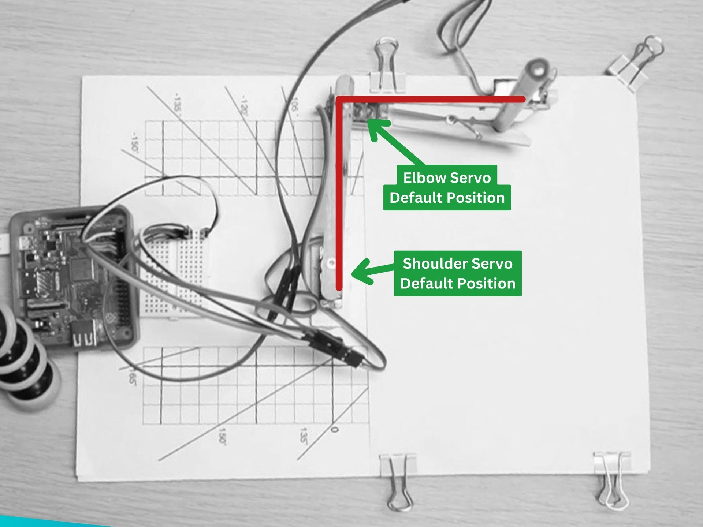

{:class="cover"}

---

By the end of this lesson you will be able to create a BrachioGraph in Python, attach each arm at its default angle, move the servos with `set_angles()`, and raise and lower the pen.

## Meet the plotter in Python

Everything starts with one object. Creating a `BrachioGraph` tells the library to set the shoulder and elbow servos to their default "parked" position (a pulse-width of 1500 microseconds each, the middle of most servos' range). That is why we have not glued the arms on yet.

> **Warning**: Detach the inner arm from the servo before you create the plotter for the first time. The official docs warn that the machine may flail when the servos are energised.

Start the service and the environment as in lesson 3:

```bash
sudo pigpiod
source env/bin/activate
cd BrachioGraph
python
```

Then, at the Python prompt:

```python
from brachiograph import BrachioGraph

bg = BrachioGraph()
```

The motors buzz as they move to their default positions. The variable `bg` is your plotter, and everything else in this course is a method on `bg`.



---

## Attach and test the inner arm

Push the inner arm onto the shoulder servo so that it sits as close as possible to -90 degrees on the grid. It won't be exact, and calibration in lesson 5 deals with that.

{:class="w-100 card-hover card-shadow rounded-3"}

Now test it. `set_angles(a, b)` takes the inner arm angle first and the outer arm angle second:

```python
bg.set_angles(0, 90)
```

The inner arm should swing clockwise to about 0 degrees. Bring it back with:

```python
bg.park()
```

`park()` also raises the pen. The arm moves quickly because `set_angles()` goes straight to the new angle with no easing.

---

## Attach and test the outer arm

Attach the outer arm so it sits as close to 90 degrees from the inner arm as you can. Test with:

```python
bg.set_angles(-90, 120)
```

The outer arm should swing clockwise by about 30 degrees from where it was. Park again with `bg.park()`.

---

## Raise and lower the pen

Put a pen in the clothes peg, then try:

```python
bg.pen.down()
bg.pen.up()
```

Adjust the pen servo horn and the position of the pen in the peg until the pen firmly touches the paper when down, and clears it by a millimetre or two when up. You can also pass `pw_up` and `pw_down` pulse-width values when creating the plotter, if you need to change how far the servo travels.

---

## Read the status report

```python
bg.status()
```

You get a table of pulse-width, angle and hysteresis correction for each servo (servo 1 is the shoulder, servo 2 is the elbow), then whether the pen is up or down, and the plotting area. Something like this, though your numbers will be different:

```text
------------------------------------------
                      | Servo 1 | Servo 2
                      | Shoulder| Elbow
----------------------|---------|---------
          pulse-width |    1500 |    1500
                angle |     -90 |      90
hysteresis correction |     0.0 |     0.0
------------------------------------------

------------------------------------------
pen: up
------------------------------------------
bottom left: (-8, 4) top right: (6, 13)
------------------------------------------
```

The last line is the default drawing area in centimetres from the shoulder spindle.

---

## A complete first program

Here is the whole routine as a script you can save as `first_move.py` in the `BrachioGraph` folder and run with `python first_move.py`. It moves the arm, puts the pen down and up, and parks.

```python
import time

from brachiograph import BrachioGraph

bg = BrachioGraph()

bg.set_angles(0, 90)
time.sleep(1)

bg.set_angles(-90, 120)
time.sleep(1)

bg.pen.down()
time.sleep(1)
bg.pen.up()

bg.park()
bg.status()
```

> **Teachers**: Servos can be moved by hand and pinch fingers, so keep fingers clear when the program starts. Pairs share one plotter, so agree who types and who watches the arm. If your Pi is shared, make sure only one student starts `pigpiod`.

---

## Try it Yourself

1. Change the angles in `first_move.py` to `(45, 45)`, then `(-45, 135)`. Which position reaches furthest from the base?
2. Add a line that raises the pen, moves to a new angle and lowers it again. Does the pen mark the paper where you expect?
3. Run `bg.status()` after each move and write down how the angles change.
4. Challenge: find the angle pairs that point the arm straight forward, left and right. Write them on your template next to the 0,0 point.

---

## Common Issues

- **Problem**: `ModuleNotFoundError: No module named 'brachiograph'`.
- **Solution**: Run Python from inside the `BrachioGraph` folder, with `(env)` showing in your prompt.
- **Why**: The library is the `brachiograph.py` file in the repository, so Python only finds it from there.

- **Problem**: Nothing moves and there is no error.
- **Solution**: Run `sudo pigpiod`, then restart Python and create the plotter again. Also check the wiring against lesson 2.
- **Why**: Without the daemon the library switches to a virtual plotter.

- **Problem**: The arm goes to the wrong place.
- **Solution**: Expect this at first. The horns can't be fitted at exactly the right angle, so you fine-tune with parked pulse-widths in lesson 5.
- **Why**: A servo spindle has teeth, so the arm lands within a tooth or so of ideal.

- **Problem**: The servos buzz at rest.
- **Solution**: Check the mechanical joints aren't binding. The library also has a `quiet()` method for switching servo pulses off, which you can look up in the plotter reference.
- **Why**: A servo holding a position keeps working against any force that pushes it away from that position.

---

## Check your understanding


? Why do we detach the inner arm before creating the plotter?
- [ ] The library can't find the arm otherwise
- [x] The servos jump to their default position and the arm might flail
- [ ] The pen would run out of ink
> The servos move as soon as the plotter is created, so the arm is attached afterwards.

? In `bg.set_angles(0, 90)`, which number is the inner arm angle?
- [x] 0, the first
- [ ] 90, the second
- [ ] Both are for the outer arm
> The first value is the inner arm angle, the second is the outer arm angle.

? Which call lifts the pen off the paper?
- [ ] bg.pen.down()
- [x] bg.pen.up()
- [ ] bg.park()
> `bg.pen.up()` raises the pen, and `bg.park()` also raises it while returning to the park position.

