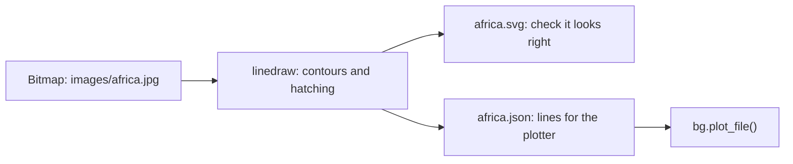

{:class="cover"}

---

By the end of this lesson you will be able to convert a bitmap image into a JSON line file with `image_to_json()`, preview it, and plot it with `bg.plot_file()`.

## Pictures are not plottable, lines are

A photo is a grid of coloured pixels. A pen plotter can only follow lines, so it needs a different kind of data: a list of lines, where each line is a list of points. Turning pixels into lines is called vectorising. The `linedraw.py` module in the BrachioGraph repository does it for you, finding the contours (outlines) of the image and filling areas with hatching.



---

## Install OpenCV

`linedraw` needs OpenCV, which is not in `requirements.txt`. With your virtual environment active, install it:

```bash
pip install opencv-python-headless
```

> **Teachers**: This download is large and slow on a busy school network, so install it once on a prepared SD card image. Photos of people used in class should be ones students have permission to use.

---

## Convert an image to JSON

Run Python in the `BrachioGraph` folder and write a short program. Save this as `vectorise_africa.py`. The repository's `images` folder holds example images, so use one of those, or put your own image there:

```python
from linedraw import image_to_json

image_to_json("images/africa", draw_contours=2, draw_hatch=16)
```

This finds `africa` (as `.jpg`, `.png` or `.tif`) in the `images` folder, draws its contours and hatch lines, and writes two files: `africa.json` for the plotter and `africa.svg` for you to look at. Open the SVG in a browser to check it before you spend ten minutes plotting.

The two numbers set the detail. A value of 0 switches that feature off, and lower values give more detail. The official suggestions:

- `draw_contours`: start at 2, then try values from 0.5 to 4.
- `draw_hatch`: start at 16, then try values from 8 to 16.

---

## Emphasise the edges

To make outlines stand out, repeat the contours in the file:

```python
from linedraw import image_to_json

image_to_json("images/africa", draw_contours=2, draw_hatch=16, repeat_contours=3)
```

With `repeat_contours=3` the contour data is added three times, so the pen goes over the edges three times. That works especially well with pencil drawings.

---

## Plot it

Start the plotter as in the earlier lessons, then plot the JSON file with your plotter object:

```python
from custom import bg

bg.plot_file("images/africa.json")
```

If you don't have a `custom.py` yet, create a plain `BrachioGraph()` instead. Wait for the whole drawing to finish before you move the paper.

---

## Work with the lines directly

If you want to process the lines in your own code, use `vectorise()`, which returns the list of lines and also writes an SVG:

```python
from linedraw import vectorise

lines = vectorise("images/africa.jpg", draw_hatch=16, draw_contours=2)
print(len(lines), "lines")
```

Preview how the plotter will draw them with Python's turtle graphics. It is slower than the real plotter, but it needs no servos:

```python
from linedraw import vectorise, draw

lines = vectorise("images/africa.jpg", draw_hatch=16, draw_contours=2)
draw(lines)
```

---

## Try it Yourself

1. Vectorise `africa` with `draw_hatch=0`, then again with `draw_contours=0`. What does each setting contribute?
2. Put your own photo in the `images` folder, vectorise it, and compare its SVG to the original.
3. Try `repeat_contours=3` and plot a small area of the file to see the difference.
4. Challenge: use `vectorise()` and `len(lines)` to compare how many lines three different settings produce, and guess which plot takes longest.

---

## Common Issues

- **Problem**: `ModuleNotFoundError: No module named 'cv2'`.
- **Solution**: Run `pip install opencv-python-headless` with the virtual environment active.
- **Why**: OpenCV is not in the standard requirements file.

- **Problem**: The plot takes ages or the SVG looks messy.
- **Solution**: Raise `draw_hatch` and `draw_contours`, or turn hatching off with 0.
- **Why**: Lower values mean more detail, which means many more lines to draw.

- **Problem**: The image file isn't found.
- **Solution**: Check it is in the `images` folder and that you called it from the `BrachioGraph` folder.
- **Why**: The path is relative to where Python runs.

- **Problem**: The drawing is too big or off the paper.
- **Solution**: Check the plotter bounds with `bg.status()`, and preview with the SVG and `draw()` first.
- **Why**: The plotter can only draw within its calibrated area.

---

## Check your understanding


? What does vectorising an image mean?
- [ ] Making the image bigger
- [x] Turning pixels into lines the plotter can follow
- [ ] Changing the colours
> A pen plotter follows lines, so the image has to become a list of lines made of points.

? Which setting makes edges stand out more by drawing them several times?
- [ ] draw_hatch
- [x] repeat_contours
- [ ] draw_contours=0
> `repeat_contours=3` repeats the contour data three times in the JSON.

? Which output file is for checking the result before plotting?
- [ ] africa.json
- [x] africa.svg
- [ ] custom.py
> The SVG shows you what the vectorised drawing looks like. The JSON is what the plotter reads.

