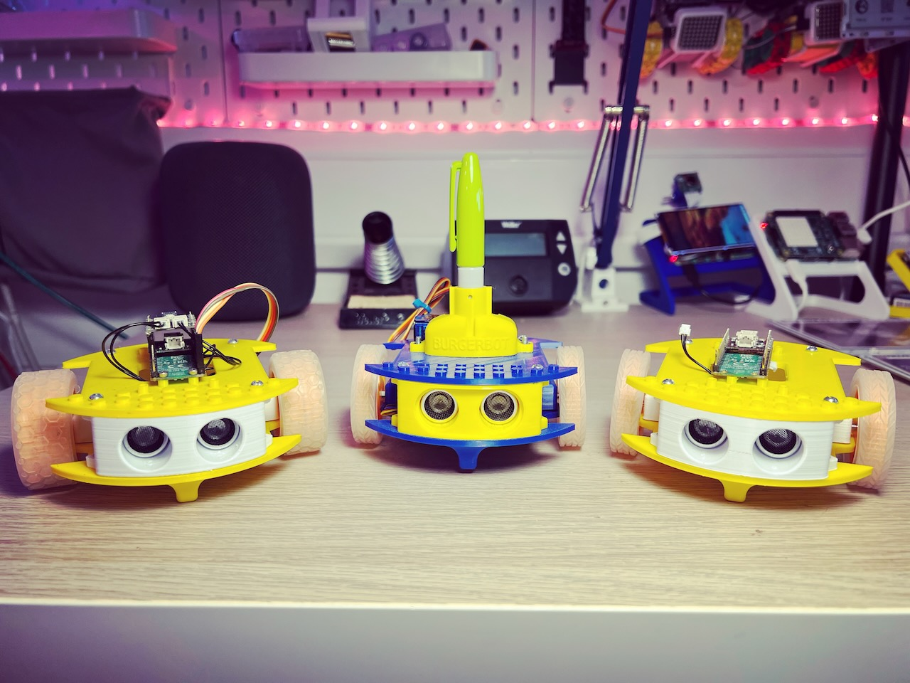

{:class="cover"}

---

By the end of this lesson you will be able to name the parts of BurgerBot, say what each one does, and find the files you need to print.

---

`BurgerBot`, as the name suggests, is a Burger-shaped robot. BurgerBot is quick and easy to print and assemble, with a low build cost and is designed for education and hobbyists. The Raspberry Pi Pico and Pico W board power the robot making it easy to program with MicroPython.

---

{:class="img-fluid w-100"}

---

## The 3D printable parts

BurgerBot is made up of some quick to print pieces:

Part                          | Description
------------------------------|-----------------------------------------------------------------------------------------------------------------------------------------------------------------------------------------------------
The Base                      | Has two solid casters to prevent the robot from tipping over.
Motor Holder                  | The two motor holders are used to secure the motors to the base with 2x M3 nuts and bolts, each
Range Finder Holder           | This is the face of the robot and holds the ultrasonic range finder in place
Rear Support / Battery Holder | The rear support provides a platform for the top section to attach to. In v2 of burgerbot this also holds the Pico and the Galleon Battery pack.
Top section                   | The top section completes the basic robot build. There are alternative top sections depending on whether the burgerbot has the pen module attached, the keypad module, or the original pico holder.
{:class="table table-code-fit"}

---

## The other parts

Here are the list of electronics and other parts:

Part | Description
----|---
Moon Buggy Wheels             | The wheels are the 'moon buggy' type and provide good grip and traction to the robot
Motors                        | 2x motors are required to drive the robot, they can be the N20 type or the MMME variety
Raspberry Pi Pico             | The brains of the robot this can be either the wireless or non-wireless version
Ultrasonic Range Finder | The distance sensor, an HC-SR04P (the 3.3V version)
Some female to female dupont cables | These enable the range finder to be connected to the Pico
{:class="table table-code-fit"}

It uses two Micro Metal Motors which connect to the [Motor SHIM for Pico](https://collabs.shop/cinmes) from Pimoroni, and a Galleon Battery, which connects to the [LiPo SHIM for Pico](https://collabs.shop/6pumih).

BurgerBot has an ultrasonic rangefinder mounted at the front; however, this needs to be the 3.3V variant, because the Pico's pins can't handle the 5V signal from a standard HC-SR04. The wiring is covered in the [Measuring Distance](06_measuring_distance.html) lesson.

> **Check your motor driver board.** The parts list uses the Pimoroni Motor SHIM for Pico. The current `burgerbot.py` library drives each motor with one speed (PWM) pin and one direction pin, which is not how the Motor SHIM's DRV8833 chip is controlled. [Getting the code](03_getting_the_code.html) explains the pins the library expects, so read it before you buy or wire a motor driver.

BurgerBot also features two moon-buggy wheels that attach directly to the motors. In addition, there are two little 'nubs' underneath to stop the robot from falling over backwards or forwards.

The original top section has four mounting holes to secure the Pico using four M2 screws.

---

## STL files

Here are the parts for BurgerBot v2, the version shown in the build video:

* [Bottom](/assets/stl/burgerbot_v2/bottom.stl)
* [Motor Holder](/assets/stl/burgerbot_v2/motor_holder.stl) - print 2 of these
* [Battery Holder](/assets/stl/burgerbot_v2/battery_holder.stl)
* [Range Finder Holder](/assets/stl/burgerbot_v2/range_finder.stl)
* [Top](/assets/stl/burgerbot_v2/top.stl) or [Top with mudguards](/assets/stl/burgerbot_v2/top_with_mudguards.stl)

The parts for the original BurgerBot are still available too:

* [Base](/assets/stl/burgerbot/base.stl)
* [Motor Holder](/assets/stl/burgerbot/motor_holder.stl) - print 2 of these
* [Top Section](/assets/stl/burgerbot/top_section.stl)
* [Rear Support](/assets/stl/burgerbot/support.stl)
* [Range Finder Holder](/assets/stl/burgerbot/rangefinder.stl)

---

## Try it Yourself

1. Look at the two parts tables. Which printed part holds the sensor, and which holds the Pico and battery in v2?
2. Open the v2 STL files in a slicer. How long does each part take to print on your printer? Add them up so you know when to start printing.
3. Challenge: the original BurgerBot has the Pico on top, and v2 puts it inside the rear support. Which is better for adding the pen module, and why?

---

## Common Issues

- **Problem**: The range finder works on the bench but the Pico stops responding, or gets hot
- **Solution**: Check that you bought the 3.3V HC-SR04P and not a standard 5V HC-SR04
- **Why**: A standard HC-SR04 sends a 5V echo signal into a Pico pin that can only take 3.3V

> **Teachers**: 3D printing is the slowest part of this course. The parts take several hours to print in total, so plan for a print queue and start a week ahead, or ask a local maker space to print them. Print one set per robot and a spare motor holder, because the small parts are the ones that fail.

---

## Check your understanding


? Why does BurgerBot need the 3.3V version of the HC-SR04 range finder?
- [ ] It's smaller and fits the holder
- [x] The Pico's GPIO pins can't safely take the 5V signal from a standard HC-SR04
- [ ] The 3.3V version measures further
> The Pico is a 3.3V device, and a 5V echo signal could damage its input pin.

? How many motor holders do you print for BurgerBot?
- [ ] One
- [x] Two, one for each motor
- [ ] Four
> The STL list says to print 2 motor holders, one for each motor.

? What stops BurgerBot tipping forwards or backwards?
- [ ] The battery weight
- [ ] The range finder holder
- [x] Two small nubs underneath the base
> The base has two solid nubs underneath that act as casters.


---
