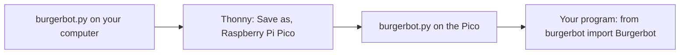

{:class="cover"}

---

By the end of this lesson you will be able to copy `burgerbot.py` onto the Pico with Thonny and prove it works with a short test program.

---

## Uploading the code

To upload the `burgerbot.py` file to a Raspberry Pi Pico using [Thonny](https://thonny.org), follow these steps:

1. Connect the Raspberry Pi Pico to your computer using a USB cable.
1. Open Thonny on your computer.
1. Go to the **Tools** menu and select **Options**.
1. In the **Options** window, go to the **Interpreter** tab.
1. Select **MicroPython (Raspberry Pi Pico)** from the list.
1. Click **OK** to close the **Options** window.
1. Go to the **File** menu and select **Open**, then open `burgerbot.py` from your computer.
1. Go to the **File** menu and select **Save as**, choose **Raspberry Pi Pico**, and save it as `burgerbot.py`.
1. Create a new file, type `from burgerbot import Burgerbot` and run it with the green **Run** button. If there's no error, the library is installed.



---

## Test it

Before you test the motors, stand the robot on a small box so the wheels are in the air. Then save and run this program:

```python
from burgerbot import Burgerbot

bot = Burgerbot()
print("BurgerBot is ready. Speed is", bot.speed)

bot.forward(1)    # both wheels should turn forward for a second
bot.stop()
print("Distance ahead:", bot.distance)
```

You should see the message in Thonny's shell, both wheels turn for a second, and then a distance reading. If the robot is not wired up yet, run only the first three lines.

> ## Make it run on its own
>
> Save a program on the Pico as `main.py` and it will run automatically whenever the robot is switched on, without a computer attached.

---

## Try it Yourself

1. Run the test program, then change `bot.forward(1)` to `bot.backward(1)`. Which way do the wheels turn?
2. Save the test program on the Pico as `main.py`, unplug the USB cable and power the robot from the battery. Does it run on its own?
3. Challenge: add a line that prints `bot.line_detected`. What does it say with nothing connected to the line sensor?

---

## Common Issues

- **Problem**: Thonny does not show a Pico to connect to
- **Solution**: Check the cable is a data cable, not charge only, and that MicroPython is installed on the Pico
- **Why**: Thonny talks to the Pico over USB, and only MicroPython firmware answers

- **Problem**: `ImportError: no module named 'burgerbot'`
- **Solution**: In **Save as**, choose **Raspberry Pi Pico**, not **This computer**, and name the file exactly `burgerbot.py`
- **Why**: The file has to be on the board's filesystem to be imported

- **Problem**: The wheels spin and the robot drives off the desk
- **Solution**: Test with the wheels in the air, then run on the floor
- **Why**: `forward()` does not stop the motors, so the robot keeps going until you call `stop()`

> **Teachers**: school computers often block installing Thonny or the USB connection, so ask IT beforehand. Use one Pico per pair, label the Picos, and have learners test with the wheels in the air so robots do not leave the desk.

---

## Check your understanding


? Where must `burgerbot.py` be saved so that `import` finds it?
- [ ] On your computer's desktop
- [x] On the Pico itself
- [ ] In the Thonny folder
> Python imports from the board it is running on, so the file must be on the Pico.

? What does saving a file as `main.py` on the Pico do?
- [x] It runs automatically when the robot is switched on
- [ ] It deletes `burgerbot.py`
- [ ] It makes the robot drive faster
> The lesson explains that `main.py` runs on its own whenever the robot is switched on.

? Why test with the wheels in the air?
- [ ] It saves battery
- [x] `forward()` does not stop the motors, so the robot could drive away
- [ ] The motors only work off the ground
> The motors keep running until `stop()` is called.


---
