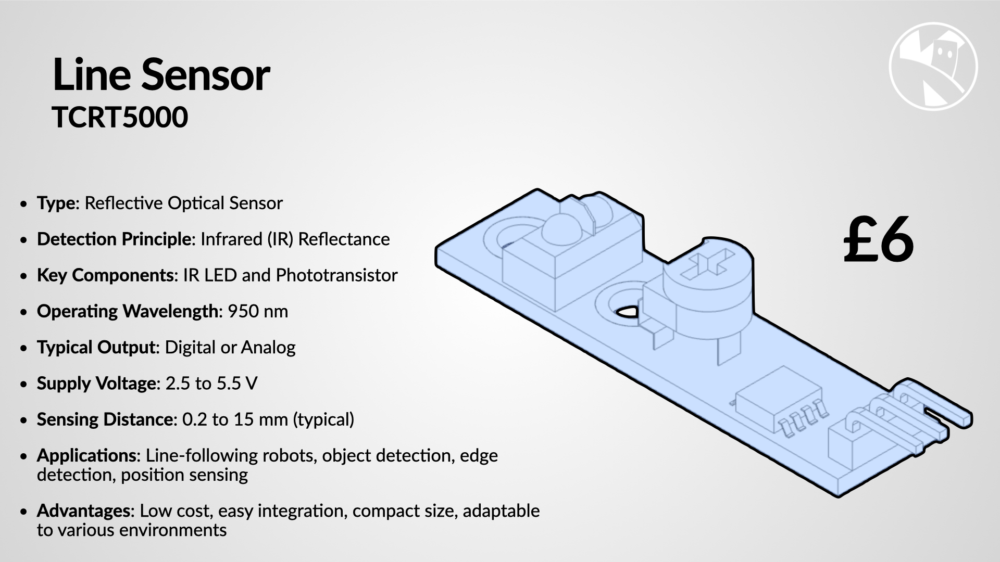
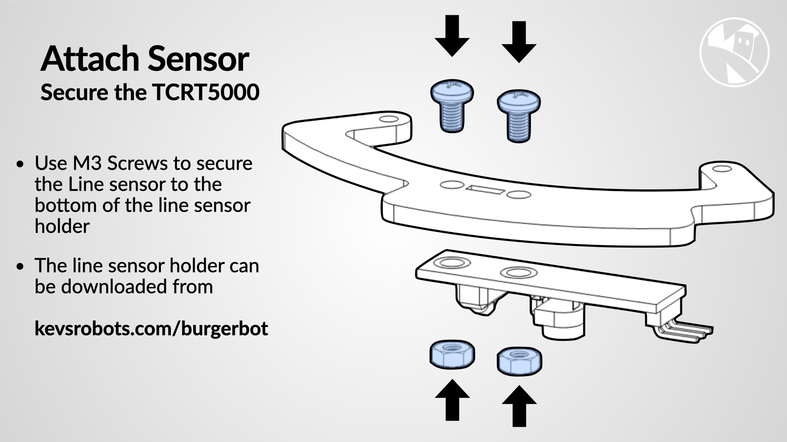
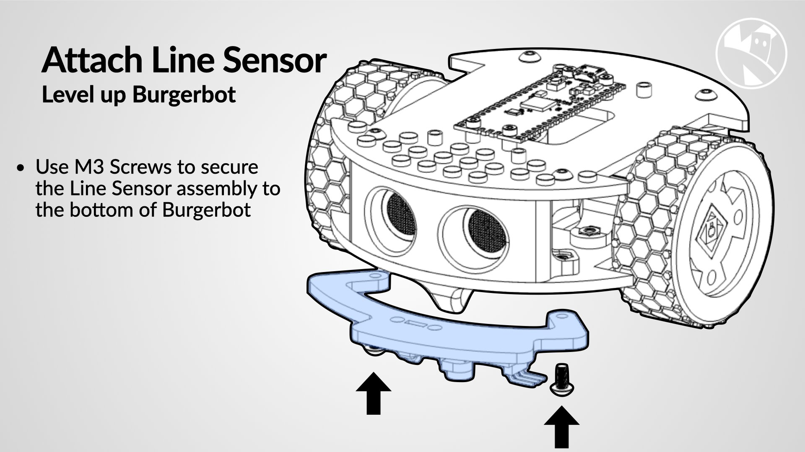
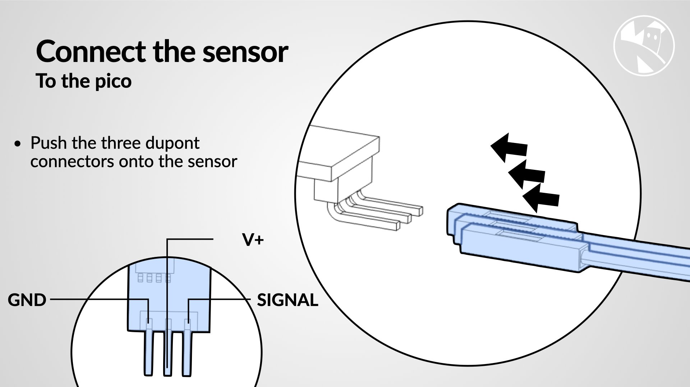
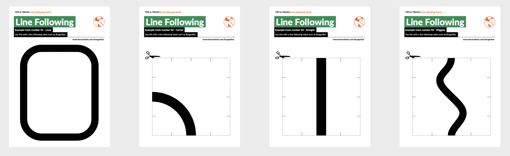

{:class="cover"}

---

By the end of this lesson you will be able to explain how the TCRT5000 line sensor works, and fit it to BurgerBot with its printed holder.

---

## Line following Upgrade

A great upgrade for BurgerBot is a line following sensor. The TCRT5000 module has an infrared LED that shines down at the floor and a sensor that measures how much light bounces back. White paper reflects a lot, a black line reflects very little, so the module's output tells your program whether the robot is over the line. Mounted under the front of the robot, it lets BurgerBot follow a track you draw or print.

The steps below show how to fit it. Build it first, then follow the wiring and code in the next lesson.

Step | Detail
---|---
[{:class="img-fluid w-100"}](assets/line01.jpg) | Learn about the TCRT5000 sensor
[{:class="img-fluid w-100"}](assets/line02.jpg) | Attach the sensor
[{:class="img-fluid w-100"}](assets/line03.jpg) | Attach the sensor assembly to the robot
[{:class="img-fluid w-100"}](assets/line04.jpg) | Connect the sensor to the Pico
{:class="table table-striped"}

---

## Download the 3d printable Line following sensor holder

Click here to download the 3D printable parts:

* [`line_sensor_holder.stl`](/assets/stl/burgerbot_v2/line_sensor_holder.stl) - 40 minute print time

You will also need 2 M3 screws and 2 M3 nuts.

---

## Purchase the sensor

To purchase a [TCRT5000 click here](https://shop.pimoroni.com/products/line-tracking-sensor-tcrt5000-module).

---

## Download the Tracks PDF

{:class="img-fluid w-50 shadow-lg"}

Download the line following tracks [PDF here](assets/tracks.pdf)

Print it on plain paper and lay it flat on a table or the floor. Once you have the code running, you can also draw your own track with a thick black marker or tape.

> **Teachers**: the sensor holder is a short print, but the tracks need large sheets of paper, so print on A3 if you can or tape A4 pages together. Run the robot on a floor track rather than a desk so it cannot drive off, and keep the track flat, because curled paper confuses the sensor. Several robots can share a room, but give each its own track.

---

## Try it Yourself

1. Hold the sensor over white paper, then over the black line, and watch the small LED on the module (if yours has one). What changes?
2. Look at the tracks PDF. Which track do you think is the easiest to follow, and which is the hardest, and why?
3. Challenge: draw your own track with sharp corners and a gentle curve. Where do you expect the robot to struggle?

---

## Common Issues

- **Problem**: The sensor doesn't seem to notice the line
- **Solution**: Check it is mounted facing down, close to the paper, and use a dark, matt line
- **Why**: The sensor measures reflected infrared light, so a shiny line or a large gap to the floor weakens the signal

- **Problem**: The sensor reacts to the room's lighting
- **Solution**: Turn the small potentiometer on the module to adjust its sensitivity, and avoid direct sunlight
- **Why**: Sunlight contains infrared light that can swamp the sensor's own reflected light

---

## Check your understanding


? What does the TCRT5000 measure?
- [ ] How far away the line is
- [x] How much infrared light bounces back from the floor
- [ ] The colour of the line
> A black line reflects much less light than white paper, so the sensor can tell them apart.

? Which part do you print for this upgrade?
- [x] The line sensor holder
- [ ] The camera holder
- [ ] The cog wheel
> The lesson lists `line_sensor_holder.stl`.

? Why is a flat, matt line best?
- [ ] It looks nicer
- [x] Shiny or curled surfaces reflect light unpredictably
- [ ] The robot can't read matt paper
> A weak or unpredictable reflection makes the sensor's output unreliable.


---

---
