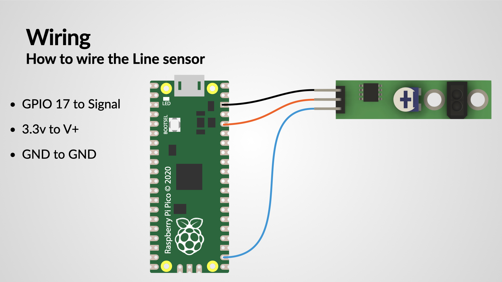

{:class="cover"}

---

By the end of this lesson you will be able to wire the line sensor to GP17 and run a program that follows the edge of a line.

---

## Wiring up the Line sensor

Attach the following wires to the Pico:

Pico GPIO Pin | Line Sensor | Comments
--------------|------------|---
3.3v out      | V+ | Solder the end of a female dupont cable to the 3.3v out on the Pico
GND           | GND | Solder the end of a female dupont cable to the ground (GND) out on the Pico
GPIO 17       | Signal| Solder the end of a female dupont cable to GPIO 17 on the Pico
{:class="table table-code-fit"}

[{:class="img-fluid w-100"}](assets/wiring.jpg)

## MicroPython code

The TCRT5000 shines infrared light at the floor and measures how much bounces back. A black line reflects much less than white paper, so the sensor's output changes when it's over the line. The library reads this for you with `bot.line_detected`.

With one sensor, the trick is to follow the *edge* of the line: turn one way while you can see the line, and the other way when you can't. The robot wiggles along the edge.

```python
from burgerbot import Burgerbot

bot = Burgerbot()
bot.speed = 0.25          # go slowly so we don't overshoot the line

while True:
    if bot.line_detected:
        bot.left_motor(bot.speed)    # on the line: left wheel drives, right stops, so it curves right
        bot.right_motor(0)
    else:
        bot.left_motor(0)            # off the line: right wheel drives, so it curves left
        bot.right_motor(bot.speed)
```

We slow the robot down so it doesn't go too fast and miss the line, and the loop checks the sensor as often as it can.

> ## Wrong way round?
>
> Depending on your sensor, `line_detected` may be `True` over white instead of black. If the robot spins in circles, swap the two halves of the `if`.

---

## Try it Yourself

1. Try different values for `bot.speed`. What's the fastest your BurgerBot can go and still stay on the line? Most TCRT5000 modules also have a small potentiometer for adjusting sensitivity.
2. Swap the two halves of the `if` and see what the robot does. Why does it go wrong?
3. Add a `print(bot.line_detected)` to the loop. How fast do the values change as the robot wobbles along the edge?
4. Challenge: stop the robot if the line has been missing for more than two seconds. Hint: `ticks_ms()` and `ticks_diff()` from the `time` module.

---

## Common Issues

- **Problem**: The robot spins in circles
- **Solution**: Swap the two halves of the `if`, or turn the sensitivity potentiometer
- **Why**: Some sensors report `True` over white instead of black

- **Problem**: The robot leaves the track on bends
- **Solution**: Lower `bot.speed`
- **Why**: With one sensor the robot can only see 'on' or 'off', so it needs time to correct before the line moves away

- **Problem**: The sensor never sees the line
- **Solution**: Check the wiring: V+ to 3.3V, GND to GND and Signal to GP17
- **Why**: The library reads GP17, so the signal wire must be there

> **Teachers**: the robot runs in a tight loop and doesn't stop on its own, so run it on a floor track, never on a desk, and press Stop in Thonny (or lift the robot) to end the program.

---

## Check your understanding


? How does a single-sensor line follower stay on track?
- [ ] It drives straight and stops when it loses the line
- [x] It follows the edge, turning one way on the line and the other way off it
- [ ] It uses the range finder to see the line
> One sensor can only tell 'on' from 'off', so the robot zig-zags along the edge of the line.

? Which Pico pin does the line sensor's signal wire connect to?
- [ ] GP16
- [x] GP17
- [ ] GP1
> The wiring table connects Signal to GPIO 17.

? Why do we slow the robot down?
- [x] So it doesn't go too fast and miss the line
- [ ] To save the motors
- [ ] Because the sensor only works slowly
> The lesson says we slow the robot so it doesn't overshoot the line.


---
