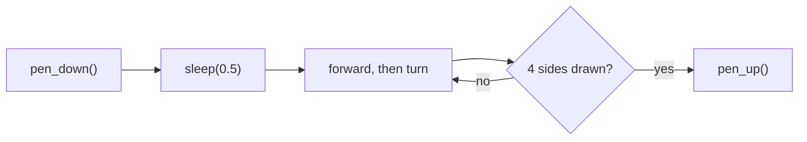

{:class="cover"}

---

By the end of this lesson you will be able to fit the pen mechanism, wire the servo to GP16, and make BurgerBot draw a square.

---

## Watch the video



---

## The pen upgrade

BurgerBot can carry a felt-tip pen in the middle of the robot. A small SG90 servo raises and lowers it, so the robot can draw as it drives, a bit like the classic Logo turtle.

Because the pen sits between the wheels, BurgerBot can turn on the spot without smudging a curve into your drawing.

---

## Parts

* An SG90 servo
* A Sharpie or similar felt-tip pen
* 3D printed [servo holder](/assets/stl/burgerbot_v2/servo_holder.stl), [pen holder](/assets/stl/burgerbot_v2/pen_holder.stl) and [cog wheel](/assets/stl/burgerbot_v2/cog_wheel.stl)
* M3 nuts and bolts

The servo turns the cog, which pushes the pen holder up and down. Fit the servo holder to the robot, slide in the pen holder, then add the cog to the servo. Test fit the pen so it slides freely but doesn't wobble.

---

## Wiring the servo

Servo wire | Pico
---|---
Brown (GND) | GND
Red (power) | VBUS / 5V
Orange (signal) | GP16
{:class="table table-code-fit"}

---

## Moving the pen

```python
from burgerbot import Burgerbot
from time import sleep

bot = Burgerbot()

bot.pen_up()
sleep(1)
bot.pen_down()
sleep(1)
bot.pen_middle()
```

If the pen doesn't reach the paper, or lifts too far, loosen the cog, turn it a few teeth and refit it.



---

## Drawing a square

```python
from burgerbot import Burgerbot
from time import sleep

bot = Burgerbot()
bot.speed = 0.3

bot.pen_down()
sleep(0.5)

for side in range(4):
    bot.forward(1.5)
    bot.stop()
    bot.turn_right(0.8)    # adjust until your corners are 90 degrees
    bot.stop()

bot.pen_up()
```

- `pen_down()` lowers the pen before we start moving, and `sleep(0.5)` gives the servo time to get there
- Each side is a forward movement followed by a turn
- `pen_up()` lifts the pen at the end so the robot doesn't leave a trail when you pick it up

---

## Try it Yourself

1. Draw a triangle. How long does a 120-degree turn take?
2. Draw a dashed line by lifting and lowering the pen as you drive
3. Write a `polygon(sides)` function that draws any regular shape

---

## Common Issues

- **Problem**: The pen doesn't touch the paper, or lifts too far
- **Solution**: Loosen the cog, turn it a few teeth and refit it
- **Why**: The servo's angle is fixed by the code, so the cog's position sets how far the pen moves

- **Problem**: The servo jitters or the robot resets when the pen moves
- **Solution**: Check the servo is powered from VBUS and GND as in the wiring table, and the battery is charged
- **Why**: Servos draw a burst of current when they move, which a weak battery or loose wire can't supply

- **Problem**: The corners are not 90 degrees
- **Solution**: Change the `turn_right(0.8)` time and test again
- **Why**: Turn time depends on speed, battery charge and the surface

> **Teachers**: use washable felt-tip pens rather than permanent markers, and draw on large sheets of paper taped to the floor so the robot does not drive off a desk or mark furniture. Keep the cap on the pen when the robot is not drawing so it doesn't dry out.

---

## Check your understanding


? Why do we `sleep()` after `pen_down()` before driving?
- [ ] To let the ink flow
- [x] To give the servo time to move the pen onto the paper
- [ ] Because `forward()` won't work straight after a servo command
> Servos take a moment to move. Driving straight away would leave a gap at the start of the line.

? Which Pico pin does the servo's signal wire connect to?
- [ ] GP17
- [x] GP16
- [ ] GP0
> The wiring table connects the orange signal wire to GP16.

? Why does the square program call `pen_up()` at the end?
- [x] So the robot doesn't leave a trail when you pick it up
- [ ] To recharge the servo
- [ ] To make the last side longer
> Lifting the pen at the end stops it marking the paper while you move the robot.


---
