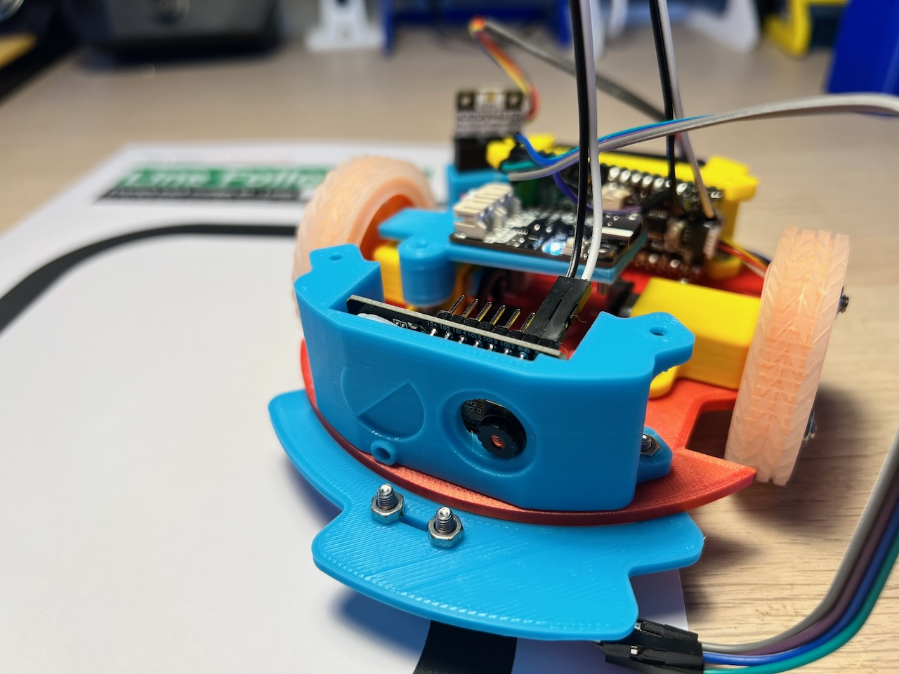
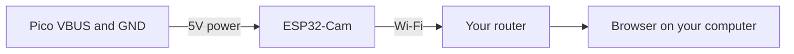

{:class="cover"}

---

By the end of this lesson you will be able to explain how the ESP32-Cam fits on BurgerBot, and print the holder that replaces the range finder.

---

## Vision

Another fun upgrade for your Burgerbot is a camera. The ESP32-Cam module is a cheap and easy to use camera module that can be powered from the Pico's `VBUS` (5V) and `GND` pins. The Camera module hosts its own webserver and can stream the video over Wi-Fi to a browser.

[{:class="img-fluid w-100"}](assets/camera_module.jpg)

---

## Setting up the camera

The first time you plug in the camera it will broadcast its own Wi-Fi hotspot ID that you will need to connect to. You can then connect it to your local Wi-Fi hotspot with the password too. The next time it restarts it will remember these settings and connect up. You will need to check the devices connected to your router to find the IP address of the camera, however once you have this you can type that into your browser and begin viewing what the robot can see.

The camera is powered by the Pico but it isn't controlled by it: the module runs its own web server, so the video goes straight to your browser and not through your MicroPython program.

---

## The Camera holder 3D Printable part

The camera module needs the existing BurgerBot range finder holder to be replaced with a new 3d printable part.

Click here to download the new Camera holder:

* [`camera_holder.stl`](/assets/stl/burgerbot_v2/camera_holder.stl) - The Camera Holder

Setup details such as the hotspot name and how to find the camera's address depend on the firmware on your camera module, so follow your module's own instructions where they differ from the description above.

> **Teachers**: the camera joins a Wi-Fi network and streams video, so check your school's rules on cameras and on devices joining the network. Many school networks stop devices seeing each other, so the browser may not reach the camera, and a small classroom router often fixes this. Make sure no one points the camera at people without their agreement.

---

## Try it Yourself

1. Plug the camera into the Pico's `VBUS` and `GND` pins and find its hotspot on your phone or laptop.
2. Connect the camera to your Wi-Fi and find its address on your router's list of devices. What is it?
3. Challenge: print the camera holder and mount the camera in place of the range finder. What can the robot see from that height?

---

## Common Issues

- **Problem**: You can't find the camera's address
- **Solution**: Look at the list of connected devices on your router, or reconnect to the camera's own hotspot and check its setup page
- **Why**: The camera gets its address from your router, so only the router knows it

- **Problem**: The camera keeps resetting
- **Solution**: Check the 5V and GND wires, and that the battery is charged
- **Why**: Camera modules draw a lot of current, and a weak supply makes them restart

---

## Check your understanding


? How is the ESP32-Cam powered on BurgerBot?
- [x] From the Pico's `VBUS` (5V) and `GND` pins
- [ ] From its own battery
- [ ] From the motor driver
> The lesson says it can be powered from the Pico's VBUS and GND pins.

? How do you view the camera's video?
- [ ] In Thonny's shell
- [x] In a web browser, using the camera's IP address
- [ ] On the range finder
> The camera hosts its own web server and streams over Wi-Fi to a browser.

? Which part must be replaced to fit the camera?
- [ ] The wheels
- [x] The range finder holder
- [ ] The base
> A new camera holder replaces the range finder holder.


---

## What's next?

Congratulations, you've built, programmed and upgraded your own robot! Here's where to go next:

- [Raspberry Pi Pico with MicroPython - GPIO Mastery](/learn/micropython_gpio/) - understand the pins and signals behind BurgerBot
- [MicroPython Robotics Projects with the Raspberry Pi Pico](/learn/micropython_robotics/) - more robot projects for the Pico
- [Build a SMARS Robot](/learn/smars/) - a tracked robot you can build and program

---
