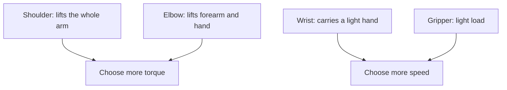

{:class="cover"}

---

Look at the box of an STS3215 and you'll see a model code such as **STS3215-C001** or **STS3215-C044**. Those codes mean different **gearing ratios**, and the gearing trades **speed for torque**. Pick the right one for each joint and the arm works much better.

---

## Speed or strength

Gears are a trade. A servo geared for more torque turns slower, and one geared for more speed is weaker. You can't have both from the same motor.

Kev's arm uses both kinds:

- **More torque, less speed** for the shoulder and elbow, where the mechanical load is greatest. They lift the rest of the arm
- **Less torque, more speed** for the wrist and gripper, where the load is small

The code on the box tells you which variant you have. The exact ratios and the no-load speed and stall torque are on the seller's listing and the Feetech datasheet. Check those numbers rather than trusting a table in a course, because suppliers change their variants.



**Why this matters:** a shoulder servo that is too weak stalls and overheats. A wrist servo that is too slow makes the whole arm feel sluggish. You can't fix either in software.

## A sensible way to choose

1. List the joints and ask what each one *carries*. Everything beyond a joint loads it
2. Give the most torque to the joints nearest the base that carry the most
3. Give speed to the joints at the tip
4. When in doubt, think about the long lever. A heavy gripper on a long forearm loads the elbow far more than you'd guess

It's a judgement call for joints like the base, which turns the whole arm's weight sideways. Start with the supplier's torque figures and the weight of your build.

## Protect your servos: limits and temperature

Whatever you choose, a joint bolted into a mechanism can hit a hard stop or a cable run. Two cheap protections help, and the blog suggests the first:

- **Position limits.** Clamp the target in code before you send it
- **A temperature check.** A servo that is working too hard gets hot, and `read_temperature()` tells you

The servo also stores its own limits in its control table, which can enforce them regardless of your code. Writing those registers is beyond this course, so we clamp in software.

This complete program sweeps two joints between their limits at their own speeds, prints each servo's temperature, and switches everything off if one gets too hot. Adjust `JOINTS` to your own servos.

```python
import time

from sts3215 import STS3215   # sts3215.py from the repo

# One entry per servo. Limits are position steps (0 to 4095).
JOINTS = {
    1: {"name": "elbow",   "low": 1024, "high": 3072, "speed": 400},
    2: {"name": "gripper", "low": 1500, "high": 2600, "speed": 1200},
}
ACC = 50
TEMP_LIMIT = 60     # degrees C. My example only: pick yours from the datasheet

bus = STS3215(uart_id=0, tx_pin=0, rx_pin=1, baudrate=1_000_000)


def safe_move(servo_id, target):
    """Clamp the target to the joint's limits, then move."""
    joint = JOINTS[servo_id]
    target = max(joint["low"], min(joint["high"], target))
    bus.move(servo_id, target, speed=joint["speed"], acc=ACC)
    return target


def too_hot():
    for servo_id, joint in JOINTS.items():
        temperature = bus.read_temperature(servo_id)
        print("  ", joint["name"], "temperature:", temperature, "C")
        if temperature is not None and temperature > TEMP_LIMIT:
            print("  ", joint["name"], "is too hot")
            return True
    return False


for servo_id in JOINTS:
    bus.set_torque(servo_id, True)

stopped = False
for end in ("low", "high", "low"):
    print("Sweeping to the", end, "limits")
    for servo_id, joint in JOINTS.items():
        safe_move(servo_id, joint[end] - 500 if end == "low" else joint[end] + 500)
    time.sleep(2)
    if too_hot():
        stopped = True
        break

for servo_id in JOINTS:
    bus.set_torque(servo_id, False)
print("Stopped because of heat" if stopped else "Finished normally")
```

Notice the sweep deliberately asks for 500 steps *beyond* each limit. `safe_move()` pulls it back, so you can watch the clamp working, and the servo never goes past the limit.

## Try it Yourself

1. Set the limits of one joint tightly and command a position outside them. Does the servo stop at the limit?
2. Lower `TEMP_LIMIT` to just above the temperature you see at rest and rerun. Does it stop early?
3. Challenge: look up the datasheet limits for your servo, and write them into the program as a comment next to `TEMP_LIMIT`.

## Common Issues

**Problem**: The joint stalls and gets hot.
**Solution**: Reduce the load, shorten the lever, or use a higher-torque variant for that joint.
**Why**: A servo pushing against a load it can't move draws high current and heats up fast.

**Problem**: A joint is slow and sluggish.
**Solution**: Check you haven't put a high-torque servo where a fast one is needed, and raise `speed` before blaming the code.
**Why**: Gearing sets the top speed. `speed` can't beat it.

**Problem**: `TypeError` comparing temperature.
**Solution**: Check `temperature is not None` first, as in the program.
**Why**: A missed reply returns `None`.
