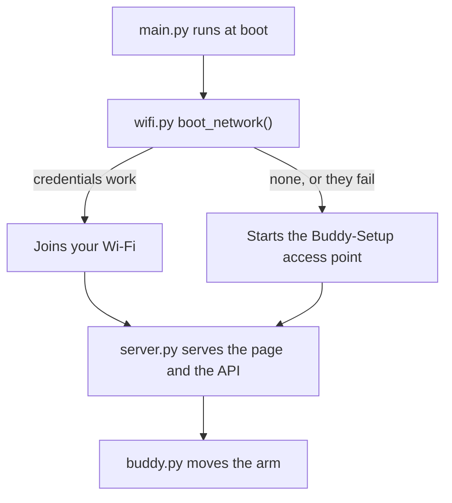

{:class="cover"}

---

Everything so far ran from Thonny. Now let's give Buddy its own control panel: sliders, a live 3D model of the arm, a box for "put the gripper here" and a command console. The clever part is that the **Pico itself serves the page**. There's no computer or cloud in the middle, just a browser and the arm.

---

## Watch the video

The video below is Kev's story of building Buddy's control software with an AI coding assistant. The repo carries a `CLAUDE.md` file with instructions for it, and a `tests/` folder that checks the code. Whatever wrote the code, the lesson is the same one we met in lesson 5: read it, run it and test it before you trust it.



## The pieces

You copied these files in lesson 9. Here is how they work together when the Pico boots:



## The boot script

MicroPython runs a file called `main.py` automatically at power-on. This one ties everything together. It needs a **Pico W**, because it uses Wi-Fi, and all the files from lesson 9. Save it on the Pico as `main.py`.

```python
from sts3215 import STS3215   # all of these files come from the repo (see lesson 9)
from buddy import Buddy
from wifi import boot_network
from server import Server

bus = STS3215(uart_id=0, tx_pin=0, rx_pin=1, baudrate=1_000_000)
buddy = Buddy(bus, config_path="/config.json")
net = boot_network()
print("network:", net)

Server(buddy).serve_forever(host="0.0.0.0", port=80)
```

When it starts you'll see a line like `wifi: connected to yourwifi as 192.168.1.50`, or `wifi: AP Buddy-Setup at 192.168.4.1`. That address is what you type into a browser.

## Getting onto Wi-Fi

`boot_network()` reads the Wi-Fi name and password from `config.json`. If there's no name, or it can't connect within 15 seconds, it starts its **own** access point, called **Buddy-Setup**. That's the fallback, and it means the arm is never stuck. It returns a dictionary with `mode` (`sta` or `ap`), `ip` and `ssid`.

The first time:

1. Power the Pico. It finds no credentials and starts the open `Buddy-Setup` network
2. Join `Buddy-Setup` from your phone or laptop
3. Send your home Wi-Fi details to the arm. Typically the address is `192.168.4.1`, and the Pico prints it on the USB serial console:

```bash
curl -X POST http://192.168.4.1/api/wifi \
  -H 'Content-Type: application/json' \
  -d '{"ssid": "yourwifi", "password": "yourpassword"}'
```

4. Reboot the Pico. It now joins your network and prints its new address
5. Browse to that address on any device on the same Wi-Fi

> **Safety.** The API has no password. Anyone on the same network can move the arm, and the Wi-Fi password is stored as plain text in `config.json`. Run it on a network you trust, keep fingers clear of the arm, and think about a password for the access point before you take it anywhere public.

## What the page gives you

- **3D viewer** shows a live model of the arm. The page loads Three.js from a CDN (`unpkg.com`) in your browser, so your phone needs internet access for it. While you're joined to `Buddy-Setup` it likely has none, so the viewer may stay blank. The rest of the page keeps working
- **Joint sliders** with one slider per joint. Moves are debounced, so the arm isn't flooded with a command on every pixel, and the page polls the arm for its status about four times a second
- **Gripper** open and close buttons, and a **torque** toggle
- **Pose target** for X, Y and Z, plus orientation. **Preview** runs IK without moving, and **Go** commits the move
- **Console** that takes typed commands: `move`, `pose`, `torque`, `gripper`, `status` and `home`. Up and Down recall history, and Tab completes joint names

Try the console. These are real commands from the repo:

```text
status
torque on
move elbow 20 300
pose 150 0 150 0 90 0
home
```
{: .no-snakie }

`move elbow 20 300` moves the elbow to 20 degrees at speed 300. `pose` takes `x y z`, or `x y z roll pitch yaw`, in millimetres and degrees.

## The API underneath

The page is just a client for a small JSON API, which is documented in the repo as `docs/api.md`. Anything that speaks HTTP can use it, including `curl`, a script or another robot.

| Endpoint | Does what |
| --- | --- |
| `GET /api/status` | Joint positions, temperatures and torque state |
| `POST /api/joint/<name>` | Move one joint: `{"degrees": 90, "speed": 200, "acc": 30}` |
| `POST /api/move` | Move several joints, paced by `duration_ms` or `max_speed` so they arrive together |
| `POST /api/pose` | Move the gripper to `x`, `y`, `z` using inverse kinematics |
| `POST /api/ik` | Solve IK for a pose without moving, to preview the angles |
| `POST /api/gripper` | `{"state": "open"}` or `{"state": "close"}` |
| `POST /api/torque` | `{"enable": true}` or `false` |
| `POST /api/home` | Park every joint at 0 degrees. This one is in `server.py` |
| `POST /api/wifi` | Save Wi-Fi credentials, then reboot |
{:class="table table-single"}

Replace `192.168.1.50` with your arm's address:

```bash
curl http://192.168.1.50/api/status
curl -X POST http://192.168.1.50/api/torque -H 'Content-Type: application/json' -d '{"enable": true}'
curl -X POST http://192.168.1.50/api/move -H 'Content-Type: application/json' \
  -d '{"joints": {"shoulder": 30, "elbow": 60}, "duration_ms": 1500}'
curl -X POST http://192.168.1.50/api/ik -H 'Content-Type: application/json' \
  -d '{"x": 150, "y": 0, "z": 150, "pitch": 90}'
```

`/api/move` calls `move_all_sync` for you, the code from lesson 11, so the two joints arrive together. Errors come back as JSON such as `{"error": "..."}` with a `400` or `404`. If you send both `duration_ms` and `max_speed`, you get a `400`, exactly as before.

**How the server works:** `server.py` is a small hand-rolled HTTP server built on the standard `socket` module, so it needs nothing extra on the Pico. It serves files from `/www` and the API from `/api/`. It handles **one request at a time**, which is plenty for one person with a phone.

**Why this matters:** you've put a full user interface on a microcontroller with no extra software. Layers pay off here, because the server only talks to `buddy.py` and never touches a UART packet.

## Try it Yourself

1. Use `curl` to read `/api/status` and find the hottest joint.
2. Preview a pose with `/api/ik`, then send the same one to `/api/pose`.
3. Challenge: write a script on your computer that calls `/api/move` with a list of poses and replays them. It's teach and repeat, over Wi-Fi.

## Common Issues

**Problem**: The page loads but the sliders don't move the arm.
**Solution**: Press the torque toggle, and check the arm is switched on.
**Why**: Some servos won't act on a new target while torque is off.

**Problem**: The 3D viewer is blank.
**Solution**: Join a network that has internet access, or accept it. The rest works without it.
**Why**: The page fetches Three.js from `unpkg.com` in the browser.

**Problem**: The pose box says "unreachable".
**Solution**: Leave `yaw` blank so it is worked out for you, and check the distance against the arm's reach.
**Why**: With five effective degrees of freedom, yaw must match the direction to the target.

**Problem**: The Pico never joins your Wi-Fi.
**Solution**: Rejoin `Buddy-Setup`, send the credentials again, and read the `wifi:` lines on the USB console.
**Why**: `boot_network()` prints which path it took.
