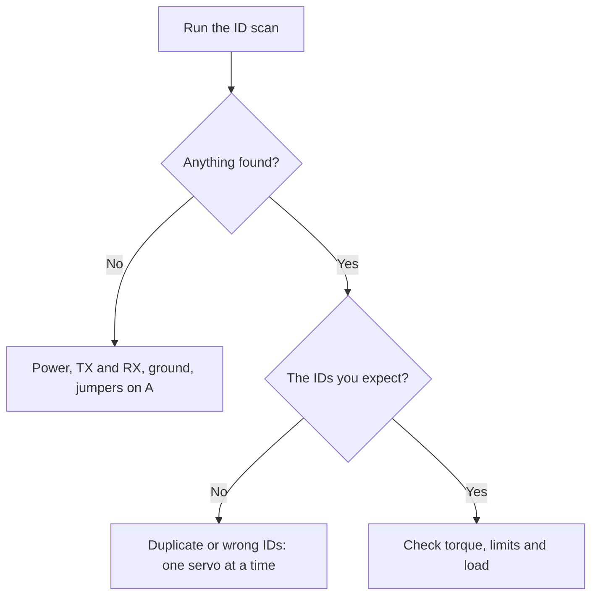

{:class="cover"}

---

Everyone hits a wall with bus servos at some point, usually the first time two servos share an ID or a ground wire comes loose. The good news: the servos talk back, so you can nearly always find the fault by asking them. This lesson collects the problems from the whole course in one place.

---

## Start here: three questions

Before reading the table, run the scan program from lesson 5, then ask:

1. **Does anything answer?** If not, it's power, wiring or jumpers
2. **Does the right ID answer?** If not, it's an ID problem
3. **Does it answer and still not move?** Then it's torque, limits or the load

## Servo problems

| Problem | Solution | Why |
| --- | --- | --- |
| No servo answers | Check the 7.4V supply is on, TX goes to RX and RX to TX, and both jumpers are on **A** | A swapped pair, no power, or the wrong jumper all look like silence |
| Garbled data or random disconnects | Join the Pico GND and the driver board GND, and check the baud rate is 1,000,000 | UART signals need a common reference |
| Nothing moves when two servos are chained | Connect them one at a time and give each its own ID | Two servos on one ID collide |
| A servo reverts to ID 1 | Set the ID again, then power-cycle and scan | The change didn't stick, and only a power cycle proves it did |
| One servo answers, the rest don't | Look for duplicate IDs, then check the cable before the first missing servo | The chain is broken at that point, or two share an ID |
| Servo twitches or stalls | Use a supply that delivers enough current, and check for a mechanical jam | A moving servo draws far more current than an idle one |
| A joint gets hot | Reduce the load or use a higher-torque variant, and use the temperature check from lesson 8 | A servo working against its limit heats up |
| `None` from a read | Check the ID and the wiring, and test for `None` in your code | The servo didn't reply in time |
| Servo moves but not where I asked | Check `speed`, the position range and the limits | Out-of-range targets are clamped or refused |
{:class="table table-single"}

## Arm and code problems

| Problem | Solution | Why |
| --- | --- | --- |
| `buddy: clamped` is printed | Widen `min_deg` and `max_deg` in `config.json` | Requests are limited to those values |
| A joint goes the wrong way | Flip its `sign` and recalibrate | The servo is mounted the other way round |
| Positions are wrong after calibration | Rerun `calibrate.py` with the arm held exactly at home | The offsets record whatever pose you held |
| Joints arrive at different times | Use `move_all_sync` instead of `move_all` | Equal speeds over unequal distances |
| `inverse_kinematics` returns `None` | Check reach, and leave `yaw` as `atan2(y, x)` | The target is out of range, or yaw disagrees with the base |
| The gripper ends up in the wrong place | Measure the arm and set `L1` to `L5` in `kinematics.py` | The shipped lengths are placeholders |
| Web sliders don't move the arm | Toggle torque on | Some servos ignore targets with torque off |
| The 3D viewer is blank | Give the phone internet access | The viewer's script comes from a CDN |
| The Pico never joins Wi-Fi | Use `Buddy-Setup` and resend the credentials, then read the `wifi:` lines | `boot_network()` falls back to the access point on failure |
{:class="table table-single"}

## Habits that prevent most of it

- **Label every servo** with its ID the moment you set it
- **Add servos to the chain one at a time**, scanning after each
- **Use a decent supply.** Most random twitching traces back to power
- **Test with torque off first.** If the position numbers look right, then switch torque on
- **Start slow.** A low `speed` and gentle `acc` give you time to react

## Try it Yourself

1. Unplug the ground wire between the Pico and the board while the scan runs. What does the scan print?
2. Deliberately give two servos the same ID, and see what a scan shows.
3. Challenge: write a `health_check.py` that scans IDs 1 to 6, reads each servo's temperature and position, and prints one line per servo.

## Common Issues

**Problem**: I fixed the wiring, but still nothing answers.
**Solution**: Power-cycle the servo supply, then rerun the scan.
**Why**: A servo that browned out may need a clean restart before it talks.

**Problem**: The program hangs.
**Solution**: Press Ctrl-C and check any `while` loop that waits on a reading has a timeout.
**Why**: A loop waiting for a servo that never answers waits for ever.
