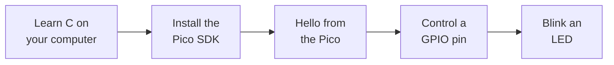

{:class="cover"}

---

By the end of this lesson you will know what the course covers, what kit you need, and how the lessons fit together.

Ahoy there makers! Most robots you will ever meet, from vacuum cleaners to drones, run firmware written in C. In this course we'll learn the basics of C and then use it to make a real Raspberry Pi Pico blink a real LED. No programming or electronics experience needed.

---

## Overview

C is a small, fast language that talks to hardware almost directly. The Raspberry Pi Pico is a small, cheap microcontroller board, and Raspberry Pi's official way to program it in C is the **Pico SDK** (software development kit). We'll learn C first on your own computer, where mistakes are cheap, then move the same ideas onto the Pico.

Here is the journey:

## Course Content

- What C is, and how a program becomes something a chip can run
- Variables and data types, with the traps that catch beginners
- Decisions and loops, using robot-flavoured examples
- Functions, so your code stays tidy as it grows
- Installing the Pico SDK and building an example
- Your first Pico program, printing over USB
- GPIO pins, then the capstone: a blinking LED circuit

## Key Results

After completing this course, you will:

- Read and write small C programs with variables, conditions, loops and functions
- Install the Pico C/C++ SDK and build a `.uf2` file
- Write a `CMakeLists.txt` for your own project
- Print messages from the Pico to your computer over USB
- Control a GPIO pin and blink an LED from C

## What you'll need

- A Raspberry Pi Pico, Pico W or Pico 2. The lessons apply to all three; where they differ, we say so
- A USB data cable that fits your board (micro-USB for Pico and Pico W, USB-C for Pico 2)
- A computer running Windows, macOS or Linux
- A breadboard, one LED, one 330 ohm resistor and two jumper wires, for lessons 8 and 9
- A C compiler such as `gcc` for lessons 2 to 5 (Linux and macOS usually have one; on Windows use WSL or an online C compiler)

You don't need to know any other language first. If you have used [MicroPython on the Pico](/learn/micropython/), you will spot the differences as we go, and if you are new to the terminal, [Introduction to the Linux Command Line on Raspberry Pi OS](/learn/linux_intro/) is a friendly warm-up.

## How the course works

**Real output.** The C programs in lessons 2 to 5 were compiled and run, and the output shown is what they print. The Pico programs follow the official `pico-examples` projects from Raspberry Pi.

**Two places to type.** Lessons 2 to 5 run on your computer. From lesson 6 on, you build on your computer and the program runs on the Pico.

**Check, try, fix.** Each lesson has a Try it Yourself section, a Common Issues list and a short quiz. Quiz scores stay in your browser and show in the sidebar.

**Mistakes are normal.** C is strict, and a missing semicolon stops the build. That is not you failing; it is every C programmer's Tuesday.

> **Teachers**: this course suits learners aged about 12 and up, and can be run as a club or a term unit. Allow 30 to 45 minutes per lesson, and about 90 minutes for lesson 6, where the tools are installed. Lessons 2 to 5 need only a computer with a C compiler, so they can run with no hardware at all. For lessons 6 to 9 you need one Pico per learner or pair, plus an LED, resistor and breadboard each. Installing tools often needs administrator rights on school computers, so ask your IT team before the lesson, or have learners use their own laptops or a shared build machine. The SDK download is a few hundred megabytes, so do it once and share it rather than having thirty learners download at the same time.

Ready? Let's find out what C actually is.

## Check your understanding


? Where do lessons 2 to 5 run?
- [x] On your own computer, with a C compiler
- [ ] Only on the Pico
- [ ] Only in a web browser
> Lessons 2 to 5 teach plain C on your computer first. The Pico comes in from lesson 6.

? What is the Pico SDK?
- [ ] A kind of Pico board
- [x] The software kit Raspberry Pi provides for writing C and C++ for the Pico
- [ ] A text editor
> The SDK holds the libraries and build files that turn your C into something the Pico can run.

? Which project do we build at the end of the course?
- [ ] A line-following robot
- [x] A blinking LED circuit
- [ ] A Wi-Fi weather station
> The capstone in lesson 9 is an external LED blinking on a GPIO pin.

