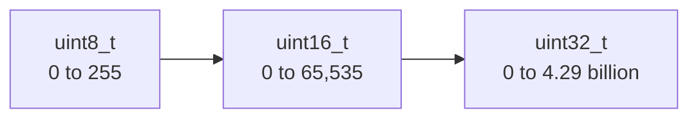

{:class="cover"}

---

By the end of this lesson you will be able to declare variables of the common C types, do arithmetic with them, and predict what integer division and overflow do.

A robot has to remember things: how fast the motors are turning, the battery voltage, whether the lights are on. In C we remember things in **variables**. A variable is a named box in memory, and in C every box has a fixed **type** that says what kind of thing it can hold.

---

## Declaring variables

To make a variable you give it a type, a name, and (usually) a starting value:

```c
#include <stdio.h>
#include <stdbool.h>
#include <stdint.h>

int main(void) {
    int wheel_count = 4;
    float battery_volts = 7.4f;
    char robot_id = 'A';
    bool lights_on = true;

    printf("Wheels: %d\n", wheel_count);
    printf("Battery: %.1f V\n", battery_volts);
    printf("Robot ID: %c\n", robot_id);
    printf("Lights on: %d\n", lights_on);

    int ticks = 7;
    int per_rev = 2;
    printf("7 / 2 = %d\n", ticks / per_rev);
    printf("7 %% 2 = %d\n", ticks % per_rev);
    printf("7 / 2.0 = %.1f\n", ticks / 2.0f);

    uint8_t pwm_level = 250;
    pwm_level = pwm_level + 10;
    printf("250 + 10 in a uint8_t = %u\n", pwm_level);
    printf("uint8_t is %zu byte, int is %zu bytes\n", sizeof(uint8_t), sizeof(int));
    return 0;
}
```

Save it as `vars.c`, build with `gcc -Wall -o vars vars.c`, run `./vars`, and you should see:

```text
Wheels: 4
Battery: 7.4 V
Robot ID: A
Lights on: 1
7 / 2 = 3
7 % 2 = 1
7 / 2.0 = 3.5
250 + 10 in a uint8_t = 4
uint8_t is 1 byte, int is 4 bytes
```

(On a Pico an `int` is also 4 bytes, because the chip is 32-bit.)

---

## The types you will use most

| Type | Holds | Example |
|------|-------|---------|
| `int` | A whole number, positive or negative | `int speed = -50;` |
| `float` | A decimal number (approximate) | `float volts = 3.3f;` |
| `char` | A single character, in single quotes | `char grade = 'B';` |
| `bool` | `true` or `false` (needs `stdbool.h`) | `bool led_on = false;` |
| `uint8_t` | A whole number from 0 to 255 | `uint8_t brightness = 200;` |
| `uint32_t` | A whole number from 0 to about 4.29 billion | `uint32_t time_ms = 0;` |
{:class="table table-single"}

The `uint8_t` family comes from `stdint.h`. The number is how many bits the box has, and the `u` means unsigned (never negative). Embedded code uses these a lot, because on a microcontroller you often care exactly how big a value is. The Pico SDK also gives you a handy type called `uint`, which you will meet in lesson 8.



---

## Format codes for printf

`printf` needs to know what kind of value to print. `%d` is a whole number, `%.1f` is a decimal with one digit after the point, `%c` is a character, and `%u` is an unsigned number. To print an actual percent sign, write `%%`.

## Two traps to know now

**Integer division chops the decimals.** `7 / 2` is `3`, not `3.5`, because both numbers are `int`. Make one of them a `float` (`7 / 2.0`) to get `3.5`. The `%` operator gives the remainder, so `7 % 2` is `1`. That is handy for things like "every 10th reading".

**Overflow wraps around.** A `uint8_t` can only hold up to 255. Add 10 to 250 and it wraps to `4`, as the output above shows. Imagine a motor speed jumping from full power to almost nothing. Choose a type big enough for your biggest value.

## Comments

Comments are notes for humans that the compiler ignores. Use `//` for one line and `/* ... */` for several.

```c
// This is a single-line comment
/* This one
   spans lines */
```

---

## Try it Yourself

1. Add a `float` called `distance_cm` set to `23.5` and print it.
2. Change `ticks` to `9` and predict `ticks / per_rev` before you run it.
3. Change `pwm_level` to `255` and then add `1`. What do you get?
4. Challenge: store a wheel diameter of 6.5 cm in a `float` and print the circumference (diameter times 3.14159).

## Common Issues

- **Problem**: The answer to `7 / 2` prints as `3`.
- **Solution**: Make at least one operand a `float`, such as `7 / 2.0`, and print with `%f`.
- **Why**: When both sides are integers, C does integer division and throws away the remainder.

- **Problem**: A warning such as `assignment to 'int' from 'char *' makes integer from pointer without a cast`.
- **Solution**: You tried to put text into an `int`. Use a matching type, for example `char` for a single character in single quotes.
- **Why**: C types are fixed. A variable declared `int` stays `int`, so `age = "thirty"` is a mistake (gcc 13 warns, newer versions refuse to compile it).

- **Problem**: A `printf` prints garbage numbers.
- **Solution**: Match the code to the type: `%d` for `int`, `%f` for `float`.
- **Why**: `printf` trusts you. It cannot check that the value is what you said it was.

## Check your understanding


? What does `7 / 2` give when both numbers are `int`?
- [ ] 3.5
- [x] 3
- [ ] 4
> Integer division drops the remainder, so the result is 3.

? A `uint8_t` holds 250 and you add 10. What is stored?
- [ ] 260
- [x] 4
- [ ] An error stops the program
> A `uint8_t` only holds 0 to 255, so the value wraps around to 4.

? Which header do you need to use `bool`, `true` and `false`?
- [ ] `stdio.h`
- [x] `stdbool.h`
- [ ] `stdint.h`
> `stdbool.h` provides `bool`. `stdint.h` provides `uint8_t` and friends.

