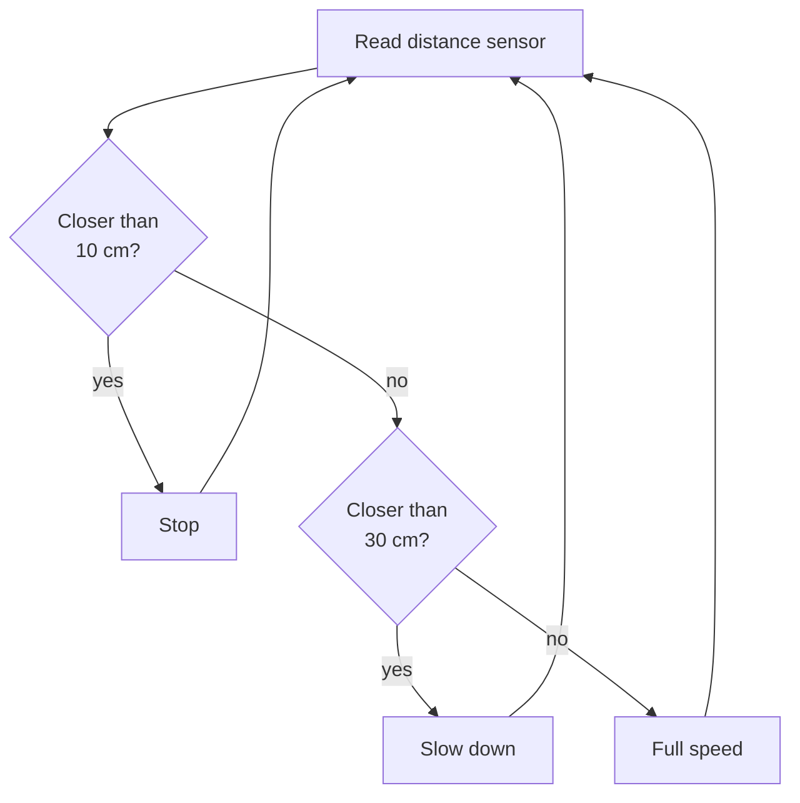

{:class="cover"}

---

By the end of this lesson you will be able to write `if`/`else` decisions, `for` and `while` loops, and an endless loop with a way out.

A robot that can't decide or repeat is just a paperweight. Every robot loop is the same story: read a sensor, decide what to do, act, then do it all again. In C that story is told with `if` and loops.



---

## Making decisions with if

Here is that flowchart as a real program. Save it as `logic.c`:

```c
#include <stdio.h>

int main(void) {
    int distance_cm = 12;

    if (distance_cm < 10) {
        printf("Too close: stop!\n");
    } else if (distance_cm < 30) {
        printf("Obstacle ahead: slow down\n");
    } else {
        printf("Clear: full speed\n");
    }

    for (int reading = 0; reading < 5; reading++) {
        printf("Sample %d\n", reading);
    }

    int battery = 3;
    while (battery > 0) {
        printf("Battery bars: %d\n", battery);
        battery--;
    }
    printf("Battery flat\n");

    int tries = 0;
    while (1) {
        tries++;
        if (tries == 3) {
            printf("Found it on try %d, leaving the loop\n", tries);
            break;
        }
    }
    return 0;
}
```

Build with `gcc -Wall -o logic logic.c` and run `./logic`. You get:

```text
Obstacle ahead: slow down
Sample 0
Sample 1
Sample 2
Sample 3
Sample 4
Battery bars: 3
Battery bars: 2
Battery bars: 1
Battery flat
Found it on try 3, leaving the loop
```

The `if` checks each test in order and runs only the first block that is true. With `distance_cm` at 12, the first test fails and the second passes.

## Comparison operators

| Operator | Meaning | Example |
|----------|---------|---------|
| `==` | Equal to | `speed == 0` |
| `!=` | Not equal to | `speed != 0` |
| `<` and `>` | Less than, greater than | `distance_cm < 10` |
| `<=` and `>=` | Less or equal, greater or equal | `battery >= 3` |
| `&&` | Both must be true | `a > 0 && b > 0` |
{:class="table table-single"}

To say "either" use two vertical bars (the pipe character, written twice) between the tests.

---

## Loops

**`while`** repeats as long as its test is true. We used it to count the battery down. If the test never becomes false, it never stops, so something inside must change.

**`for`** is the tidy way to repeat a known number of times. It has three parts inside the brackets, separated by semicolons:

1. Start: `int reading = 0`
2. Keep going while: `reading < 5`
3. After each trip round: `reading++` (add one)

Note the loop runs for 0, 1, 2, 3, 4. Computers count from zero, so five trips ends at 4.

**The endless loop.** A robot's main program usually never ends, so you will write `while (1)` or `while (true)` a lot. Notice the `break` in our example: it jumps straight out of a loop, which is how you leave an endless one when something happens. On the Pico, `main` never returns, so the endless loop in lesson 7 has no `break` at all.

---

## Try it Yourself

1. Change `distance_cm` to `5`, then `50`, and predict the message each time.
2. Change the `for` loop so it counts from 1 to 10.
3. Make the `for` loop print only even numbers by changing the increment to `reading += 2`.
4. Challenge: add a check inside a `for` loop that prints "every fifth sample" when `reading % 5 == 0`.

## Common Issues

- **Problem**: An `if` always runs, and the compiler warns `suggest parentheses around assignment used as truth value`.
- **Solution**: You wrote `if (level = 0)`. Change it to `if (level == 0)`.
- **Why**: A single `=` stores a value and the stored value (0 or not) becomes the test. Two `==` compares.

- **Problem**: The program runs forever and never prints "Battery flat".
- **Solution**: Make sure something inside the `while` changes the variable in the test, such as `battery--`. Press Ctrl+C to stop it.
- **Why**: A loop only ends when its test becomes false.

- **Problem**: The loop ran one time too many or too few.
- **Solution**: Check whether you need `<` or `<=`, and whether you started at 0 or 1.
- **Why**: Off-by-one mistakes are the most common loop bug in every language.

## Check your understanding


? With `distance_cm = 12`, which message does our if/else chain print?
- [ ] Too close: stop!
- [x] Obstacle ahead: slow down
- [ ] Clear: full speed
> 12 is not below 10, but it is below 30, so the second block runs.

? How many times does `for (int i = 0; i < 5; i++)` run its body?
- [ ] 4
- [x] 5
- [ ] 6
> It runs for 0, 1, 2, 3 and 4, which is five times.

? What does `break` do inside a loop?
- [ ] Skips to the next trip round
- [x] Jumps out of the loop immediately
- [ ] Stops the whole computer
> `break` leaves the loop, which is how you escape a `while (1)`.

