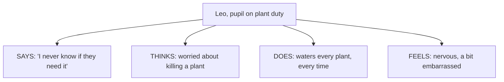

{:class="cover"}

---

By the end of this lesson you will be able to observe and interview the people a project is for, record what you learn in an empathy map, and tell an observation from an assumption.

---

## Start by watching

The easiest way to learn about a problem is to watch it happen. Sit in the corner and notice what people *do*, not just what they say. Where do they hesitate? What do they work around? What do they ignore?

Write down exactly what you see, with times if you can: "10:15, Leo picks up the watering can, looks at three plants, waters all three." That's an **observation**. "Leo doesn't care about the plants" is an **assumption**. You didn't see that; you guessed it.

---

## Then ask

Short interviews fill in what watching can't show. A few rules make a big difference:

- **Ask open questions.** "How do you decide when to water?" not "Do you water on Mondays?"
- **Ask about real events.** "Tell me about the last time a plant died" gets a true story. "What usually happens?" gets a tidy guess.
- **Ask why.** When someone says something interesting, ask "why?" a couple of times to get underneath it.
- **Don't pitch.** If you say "would you like a robot that waters plants?", people will politely say yes. You've learned nothing.
- **Listen more than you talk.** Silence is fine. People fill it.

> **Teachers**: if pupils interview other pupils or staff, get consent first, keep questions about the project and not about people's private lives, and follow your school's safeguarding policy. Don't record audio or video of children without the right permission. Notes on paper, with no surnames, are usually enough.

---

## The empathy map

An empathy map is a quick way to sort what you've learned about one person into four boxes.

**Says** and **does** come straight from your notes. **Thinks** and **feels** are your reading of them, so mark where the evidence came from. Gaps between what people say and do are gold: they often point at the real problem.

---

## Why the AI can't do this for you

It's tempting to ask an AI "what problems do teachers have with classroom plants?". You'll get a neat, confident list. But it's an **average user**, stitched together from everything it has read. It hasn't met Ms Okafor. It doesn't know Mr Hughes is only in on Fridays. The details that make your project work are exactly the ones it can't know.

The AI is useful *around* empathy work:

- **Drafting interview questions** before you go, which you then edit
- **Summarising your notes** afterwards, but only with people's consent, and with names and personal details removed first

What it shouldn't do is replace the watching and asking.

---

## Observation or assumption?

Sort each statement. Is it something you saw or heard, or a guess?


Priya watered the cactus twice on Tuesday | left | You saw it happen, so it's an observation.
Pupils don't care about the plants | right | Nobody said or did that. It's a guess about feelings.
The fern by the radiator had dry, crunchy leaves on Monday | left | You can see and touch it. That's an observation.
A robot would solve this | right | That's a solution, and an assumption that it's wanted.
Ms Okafor said 'I lose a plant every holiday' | left | You heard her say it, so you can quote it.
Leo is lazy | right | A judgement about a person, not something you observed.
Nobody waters the plants on Friday afternoons | left | If you watched several Fridays and saw it, it's an observation.
Everyone would use an app for this | right | A guess about everyone. You'd need to test it.



---

## Plant Helper progress

Remember, the people here are a made-up example. Here's what the class found when they watched and asked:

- **Ms Okafor** said: "I lose a plant every holiday." Plants die over weekends and holidays, and it's not clear whose job they are.
- **Leo and Priya**, on plant-monitor duty, said they can't tell by looking whether a plant needs water. So they water some too much and forget others.
- **Mr Hughes**, the caretaker, is in on Fridays. He sometimes waters plants that the pupils already watered.
- Nobody asked for a robot. Nobody said "watering takes too long".

That last point matters. The brief said "a robot that waters". What we actually heard was "nobody knows which plant needs water".

---

## Try it Yourself

1. **Watch for ten minutes.** Pick something people do at home, like making tea. Write only observations, with times.
2. **Interview one person.** Use "tell me about the last time..." and ask why at least twice. Don't mention any solution.
3. **Challenge:** Make an empathy map for that person. Find one place where what they *said* doesn't match what they *did*.

---

## Common Issues

**Problem**: Everyone says your idea is great.
**Solution**: Stop describing your idea. Ask about their last real experience instead.
**Why**: People are polite. Pitching gets you compliments, not information.

**Problem**: Your notes are full of opinions.
**Solution**: Rewrite each note as what you saw or heard, word for word where you can.
**Why**: Assumptions feel like facts when you wrote them yourself.

**Problem**: The AI's list of "user problems" looks more complete than yours.
**Solution**: Use it only to check you didn't miss a question to ask. Then go and ask.
**Why**: It describes an average user, not the people in your room.

---

## Check your understanding


? Which interview question is best?
- [ ] "Would you like a robot that waters plants?"
- [ ] "Do you water on Mondays?"
- [x] "Tell me about the last time a plant died."
> It asks about a real event with an open question, and doesn't pitch a solution.

? What are the four boxes of an empathy map?
- [x] Says, thinks, does, feels
- [ ] Who, what, when, where
- [ ] Problem, solution, cost, time
> Says and does come from your notes; thinks and feels are your reading of them.

? What's a fine way to use AI in the Empathise mode?
- [ ] Ask it to describe your users instead of meeting them
- [x] Draft interview questions, or summarise anonymised notes with consent
- [ ] Have it invent quotes for your empathy map
> The AI can help around the edges, but it hasn't met your people.

