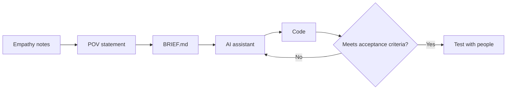

{:class="cover"}

---

By the end of this lesson you will be able to turn a point-of-view statement into a design brief file that gives an AI assistant context, constraints and a way to check its work.

---

## Why a brief beats a one-line prompt

Compare these two ways of starting:

> "Write code for a plant watering robot."

versus a file in your project folder that says who it's for, what the problem is, what it must and mustn't do, what kit you have, and how you'll know it works.

The one-liner leaves the AI to guess everything, and it will guess the *average* answer: probably a pump, probably Wi-Fi, probably libraries you don't have. A brief gives it three things it can't get anywhere else:

1. **Context**: who it's for and why, from your empathy work
2. **Constraints**: your board, your pins, your power, your safety rules
3. **A way to check the output**: acceptance criteria you can test against



Many AI coding tools read an instruction file from your project automatically, such as `CLAUDE.md` or `AGENTS.md`. Buddy, my robot arm from the [intro video](/learn/design_thinking/00_intro.html), has a `CLAUDE.md` with instructions and a `tests/` folder (see the [Bus Servos course](/learn/bus_servos/)). If your tool doesn't read files automatically, call it `BRIEF.md` and paste it in, or attach it, at the start of each session.

---

## What goes in a brief

- **Who it's for**: the users, by name or role
- **The problem**: your POV statement, word for word
- **Must / should / won't**: what it has to do, what would be nice, and what it definitely won't do. The "won't" list is as important as the "must" list, because it stops the AI adding things you don't want.
- **Constraints**: power, size, safety, network (school Wi-Fi often blocks devices), budget, and your exact board and pins
- **Acceptance criteria**: plain sentences in **Given / When / Then** form. *Given* a starting situation, *when* something happens, *then* this is what you should see.

Acceptance criteria are the part people skip, and they matter most. They turn "make it work" into something you can check.

---

## Plant Helper progress

Here's the Plant Helper brief the class wrote. Save it as `BRIEF.md` in your project folder.

```markdown
# Plant Helper brief

## Who it's for
Leo and Priya, the pupils on plant-monitor duty in Ms Okafor's Year 5 class.
Also Ms Okafor (teacher) and Mr Hughes (caretaker, in on Fridays).

## The problem
Leo and Priya need a way to tell at a glance which plant needs water,
because they can't judge it by looking and they're afraid of getting it wrong.

## Must
- Show at a glance whether one plant needs water, from across the room
- Use three LEDs: green = fine, amber = water soon, red = water now
- Work with no screen, no app and no login

## Should
- Chirp a buzzer at the end of the day if a plant is red
- Be easy to move from pot to pot

## Won't
- Won't water the plants itself (no pump: water, electronics and children)
- Won't need Wi-Fi or the internet
- Won't use any library that isn't built into MicroPython

## Constraints
- Board: Raspberry Pi Pico or Pico W, MicroPython
- Moisture sensor: capacitive, analogue out, on GP26 (ADC0), read with read_u16()
  Reads HIGHER when dry, LOWER when wet. Calibrate per sensor.
- LEDs: green GP15, amber GP14, red GP13, each with a 220 ohm resistor
- Buzzer: piezo on GP16, PWM
- Power: USB only, from a phone charger or laptop. Keep it away from the watering can.
- Size: fits on a windowsill next to a pot
- Budget: parts we already have in the kit

## Acceptance criteria
- Given the sensor is in dry soil, when the Pico reads it, then the red LED is on.
- Given the sensor is in freshly watered soil, when the Pico reads it, then the green LED is on.
- Given moisture is between 30% and 59%, when the Pico reads it, then only the amber LED is on.
- Given only one LED is ever on at a time, when the reading changes, then the old LED goes off.
- Given Leo has never seen it before, when he looks at it from his desk, then he can say which colour it is showing.
```

Notice the last acceptance criterion isn't about code at all. It's about a person. A good brief checks both.

> **Teachers**: if pupils will paste the brief into an AI tool themselves, check the tool's minimum age and account rules first. A brief like this is also a great thing to write as a whole class, with the teacher typing it into one AI account on the projector.

---

## Try it Yourself

1. **Find the gaps.** Ask an AI "write code for a plant watering robot" with no brief. List every decision it made that your brief would have made differently.
2. **Write a won't list.** For a project of your own, write three things it definitely won't do.
3. **Challenge:** Add two more acceptance criteria to the Plant Helper brief: one for the buzzer, and one for what happens if the sensor is unplugged.

---

## Common Issues

**Problem**: The AI ignores parts of your brief.
**Solution**: Ask it to repeat back the constraints and acceptance criteria before it writes any code.
**Why**: Long instructions can get lost. Making it restate them shows you what it actually took in.

**Problem**: Your acceptance criteria say "it should work well".
**Solution**: Rewrite each one as Given / When / Then with something you can see or measure.
**Why**: You can't test "work well". You can test "the red LED is on".

**Problem**: The AI adds Wi-Fi, a web dashboard and a pump.
**Solution**: Put them in your "won't" list.
**Why**: Without a won't list, the AI fills gaps with the most common answer it knows.

---

## Check your understanding


? What three things does a brief give an AI that a one-line prompt doesn't?
- [x] Context, constraints and a way to check the output
- [ ] Speed, cost and colour
- [ ] A name, a logo and a deadline
> The brief carries who it's for, the limits you're working within, and acceptance criteria to test against.

? Which is a good acceptance criterion?
- [ ] It should work well
- [x] Given the sensor is in dry soil, when the Pico reads it, then the red LED is on
- [ ] Make it nice for the pupils
> It has a starting situation, an event and something you can see.

? Why include a "won't" list?
- [ ] It makes the brief longer
- [x] It stops the AI adding things you don't want, like a pump or Wi-Fi
- [ ] AI tools require one
> Left to guess, the AI fills gaps with the most common answer.

