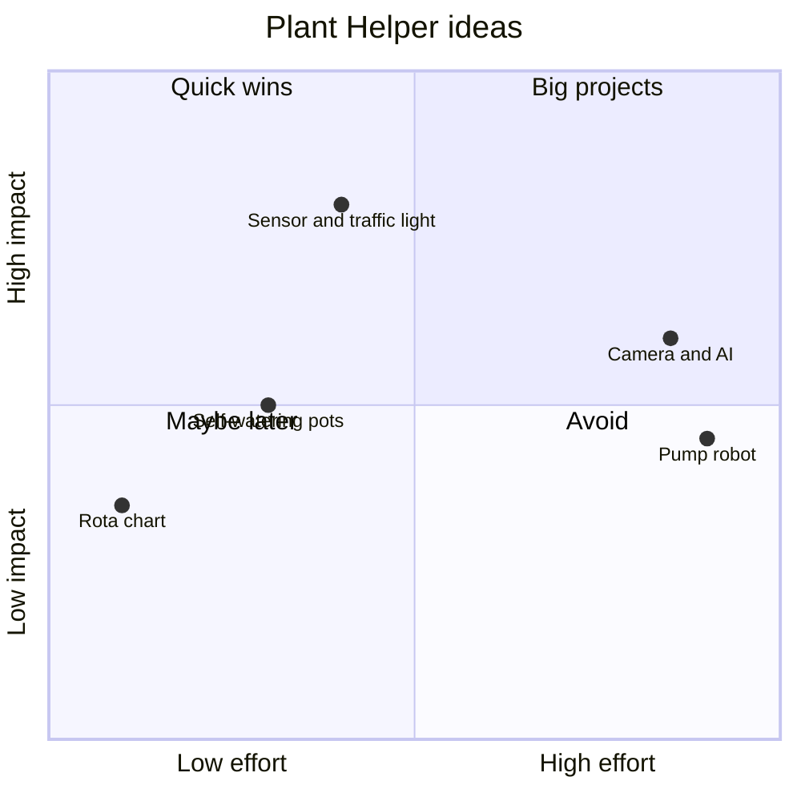

{:class="cover"}

---

By the end of this lesson you will be able to run a quick idea session that goes wide before it narrows, use an AI as an extra brainstorm partner without letting it take over, and choose an idea with clear reasons.

---

## Diverge, then converge

Ideation has two halves, just like each diamond in the Double Diamond. First you **diverge**: get as many ideas as you can. Then you **converge**: choose. The mistake is doing both at once. If you judge each idea as it appears, you'll stop at the first one that seems OK.

Two rules for the diverge half:

- **Quantity first.** Twenty rough ideas beat three polished ones. The good ones are often idea number twelve, not idea number one.
- **No judging.** Not yet. Say "and..." instead of "but...".

---

## Crazy 8s

Crazy 8s comes from Google Ventures' Design Sprint (Jake Knapp, *Sprint*, 2016). Fold a sheet of A4 into eight panels. Set a timer for eight minutes. Sketch one idea per panel, one minute each. They don't have to be good. They do have to be different.

The time pressure is the point. After the first three obvious ideas, your brain has to get creative.

### The worst possible idea

If the room goes quiet, flip it: "What's the worst possible way to help Leo and Priya?" A klaxon that goes off every five minutes. A plant that shouts. Laughing at bad ideas relaxes everyone, and turning a bad idea inside out often gives a good one. (A plant that *quietly* tells you it's thirsty?)

---

## AI as an extra brainstorm partner, after you

An AI is great at producing a long list of ideas. But if you ask it first, you'll **anchor** on its list: everyone's ideas will drift towards what it said, and you'll lose the ones that came from your own empathy work.

So do your own Crazy 8s first. Then give the AI your POV and How Might We questions and ask: "Here are our ideas. Suggest ten more that are different from these." Add the good ones to the wall. Treat it as one more voice in the room, not the judge.

---

## Converge: impact and effort

Once the wall is full, group similar ideas together, then place each group on a grid. How much would it help the user (impact)? How hard is it to make (effort)?

Then **dot vote**: everyone gets three sticky dots and puts them on the ideas they'd most like to try. You can put more than one dot on an idea. Dots show where the team's energy is; the grid shows whether it's sensible. Use both.

---

## Plant Helper progress

Here are some of the ideas the class came up with:

| Idea | Helps Leo and Priya know which plant needs water? | Notes |
| --- | --- | --- |
| Pump robot that waters automatically | No, it skips them entirely | Water, electronics and 30 children. Needs its own power supply |
| Soil sensor and traffic-light LEDs | Yes, at a glance | Cheap, safe, uses parts in the kit |
| Rota chart on the wall | Partly: says *who*, not *which plant* | Very quick, worth doing anyway |
| Self-watering pots | Avoids the question | Good for holidays, costs money per pot |
| Camera and AI that spots droopy plants | Maybe, by the time it droops it's late | Needs Wi-Fi, accounts and a lot of effort |
{:class="table table-single"}

The pump robot was the original brief, and it's exciting. But it doesn't fix "nobody knows which plant needs water", and a pump near children and electronics is a real risk. The sensor and traffic light wins on the grid and got the most dots: it's high impact, low effort, and it answers the POV directly. The rota chart is a quick win too, so the class does that as well.

The chosen concept is the **Plant Helper**: a Pico with a capacitive soil moisture sensor, a traffic-light LED (green = fine, amber = water soon, red = water now) and an optional buzzer chirp at the end of the day.

---

## Try it Yourself

1. **Crazy 8s.** Fold some A4 and sketch eight Plant Helper ideas in eight minutes.
2. **Worst idea.** Write three terrible ideas, then flip each one into something useful.
3. **Challenge:** After your own Crazy 8s, ask an AI for ten more ideas that are different from yours. Put all of them on an impact and effort grid. Did the AI's ideas land anywhere new?

---

## Common Issues

**Problem**: The group keeps arguing about the first idea.
**Solution**: Set a timer and agree "no judging until it goes off".
**Why**: Judging and generating use different parts of your thinking. Mixing them stops the flow.

**Problem**: Everyone's ideas look like the AI's.
**Solution**: Do your own ideas first and ask the AI afterwards.
**Why**: Anchoring: the first list you see pulls everyone's thinking towards it.

**Problem**: The most exciting idea wins every vote.
**Solution**: Check it against the POV and the impact and effort grid before you commit.
**Why**: Exciting isn't the same as useful. The pump was exciting.

---

## Check your understanding


? What is Crazy 8s?
- [x] Eight ideas in eight minutes, one per panel of a folded sheet of A4
- [ ] Eight people voting on one idea
- [ ] A brainstorm with eight AI tools
> It comes from Google Ventures' Design Sprint. The time pressure pushes you past the obvious ideas.

? Why ask the AI for ideas only after your own?
- [ ] AI ideas are always bad
- [x] So you don't anchor on its list and lose ideas from your own empathy work
- [ ] It costs less that way
> The first list people see pulls their thinking towards it.

? Why did the class pick the sensor and traffic light over the pump robot?
- [ ] The pump was too boring
- [x] It answers the POV directly, is low effort and is much safer
- [ ] Pumps don't work with a Pico
> The pump skips the real problem of knowing which plant needs water, and adds water and electronics near children.

