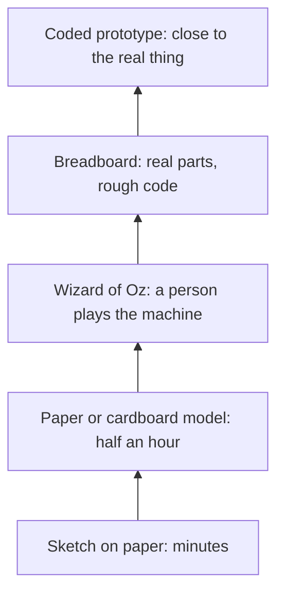

{:class="cover"}

---

By the end of this lesson you will be able to choose the cheapest prototype that answers a question, and run a Wizard of Oz test before writing any code.

---

## Every prototype answers a question

A prototype isn't a small version of the finished product. It's a **question you can hold**. Before you make one, finish this sentence: "We're making this to find out whether..."

- "...pupils notice a light on the windowsill."
- "...the sensor can tell wet soil from dry."
- "...the buzzer is annoying."

If you can't finish the sentence, you're not prototyping, you're just building. And with an AI assistant, building is so fast it's easy to do a lot of it without learning anything.

---

## The fidelity ladder

Fidelity means how close a prototype is to the real thing. Start at the bottom and only climb when the question needs it.

| Rung | Good for answering | Cost |
| --- | --- | --- |
| Sketch | "Does this make sense to us?" | A pencil |
| Paper or cardboard | "Is it the right size? Where would it go?" | Card and tape |
| Wizard of Oz | "Will people use it the way we think?" | A person and a bit of acting |
| Breadboard | "Can the parts actually do it?" | The kit |
| Coded prototype | "Does the whole thing work together?" | Time, and AI help |
{:class="table table-single"}

The cheapest prototype that answers the question is the right one. If the question is "will pupils look at it?", you don't need a sensor yet.

---

## Build to think

Sometimes you don't know the question until your hands are busy. That's fine. Cutting out a cardboard box and holding it next to a pot often tells you something no amount of talking would: it's too big, it blocks the light, it falls in the soil. Making is a way of thinking. Just stop and write down what you learned.

---

## Wizard of Oz prototypes

In a **Wizard of Oz** prototype, a person secretly plays the part of the "smart" system, so you can test the idea before building it. The term comes from J. F. Kelley's work on natural-language interfaces in the 1980s (Kelley, 1984).

It's a superb fit for vibe coders. Before you ask an AI to write a single line, you can find out whether the behaviour you're about to build is the one people want.

---

## Plant Helper progress

The big question after ideation was: **do pupils even look at a light on the windowsill?** If they don't, a perfect sensor is pointless.

So the class made a cardboard traffic-light card, with green, amber and red circles, and a little stand to keep it upright next to a pot. Each morning Ms Okafor pushed her finger into the soil and set the card to the right colour by hand. Nobody needed to know it wasn't automatic. That's the Wizard of Oz.

For one week, she noted:

- Did Leo or Priya look at the card without being reminded?
- Did they water when it showed red, and leave it alone on green?
- What did they say about it?

What happened will feed lesson 10, but even after two days the class learned something: the card had to face the room, not the window, or nobody saw it. That's a cardboard-sized fix, found before any code was written.

> **Teachers**: the cardboard Wizard of Oz is an ideal no-hardware session. Groups can make cards for different plants and take turns being the "wizard".

---

## Try it Yourself

1. **Finish the sentence.** For three things you'd like to add to the Plant Helper, write "We're making this to find out whether...".
2. **Choose a rung.** For each one, pick the lowest rung on the fidelity ladder that would answer it.
3. **Challenge:** Make the cardboard traffic-light card and run a Wizard of Oz test for three days at home or school. Write down one thing that surprised you.

---

## Common Issues

**Problem**: Your prototype took a week and you still don't know what you learned.
**Solution**: Write the question first, then build only what answers it.
**Why**: Without a question, a prototype becomes a product, and a product is expensive to throw away.

**Problem**: People change how they behave because they know it's a test.
**Solution**: Keep the Wizard of Oz quiet and natural, and watch for a few days, not just once.
**Why**: Novelty wears off. Day three tells you more than day one.

**Problem**: You jumped straight to code because the AI makes it easy.
**Solution**: Ask whether a sketch or cardboard model would answer the question first.
**Why**: Cheap code is still slower than cardboard, and harder to change your mind about.

---

## Check your understanding


? What should every prototype do?
- [ ] Look like the finished product
- [x] Answer a specific question
- [ ] Use real electronics
> Start with "We're making this to find out whether..." and build only what answers it.

? What is a Wizard of Oz prototype?
- [ ] A prototype built entirely by an AI
- [x] A person secretly plays the part of the smart system, so you can test the idea before building it
- [ ] A very high fidelity prototype
> The term comes from J. F. Kelley's work on natural-language interfaces (Kelley, 1984).

? The question is "do pupils even look at a light on the windowsill?" Which prototype is best?
- [x] A cardboard traffic-light card the teacher sets by hand
- [ ] A fully coded Pico with a sensor
- [ ] A camera and AI system
> It's the cheapest prototype that answers the question.

