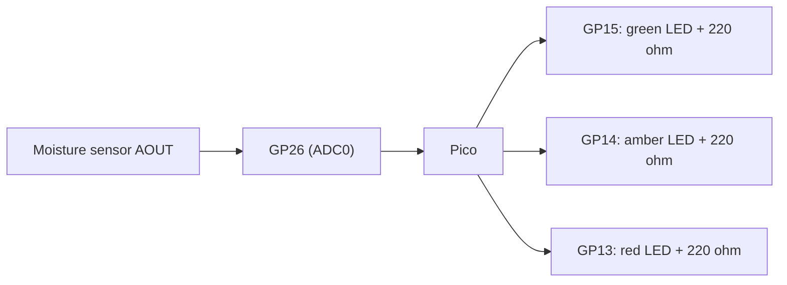

{:class="cover"}

---

By the end of this lesson you will be able to give an AI assistant the hardware facts it needs, check its answers against the real board, calibrate a soil moisture sensor and build a working Plant Helper traffic light on a Pico.

---

## Hardware is different

When AI-written software is wrong, you get an error message. When AI-written *hardware* code is wrong, you might get nothing at all, a part that gets hot, or a reading that looks fine but isn't. AI assistants confidently get three things wrong:

- **Pins.** It'll guess pin numbers that suit a different board, or a pin that's already in use.
- **Voltages.** It may suggest wiring a part to 5 V that should be on 3.3 V, or skip a resistor.
- **Library APIs.** MicroPython is not CPython. The AI may write `adc.read()` (the Pico uses `read_u16()`), `pwm.duty()` (the Pico uses `duty_u16()`) or `time.strftime()`, which isn't there at all.

So give it the facts up front. Your `BRIEF.md` already has a pin table; add your board and firmware version too: "Raspberry Pi Pico W, MicroPython v1.26.1, pins as in the table below." (Use the version your board actually reports: Thonny and Snakie show it when they connect, or type `import sys; sys.version` in the REPL.) Then check every answer against the datasheet for each part and the [MicroPython docs for the Pico](https://docs.micropython.org/en/latest/rp2/quickref.html).

And add **one part at a time**. Sensor first, check it works. Then the LEDs. Then the buzzer. If you wire everything and run AI code for all of it at once, you won't know which bit is broken.

---

## Why there's no pump

The original brief was a watering robot, and a pump is the obvious way to build one. We're not doing it, for three reasons:

1. **Water and electronics.** A leak or a knocked-over pot puts water on a powered circuit.
2. **Power.** A pump needs more current than a Pico pin can give. It needs its own supply and a transistor or MOSFET to switch it, which is a lot more to get right.
3. **Children.** Thirty pupils, a classroom, and a device that moves water on its own is a poor mix.

And from lesson 6, a pump doesn't solve the real problem: knowing which plant needs water. Leave pumps for an adult build later.

> **Teachers**: keep the Pico, breadboard and USB cable away from the watering can, and calibrate the sensor with a small glass of water on a tray, not at the sink. Only the sensor's probe end goes in water or soil; the electronics on the top of the sensor must stay dry. Don't use a pump in a classroom build.

---

## Let the editor see your code



Snakie is my robotics-first MicroPython editor. Its LLM chat pane reads the code you're working on, and it offers ghost-text suggestions as you type. An assistant that can see your actual code, with your pin numbers in it, makes far fewer guesses. See [Getting started with Snakie](/learn/snakie_getting_started/).

---

## Plant Helper progress

### Wiring



Connect the sensor's VCC to the Pico's 3V3 pin and GND to a GND pin, and its analogue out to GP26. Each LED's long leg goes to its pin through a 220 ohm resistor, and its short leg to GND.

### Step 1: calibrate the sensor

A capacitive sensor reads **higher when dry and lower when wet**. The exact numbers vary from sensor to sensor, so let's measure yours. Run this, hold the sensor in the air and note the number, then stand the probe end in a glass of water and note that one too.

```python
from machine import ADC
import time

sensor = ADC(26)  # GP26 is ADC0

while True:
    raw = sensor.read_u16()  # 0 to 65535
    print("Raw reading:", raw)
    time.sleep(1)
```

Your air reading is **dry** and your water reading is **wet**. Write them down.

### Step 2: the traffic light

Now we map the raw reading to a percentage, where dry is 0% and wet is 100%, and light one LED: green at 60% or more, amber from 30% to 59%, red below 30%. Put your own numbers into `DRY` and `WET`.

```python
from machine import Pin, ADC
import time

DRY = 50000  # your reading in air: replace with yours
WET = 20000  # your reading in water: replace with yours

sensor = ADC(26)
green = Pin(15, Pin.OUT)
amber = Pin(14, Pin.OUT)
red = Pin(13, Pin.OUT)


def moisture_percent(raw):
    percent = (DRY - raw) * 100 // (DRY - WET)
    if percent < 0:
        percent = 0
    if percent > 100:
        percent = 100
    return percent


while True:
    raw = sensor.read_u16()
    percent = moisture_percent(raw)

    green.value(0)
    amber.value(0)
    red.value(0)

    if percent >= 60:
        green.value(1)
    elif percent >= 30:
        amber.value(1)
    else:
        red.value(1)

    print("Raw", raw, "moisture", percent, "%")
    time.sleep(1)
```

Push the sensor into a dry pot and the red LED should light. Water it, wait a minute, and it should move to amber, then green. That's the first acceptance criterion from the brief, met.

---

## Try it Yourself

1. **Calibrate twice.** Run the calibration again tomorrow. Did the dry and wet numbers move? How much?
2. **Ask the AI to check.** Paste the traffic-light program into your AI assistant with your board and pin table, and ask "what would go wrong if I ran this on a Pico?". Does it spot anything real, or invent problems?
3. **Challenge:** Change the thresholds so amber starts at 40%. Which line do you change, and how would you know if 40% is better than 30%?

---

## Common Issues

**Problem**: The reading barely changes between air and water.
**Solution**: Check the sensor's analogue out is on GP26 and that VCC is on 3V3, not a GPIO pin.
**Why**: Only GP26, GP27 and GP28 can read analogue voltages on the Pico.

**Problem**: The LED is red in wet soil and green in dry soil.
**Solution**: Check you haven't swapped `DRY` and `WET`. DRY should be the bigger number.
**Why**: Capacitive sensors read higher when dry, which is the opposite of what most people expect.

**Problem**: The AI's code uses `adc.read()` and crashes with `AttributeError`.
**Solution**: Use `read_u16()`, and tell the AI you're on a Pico running MicroPython.
**Why**: `read()` is from other boards. The Pico's ADC only has `read_u16()`.

---

## Check your understanding


? A capacitive soil sensor reads 52000 in air and 21000 in water. Which reading means drier soil, 40000 or 25000?
- [x] 40000
- [ ] 25000
> Capacitive sensors read higher when dry and lower when wet.

? Why doesn't the Plant Helper use a pump?
- [ ] Pumps are too quiet
- [x] Water and electronics near children is risky, a pump needs its own supply and a transistor, and it doesn't solve the real problem
- [ ] MicroPython can't control pumps
> The real problem is knowing which plant needs water, and a pump adds risk without solving it.

? What should you tell an AI assistant before it writes hardware code?
- [ ] Nothing, it knows every board
- [x] Your board, firmware version and pin table
- [ ] Only the colour of your LEDs
> Without them it guesses pins, voltages and APIs, often for a different board.

