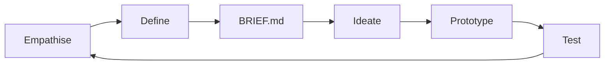

{:class="cover"}

---

By the end of this lesson you will be able to name the question each design thinking mode answers, and use a one-page checklist to start your next AI-assisted project the right way.

---

## What we did

Well done! We started with "Build a robot that waters the classroom plants" and ended with a tested Plant Helper that tells Leo and Priya, at a glance, which plant needs water, lets them record that they've watered it, and chirps at home time if a plant is still dry. No pump, no Wi-Fi, and nothing the class didn't need.

The point was never the plant. It was the loop. AI has made building cheap, so the skill that matters is choosing what to build and checking it works for a real person.

---

## Each mode and its question

| Mode | The one question it answers | Plant Helper artefact |
| --- | --- | --- |
| Empathise | What is really going on for these people? | Empathy map: "nobody knows which plant needs water" |
| Define | Whose problem are we solving, and why? | POV: Leo and Priya need to tell at a glance... |
| Ideate | What are all the ways we could help? | Ideas board, impact and effort grid, dot votes |
| Prototype | What's the cheapest way to find out? | Cardboard Wizard of Oz card, then the breadboard |
| Test | Does it work for them? | Test notes: amber looked "broken" |
{:class="table table-single"}

And alongside them, the brief: `BRIEF.md`, which carries all of that into every AI session.

---

## Design thinking for vibe coders: the checklist

Print this and stick it above your desk.

**Before any code**

1. Underline the solution words in the brief.
2. Watch and talk to the real people. Ask about the last time, ask why, don't pitch.
3. Write a POV: user, need, insight. Write How Might We questions.
4. Write `BRIEF.md`: who, problem, must / should / won't, constraints, Given / When / Then.
5. Your ideas first, then the AI's. Choose with impact, effort and dots.
6. Make the cheapest prototype that answers your question. Try a Wizard of Oz.

**While the AI writes code**

7. Brief in, ask for a plan first, then one small step at a time.
8. Run it, read it, commit it.
9. Check every package exists before you install it.
10. For hardware, give it your board, firmware and pin table, and check the datasheet.

**After**

11. Test the logic with asserts. Watch for an AI editing tests to pass.
12. Test with five real people: a task, not a tour. Stay quiet.
13. I like / I wish / What if. Iterate, pivot or stop.
14. Update the brief first, then the code. One change at a time.

---

## What's Next

- [Bus Servos](/learn/bus_servos/): the course behind Buddy, the robot arm whose code I wrote with an AI assistant
- [Getting started with Snakie](/learn/snakie_getting_started/): an editor whose AI chat can see your code
- [Robot Senses](/learn/robot_senses/): more sensors to design with
- [Learn MicroPython](/learn/micropython/): get stronger at the language behind the Plant Helper
- [Learn Git](/learn/git/): save points for every AI session
- [Pico Drone](/projects/picodrone/): see what happens when Copilot writes the flight code

---

## Plant Helper progress

Finished: empathy map, POV, `BRIEF.md`, ideas board, cardboard prototype, test notes, tested functions and the v2 program, all in one folder. Next time a brief lands on your desk, you know where to start.

---

## Try it Yourself

1. **Teach it back.** Explain the five modes to someone in two minutes, using the Plant Helper as your example.
2. **Spot the skipped mode.** Think of a gadget or app that annoys you. Which mode do you think its makers skipped?
3. **Challenge:** Pick a "Make it yours" brief from lesson 13 and do the first three steps of the checklist this week.

---

## Common Issues

**Problem**: You've finished the course and dived straight into code on your next project.
**Solution**: Go back to step 1 of the checklist. Ten minutes of watching saves an afternoon of building.
**Why**: The AI makes building feel like the first step. It's step seven.

**Problem**: Your brief has gone out of date.
**Solution**: Update `BRIEF.md` every time you learn something from a test.
**Why**: An out-of-date brief gives your AI out-of-date instructions.

---

## Check your understanding


? Which mode answers "What's the cheapest way to find out?"
- [ ] Empathise
- [ ] Define
- [x] Prototype
> Every prototype answers a question, and the cheapest one that answers it is the right one.

? In the checklist, what comes before asking the AI for any code?
- [ ] Installing every package it suggests
- [x] Writing a brief and asking for a plan first
- [ ] Testing with five users
> Brief in, plan first, then one small step at a time.

? What's the main idea of the course?
- [x] AI makes building cheap, so choosing what to build and checking it works for real people matters more
- [ ] AI should never be used for robots
- [ ] Design thinking means drawing pictures before coding
> Design thinking and vibe coding work best together: one finds the right thing, the other builds it fast.

