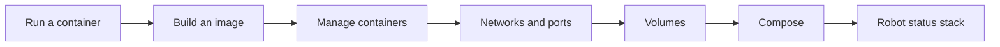

{:class="cover"}

---

Ahoy there makers! Have you ever got a project working on your laptop, copied it to your Raspberry Pi, and then spent an evening hunting for the missing library? Docker is the cure. It packs your program and everything it needs into one tidy box that runs the same way on any machine.

{:class="img-fluid"}

## Overview

In this course we'll build one project from start to finish: a **robot status page**. It's a small Python web app that shows your robot's name, how warm its CPU is, how long it has been running, and how many times the page has been visited.

We'll start by running someone else's container, then package our own app into an image, join it to a second service (a Redis database that remembers the visit count), and finally describe the whole thing in a single Compose file that starts with one command.

## Course Content

- **Overview**: what Docker is and how to install it on a Raspberry Pi or Linux PC
- **Images and Containers**: running containers, writing a Dockerfile, managing and debugging containers
- **Networking and storage**: ports, networks, and volumes that keep your data safe
- **Docker Compose**: describing a multi-container stack in one file
- **Project**: the finished robot status stack, with a health check and automatic restarts
- **Summary**: what you built and where to go next

## Key Results

After completing this course, you will be able to:

- Explain the difference between an image and a container
- Install Docker Engine on Raspberry Pi OS or another Debian-based Linux
- Write a Dockerfile and build your own image
- Start, stop, inspect and debug containers using their logs
- Connect containers with ports and networks, and keep data in volumes
- Run a multi-container app with `docker compose`

## What you'll need

- A Raspberry Pi 4 or 5 running Raspberry Pi OS (64-bit), or a Linux PC. A Pi with 2 GB of RAM is plenty
- An internet connection, because images are downloaded from Docker Hub
- A terminal, either on the Pi itself or over SSH from your computer
- A text editor such as `nano`, which is already on Raspberry Pi OS
- A web browser on any computer on the same network

You should be comfortable moving around the terminal and editing files. If that is new, start with [Introduction to the Linux Command Line on Raspberry Pi OS](/learn/linux_intro/).

## How the course works

**One project, growing.** From lesson 4 onwards we work in a folder called `robot-status`. Every lesson adds to it, so keep the files between lessons.

**Where to type.** Commands starting with `docker` or `docker compose` run in your terminal on the Pi (or Linux PC). Lines inside code boxes labelled `Dockerfile` or `yaml` are files you save, not commands.

**Modern commands.** Older tutorials often type the Compose command with a hyphen between the two words. Today Compose is a Docker plugin, so the command is `docker compose` with a space, and Compose files no longer need a version line at the top. We use the modern forms throughout.

**Quizzes.** Each lesson ends with a short quiz. Your score is stored in your browser and shown in the sidebar.

> **Teachers**: This course suits learners aged about 14 and up who can already use a terminal. Allow 45 to 60 minutes per lesson, and about 90 for the project lesson. Each learner or pair needs a Raspberry Pi (or a Linux PC) with admin rights for the install in lesson 2, and internet access to Docker Hub. School networks sometimes block image downloads, so test a `docker pull` in advance. Lesson 1 can be taught with no hardware at all; the rest need a machine running Docker.
