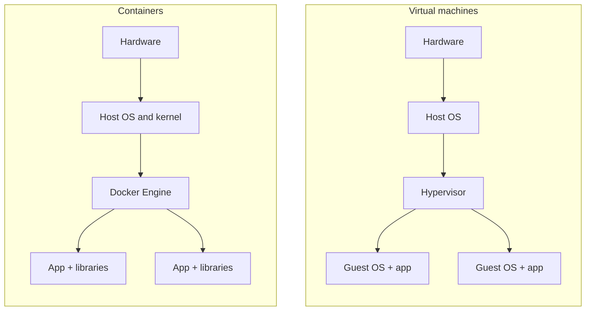

{:class="cover"}

---

By the end of this lesson you will be able to explain what a container is, and how it differs from a virtual machine.

## The "it works on my machine" problem

Imagine you've written a Python program that reads a distance sensor and serves a web page. It runs beautifully on your laptop. You copy it to your Raspberry Pi and it falls over: wrong Python version, a missing library, a clash with something else you installed last month.

Docker solves this by letting you ship the program **together with everything it needs**: the Python version, the libraries, the settings. That bundle runs the same way on your laptop, your Pi, or a friend's Linux PC.

## Containers in one picture

A **container** is a normal process on your computer that Docker has wrapped in its own private view of the world: its own files, its own network, its own list of processes. It feels like a tiny separate computer, but it isn't one.

That is the key difference from a **virtual machine** (VM). A VM pretends to be a whole computer and runs a full operating system on top of that. A container shares the kernel of the host, so it only carries the program and its libraries.

**Why this matters on a Pi:** a Raspberry Pi has limited memory. A container starts in a second or two and uses only what its program uses, so you can run several side by side where a single VM might struggle.

## The parts of Docker

You'll meet four words over and over:

| Word | What it is |
| --- | --- |
| Image | A read-only template: your app plus everything it needs |
| Container | A running (or stopped) copy made from an image |
| Docker Hub | A public library where images are shared, at hub.docker.com |
| Docker Engine | The program that builds images and runs containers |
{:class="table table-single"}

We'll spend the next lessons turning these into things you can type and see.

## Your project

Throughout this course you'll build a **robot status page**: a small web app that shows your robot's name, its CPU temperature and how many visits it has had. By the end it will run as a stack of two containers that start with one command. You don't need to write any code yet; first let's understand the tool.

> **Teachers**: This lesson needs no hardware, so it works as a discussion or unplugged activity. A useful classroom analogy is a lunchbox: the image is the packed recipe, the container is the lunchbox someone is eating from, and you can make as many lunchboxes as you like from one recipe.

## Try it Yourself

1. In your own words, write down one program you have moved between computers where something went wrong. What was missing?
2. Draw your own version of the VM versus container diagram, and label what each layer is for.
3. Challenge: a classmate says "a container is just a small VM". Write two sentences explaining what is different.

## Check your understanding


? What does a container share with the host computer that a virtual machine does not?
- [ ] A full guest operating system
- [x] The host's kernel
- [ ] Its own separate hardware
> A container shares the host kernel, so it only carries the app and its libraries. A VM runs a whole guest operating system.

? What is an image?
- [x] A read-only template that containers are made from
- [ ] A running program
- [ ] A photo of your robot
> An image is the template. A container is a copy of it that actually runs.

? Which is Docker Hub?
- [ ] The part of Docker that runs containers
- [x] A public library where images are shared
- [ ] A kind of network
> Docker Hub is where images such as `hello-world` and `nginx` are downloaded from. Docker Engine is what runs them.

