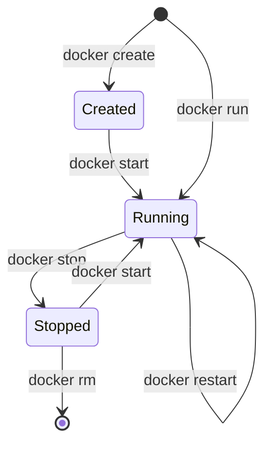

{:class="cover"}

---

By the end of this lesson you will be able to read a container's logs, open a shell inside it, check its health, and make it restart by itself.

Your `robot-status` container from the last lesson should still be running. Check with `docker ps`. If not, start it again with `docker run -d --name robot-status -p 5000:5000 robot-status`.

## The life of a container



A container is rarely "done" just because you stopped it. It lives on, stopped, until you remove it.

## Read the logs

Whatever your program prints (and the Flask request log) ends up in the container's logs:

```bash
docker logs robot-status
docker logs -f robot-status
```

`-f` follows the log live, like `tail -f`. Refresh the page in your browser and watch the request lines appear, then press `Ctrl+C`. Use `docker logs --tail 20 robot-status` to see only the last 20 lines.

**Why this matters:** a container has no screen. Logs are your window into what your robot's software is doing.

## Step inside

Need to look around? Run a command inside the running container:

```bash
docker exec -it robot-status sh
```

You're now inside. Try `ls` (you'll see `app.py` and `requirements.txt` in `/app`) and `python --version`, then `exit`. Leaving the shell doesn't stop the container, because `exec` starts an extra process rather than the main one.

You can also run one-off commands without a shell:

```bash
docker exec robot-status python --version
```

## Inspect and measure

```bash
docker inspect --format '{{.State.Status}}' robot-status
docker stats --no-stream
```

`docker inspect` prints a huge JSON document about the container; the `--format` option picks out one piece, here the state. `docker stats --no-stream` shows one snapshot of CPU and memory use for every running container, which is useful on a Pi with limited RAM.

## Stop, start, restart, remove

```bash
docker stop robot-status
docker start robot-status
docker restart robot-status
docker rm -f robot-status
```

`rm -f` removes even a running container. To tidy up everything that has stopped:

```bash
docker container prune
```

Docker asks you to confirm. To remove images nothing uses any more, try `docker image prune`.

## Come back after a reboot

Containers don't restart when the Pi does, unless you say so with a **restart policy**:

```bash
docker run -d --name robot-status -p 5000:5000 --restart unless-stopped robot-status
```

`unless-stopped` restarts the container if it crashes and when the Docker service starts at boot, but not if you stopped it yourself. For a robot dashboard on a shelf, that's what you want. Leave this version running.

## Common Issues

- **Problem**: `docker stop robot-status` hangs for about ten seconds.
- **Solution**: Add `--init` when you run the container, for example `docker run -d --init --name robot-status -p 5000:5000 robot-status`. In Compose you'll write `init: true`.
- **Why**: Your program runs as process number 1 inside the container, and Linux ignores the polite stop signal for that process unless it has a handler. Docker waits ten seconds, then forces it. `--init` adds a tiny process 1 that passes signals on properly.

- **Problem**: `docker logs` is empty even though the app is running.
- **Solution**: Make sure the Dockerfile has `ENV PYTHONUNBUFFERED=1`, then rebuild.
- **Why**: Python holds output in a buffer when it isn't connected to a terminal, so lines can appear late.

- **Problem**: `docker exec` says `container ... is not running`.
- **Solution**: Check `docker ps -a`, then `docker logs <name>` to see why it exited.
- **Why**: You can only exec into a running container. Logs of a stopped one are still kept until you remove it.

## Try it Yourself

1. Use `docker logs -f` while you refresh the page ten times. Count the request lines.
2. Use `docker exec` to run `ls /app` and `cat /app/requirements.txt` inside the container.
3. Challenge: reboot the Pi with `sudo reboot`. When it is back, run `docker ps`. Did the container return? Now try again after removing `--restart unless-stopped`.

## Check your understanding


? Which command follows a container's output live?
- [ ] `docker inspect -f robot-status`
- [x] `docker logs -f robot-status`
- [ ] `docker stats robot-status`
> `-f` means follow, like `tail -f`. `docker inspect` shows configuration and state.

? You type `exit` in a shell opened with `docker exec`. What happens to the container?
- [x] It keeps running
- [ ] It stops
- [ ] It is removed
> `exec` starts an extra process inside a running container. The main process is unaffected.

? What does `--restart unless-stopped` do?
- [ ] Restarts the container every minute
- [ ] Prevents the container from ever stopping
- [x] Restarts it after a crash or reboot, unless you stopped it yourself
> It is a restart policy: Docker brings the container back automatically, but respects a manual `docker stop`.

